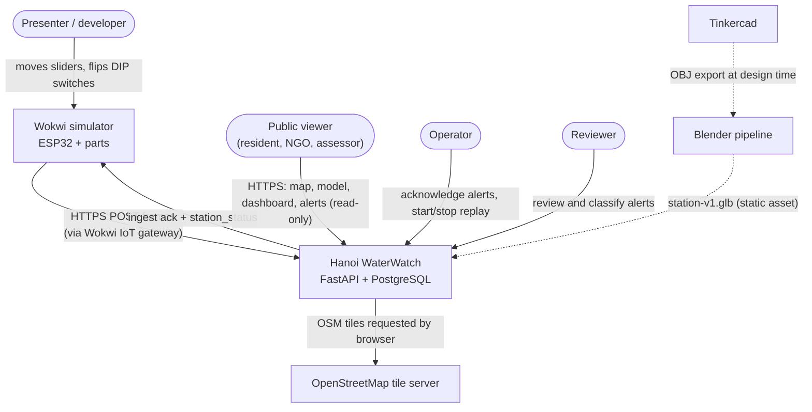
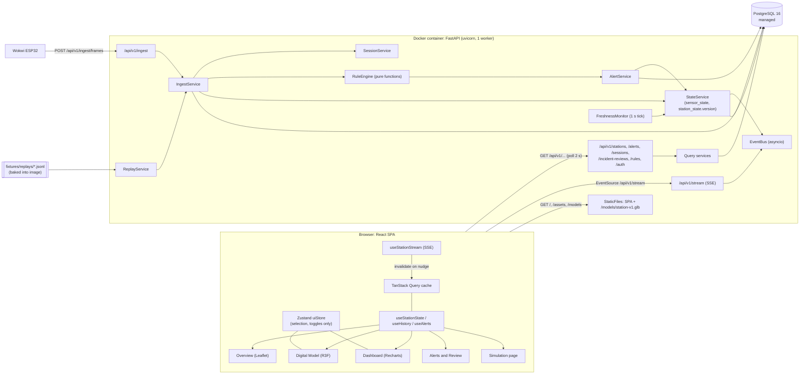
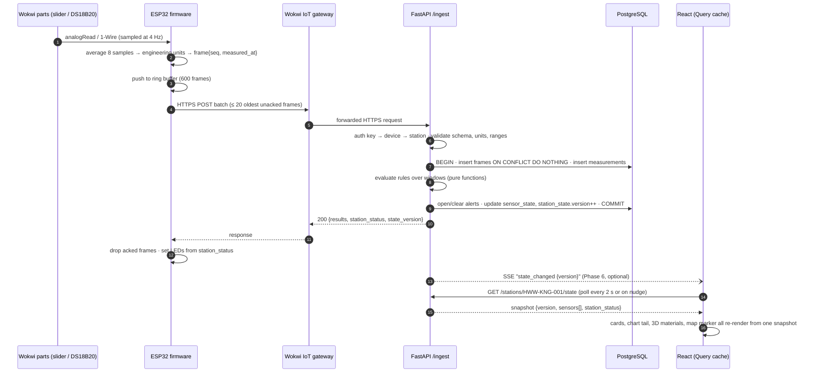
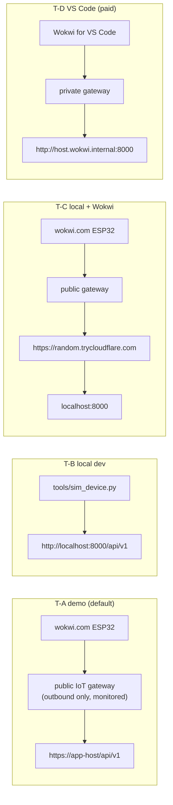

# 02: System architecture

← [01 MVP and stack](01-mvp-and-stack.md) · Next: [03 3D integration](03-3d-integration.md)

This document covers the overall architecture, the error and offline behaviour, and the repository structure: deliverables 1, 9 and 10. Deliverables 2 to 8 have their own documents. The diagrams use Mermaid, which renders on GitHub.

## 2.1 Responsibilities: what each system is and is not

| System | Represents | Produces | Consumes | Must never |
|--------|-----------|----------|----------|-----------|
| **Tinkercad model** (→ GLB) | The *physical appearance* of the station: mast, solar panel, antenna, cabinet, LEDs, beacon, guide tube, probe with 4 sensor heads. | Geometry and materials with stable node names. | Nothing at runtime. | Contain values, animations that imply data, or status logic. |
| **Wokwi simulation** | The *electronics and firmware*: signal inputs, ADC and 1-Wire reading, framing, buffering, uplink, local LEDs. | Measurement frames (HTTPS POST). | The server status in each ingest response (it drives the LEDs). | Decide alert status by itself or render the station. |
| **FastAPI backend** | The *source of truth*. | Validated measurements, statuses, alerts, the versioned station snapshot. | Frames from devices and the replay service; staff actions. | Trust provenance or status from a payload. |
| **PostgreSQL** | Durable record. | — | — | Hold values the API has not validated. |
| **React app** | The *presentation*. | Staff actions (acknowledge, review, replay). | The station snapshot, history and alerts. | Compute thresholds, cache values outside the query cache, or show a value without its timestamp. |

## 2.2 Context diagram (C4 level 1)



## 2.3 Container and component view (C4 level 2)



**Why one container with one worker:** the event bus and freshness monitor are in-process, so a single Uvicorn worker keeps them coherent. Expected load is about 0.5 ingest requests and a few dozen poll requests per second; one async worker handles this easily. The upgrade path (more instances) is in ADR-0004: move the bus to `LISTEN/NOTIFY` and the freshness tick to a Postgres advisory-lock leader.

## 2.4 Life of one measurement (overview)

The detailed version with concrete values is the turbidity walkthrough in [05 §5.11](05-synchronisation.md#511-walkthrough-the-turbidity-scenario-step-by-step).



## 2.5 Runtime topologies

| ID | Name | Path | Cost | Used for |
|----|------|------|------|----------|
| **T-A** | Demo / staging | wokwi.com (free) → **public gateway** → `https://<app-host>/api/v1/ingest/frames` | Free Wokwi + container host | Milestones M2 onward, rehearsals, the demo |
| **T-B** | Local, no Wokwi | `tools/sim_device.py` → `http://localhost:8000` | Free | Daily backend/frontend development, CI E2E |
| **T-C** | Local with real Wokwi | wokwi.com → public gateway → `cloudflared tunnel --url http://localhost:8000` → localhost | Free (quick tunnel, random URL each run) | Debugging firmware against a local backend |
| **T-D** | Local with private gateway | Wokwi for VS Code (Hobby+ plan) → private gateway → `http://host.wokwi.internal:8000` | Paid Wokwi plan | Optional; only if a team member already has the plan |



**Prerequisites and restrictions (verified against Wokwi docs, Nov 2026):** the ESP32 must join `Wokwi-GUEST`. The public gateway allows only outgoing connections and its traffic is monitored, so use HTTPS and send no personal data. The private gateway (`host.wokwi.internal`) needs a paid plan and is not supported in Safari. Nothing can connect *into* the simulated ESP32 on the public gateway, so the server never initiates contact; it replies only in the HTTP response.

## 2.6 Error handling and offline behaviour (deliverable 9)

Statuses are defined in [05 §5.5](05-synchronisation.md#55-status-model). Each failure row says what each layer does. "Freshness" is always computed from server `received_at`, never from device clocks.

| # | Failure | Detected by | Device (firmware) | Backend | UI | Recovery |
|---|---------|-------------|-------------------|---------|----|----------|
| E1 | Wokwi WiFi/gateway down, or NET DIP switch on | Device: POST error/timeout. Server: no frames for 15 s | Keep sampling; frames stay in ring buffer (600 = 20 min); backoff 1→30 s; yellow LED blinks; OLED "LINK ✗ n queued" | FreshnessMonitor sets station `offline`, sensors `offline`, opens `STN_OFFLINE` (equipment) alert, `version++` | Grey station; values replaced by "—" with "last valid 14:02:11 (2 min ago)"; banner "Station offline since …" | Device flushes oldest-first in batches of 20; server marks frames `buffered`, back-fills history, clears offline on first new frame; alerts raised from back-filled data get `detected_late = true` |
| E2 | Ring buffer overflow (outage > 20 min) | Device | Drop oldest, count `dropped_frames` and report it in next batch | Records gap; timeline shows "n frames lost on device" | Chart shows a gap (no line interpolation across gaps > 3 intervals) | — |
| E3 | Sensor fault (DIP switch, DS18B20 −127 °C, ADC rail) | Device flag `q:"fault"`; backend validity range | Sends `v:null, q:"fault", fr:"injected"` | Measurement stored with `quality=fault`; `VALID_RANGE` opens equipment alert; sensor status `sensor_fault`; **no pollution rule evaluated on faulty data** | Amber "!" icon, value "—", "Sensor fault since …"; 3D sensor amber hatched | First valid reading after 2 good frames clears it |
| E4 | Backend 5xx or deploy in progress | Device: 5xx | Retry with backoff; frames kept | Health check fails; container restarts | ConnectionIndicator "API unreachable – retrying"; keep last snapshot greyed with its timestamp | Automatic; no data loss within buffer window |
| E5 | Invalid payload (unit mismatch, unknown channel) | Backend 422 | Logs error, **drops** that batch (poison message), increments `rejected_batches`, OLED "REJ" | No writes; structured log with reason | Simulation page shows last rejection reason (from `/link`) | Fix firmware; re-flash |
| E6 | Bad or revoked device key | Backend 401 | Stops sending, keeps buffering, OLED "AUTH"; retries every 60 s | No writes; rate-limited log | Simulation page "Device rejected: auth" | Admin rotates key, update `config.h` |
| E7 | Duplicate frames (retry after a lost response) | Unique `(device_id, boot_id, seq)` | Treats `duplicate` as acked | `ON CONFLICT DO NOTHING`; counts duplicates | Nothing visible | — |
| E8 | Device clock wrong (NTP not synced or simulation slower than real time) | `time_source:"uptime"` or skew > 30 s on non-buffered frames | Sends `time_source:"uptime"` until NTP sync | Uses `received_at` as `measured_at`, stores original, sets `clock_skew_s` | Tooltip "device clock corrected" | Automatic on NTP sync |
| E9 | Two producers for one station (replay running while Wokwi live) | `station.active_device_id` | 409 → OLED "BUSY", drops frames (not buffered) | Rejects non-active device with 409 `station_busy` | Simulation page shows the active source | Operator stops replay → active device released |
| E10 | Browser loses API (Wi-Fi at venue) | Query error | — | — | ConnectionIndicator red, snapshot frozen and labelled "as of hh:mm:ss"; 3D greys out after 10 s | Query auto-retries; SSE reconnects with backoff |
| E11 | WebGL unavailable or context lost | `useWebGLSupport`, `CanvasErrorBoundary`, `webglcontextlost` | — | — | 2D `StationSchematic2D` with the same hotspots and statuses | Context restored → offer "Reload 3D view" |
| E12 | GLB fails to load (404, corrupt) | `useGLTF` error boundary | — | — | Same 2D fallback plus message "3D model unavailable" | Fix asset; CI check prevents |
| E13 | Map tiles unavailable | Leaflet `tileerror` | — | — | Markers still render on a plain background, and the station list panel is always visible | — |
| E14 | Database unavailable | Health check, SQLAlchemy errors | Retries (5xx) | 503 with `Retry-After: 5`; `/health` reports `db: down` | Connection indicator, frozen snapshot | Managed DB restarts; buffered frames re-sent |

**Hard rule from E1, E3 and E4:** the API returns `value: null` for any sensor whose status is `offline`, `sensor_fault` or `unavailable`, and returns the last valid value separately as `last_valid: {value, measured_at}`. The UI never shows `last_valid` in a "current value" slot (test T-F-03).

## 2.7 Repository structure (deliverable 10)

Monorepo `hanoi-waterwatch/`. Every path below is referenced by the backlog in [11](11-github-backlog.md).

```text
hanoi-waterwatch/
├── README.md                         # quick start, links to docs/blueprint
├── CONTRIBUTING.md                   # team GitHub workflow (integrator, branches, PRs)
├── LICENSE
├── Makefile                          # make dev | test | gen | lint | glb | seed | replay
├── .editorconfig  .gitignore  .env.example
├── docker-compose.yml                # postgres:16 + api (reload) + web (vite)
├── Dockerfile                        # multi-stage: web build → python runtime
├── .github/
│   ├── workflows/ci.yml              # lint, unit, contract, integration, e2e
│   ├── workflows/deploy.yml          # build image, run migrations, deploy on tag
│   ├── CODEOWNERS
│   ├── pull_request_template.md
│   └── ISSUE_TEMPLATE/{task.yml,bug.yml}
├── docs/
│   ├── blueprint/                    # this blueprint
│   ├── adr/0001-device-transport.md … 0006-*.md
│   ├── demo/runbook.md  demo/script.md
│   ├── reports/{latency,spike-s2,spike-s3,hosting,e2e-live,wokwi-scenarios,accessibility,vi-review,acceptance}.md
│   └── assets/                       # screenshots, circuit image
├── shared/                           # CONTRACTS: changes need both developers' approval
│   ├── registry/
│   │   ├── sensor_types.json         # ph, do, turbidity, temp: units, ranges, decimals
│   │   ├── status_visuals.json       # status → colour token, icon, LED pattern
│   │   ├── HWW-KNG-001.json          # live Wokwi station
│   │   ├── HWW-TLH-001.json          # replay-driven station
│   │   └── HWW-NHU-001.json          # planned station (always unavailable)
│   ├── schemas/
│   │   ├── registry.schema.json
│   │   ├── frame-batch.v1.schema.json
│   │   └── station-state.v1.schema.json
│   └── fixtures/
│       ├── payloads/{valid_batch,duplicate_batch,fault_frame,backlog_batch,invalid_unit}.json
│       └── replays/{demo-golden,turbidity-spike,gradual-ph,sensor-fault,network-gap,tlh-loop}.jsonl
├── firmware/
│   ├── platformio.ini                # env:esp32 (wokwi/vscode) + env:native (unit tests)
│   ├── wokwi.toml                    # VS Code simulator config (T-D)
│   ├── diagram.json                  # circuit (single source; copied into wokwi-web/)
│   ├── include/config.example.h      # INGEST_URL, DEVICE_KEY placeholders
│   ├── include/config.h              # git-ignored
│   ├── src/main.cpp
│   ├── src/transfer.h  src/transfer.cpp          # pure: raw → value (native-tested)
│   ├── src/backoff.h  src/backoff.cpp            # pure: retry schedule (native-tested)
│   ├── src/timekeeper.h  src/timekeeper.cpp      # NTP / server offset / uptime
│   ├── src/sensors.h  src/sensors.cpp
│   ├── src/frame_buffer.h  src/frame_buffer.cpp
│   ├── src/uplink.h  src/uplink.cpp
│   ├── src/scenario.h  src/scenario.cpp
│   ├── src/display.h  src/display.cpp
│   ├── src/generated/registry.h      # generated by tools/gen_registry.py
│   ├── test/test_transfer/test_main.cpp
│   ├── test/test_frame_buffer/test_main.cpp
│   ├── test/test_backoff/test_main.cpp
│   ├── wokwi-web/                    # generated bundle to paste into wokwi.com
│   │   ├── sketch.ino  diagram.json  libraries.txt
│   └── chips/                        # stretch: hww-probe.chip.json, hww-probe.chip.c
├── blender/
│   ├── README.md                     # manual steps + script usage
│   ├── source/station-tinkercad.obj  source/station-tinkercad.mtl
│   ├── station.blend
│   └── scripts/prepare_station.py    # bpy: import → scale → separate → rename → export
├── backend/
│   ├── pyproject.toml  alembic.ini
│   ├── alembic/env.py  alembic/versions/0001_initial.py  0002_seed_rules.py
│   ├── app/
│   │   ├── main.py  config.py  db.py  cli.py
│   │   ├── core/{security.py, rate_limit.py, errors.py, logging.py, time.py}
│   │   ├── models/{station.py, sensor.py, device.py, session.py, frame.py, measurement.py,
│   │   │           state.py, station_event.py, rule.py, alert.py, incident_review.py, user.py, replay.py}
│   │   ├── schemas/{ingest.py, station.py, state.py, measurement.py, alert.py,
│   │   │            review.py, session.py, replay.py, auth.py, common.py}
│   │   ├── api/v1/{health.py, meta.py, stations.py, ingest.py, alerts.py, incident_reviews.py,
│   │   │           sessions.py, replays.py, rules.py, auth.py, stream.py, admin.py, deps.py}
│   │   ├── services/{ingest_service.py, session_service.py, rule_engine.py, alert_service.py,
│   │   │             state_service.py, freshness_monitor.py, replay_service.py,
│   │   │             registry_loader.py, event_bus.py, auth_service.py, device_auth.py,
│   │   │             maintenance.py}
│   │   └── rules/{base.py, validity.py, reference_band.py, change.py, freshness.py}
│   └── tests/
│       ├── unit/{test_rules_*.py, test_ingest_schema.py, test_time.py}
│       ├── integration/{conftest.py, test_ingest_api.py, test_state_api.py, test_replay.py, …}
│       └── contract/{test_registry.py, test_fixtures.py}
├── frontend/
│   ├── package.json  vite.config.ts  tsconfig.json  index.html  playwright.config.ts
│   ├── public/models/station-v1.glb
│   ├── scripts/check-glb-nodes.mjs
│   ├── src/
│   │   ├── main.tsx  App.tsx  routes.tsx  i18n.ts  index.css
│   │   ├── api/{client.ts, schema.d.ts (generated), hooks.ts, useStationStream.ts}
│   │   ├── generated/registry.ts
│   │   ├── domain/{statusVisuals.ts, format.ts, evidence.ts}
│   │   ├── state/uiStore.ts
│   │   ├── components/layout/{AppShell.tsx, NavBar.tsx, SimulatedDataBanner.tsx,
│   │   │                      ConnectionIndicator.tsx, AlertToaster.tsx, Footer.tsx}
│   │   ├── components/status/{StatusBadge.tsx, FreshnessLabel.tsx, EvidenceClassBadge.tsx,
│   │   │                      SourceBadge.tsx}
│   │   ├── features/overview/{OverviewPage.tsx, StationMap.tsx, StationMarker.tsx,
│   │   │                      StationListPanel.tsx, RecentAlertsPanel.tsx}
│   │   ├── features/model/{ModelPage.tsx, StationCanvas.tsx, StationModel.tsx, SensorHotspot.tsx,
│   │   │                   SensorList.tsx, SensorDetailPanel.tsx, ModelControls.tsx,
│   │   │                   StationSchematic2D.tsx, CanvasErrorBoundary.tsx, useWebGLSupport.ts}
│   │   ├── features/dashboard/{DashboardPage.tsx, SensorCard.tsx, SensorChart.tsx,
│   │   │                       TimeRangePicker.tsx, EventTimeline.tsx}
│   │   ├── features/alerts/{AlertsPage.tsx, AlertList.tsx, AlertFilters.tsx, AlertDetailPage.tsx,
│   │   │                    ReviewForm.tsx, ReviewHistory.tsx}
│   │   ├── features/simulation/{SimulationPage.tsx, PipelineDiagram.tsx, LinkStatusPanel.tsx,
│   │   │                        PayloadInspector.tsx, ScenarioGuide.tsx, ReplayControls.tsx}
│   │   ├── features/auth/{LoginPage.tsx, useAuth.ts, RequireRole.tsx}
│   │   └── locales/{en.json, vi.json}
│   ├── src/**/__tests__/*.test.tsx   # Vitest
│   └── e2e/{overview,model,dashboard,alerts,simulation,consistency,offline,fallback,banner,a11y}.spec.ts
└── tools/
    ├── gen_registry.py               # registry → firmware header + TS module
    ├── check_registry.py             # schema + cross-file consistency
    ├── bundle_wokwi_web.py           # firmware/src → firmware/wokwi-web/sketch.ino
    ├── sim_device.py                 # software device: same payloads and scenarios as firmware
    ├── record_session.py             # export a DB session → fixtures/replays/*.jsonl
    └── measure_latency.py            # end-to-end latency report
```

## 2.8 Cross-cutting conventions

| Topic | Convention |
|-------|-----------|
| Time | Store and transmit UTC, ISO 8601 with milliseconds and `Z`. Display in `Asia/Ho_Chi_Minh` (UTC+7, labelled "ICT"). Freshness uses server `received_at`. |
| IDs | Station `HWW-<RIVER>-<NNN>` (`KNG` Kim Ngưu, `TLH` Tô Lịch, `NHU` Nhuệ). Channel `ph`, `do`, `turbidity`, `temp`. Sensor UID `<station>:<channel>`. 3D nodes `snake_case` with no dots (three.js strips `.` `:` `/` `[` `]` from node names). |
| Units | Wire: `pH`, `mg/L`, `NTU`, `degC`. Display: pH, mg/L, NTU, °C. Units are validated against the registry; no conversions on the server. |
| Config | 12-factor env vars (`DATABASE_URL`, `JWT_SECRET`, `CORS_ORIGINS`, `OFFLINE_AFTER_S=15`, `INGEST_MAX_FRAMES=50`, `INGEST_RATE_PER_S=2`, `PUBLIC_BASE_URL`, `WOKWI_PROJECT_URL`, `DEMO_MODE=true`; full list in [07 §7.11](07-backend-database-api.md#711-configuration-envexample)). `.env.example` documents all of them, and no real values are committed. |
| Logging | JSON lines: `ts, level, request_id, route, device_code, station_code, seq_range, outcome, duration_ms`. No device keys or JWTs in logs. |
| Errors | RFC 9457 `application/problem+json` with a machine `code` (`station_busy`, `unit_mismatch`, …). |
| Security headers | `Content-Security-Policy` (self + OSM tile host), `X-Content-Type-Options`, `Referrer-Policy`, HSTS on the deployed host. |
| Secrets | `config.h` and `.env` are git-ignored; gitleaks runs in CI. Device keys are shown once at creation or rotation. |

## 2.9 Architecture decision records (to create in Phase 1)

| ADR | Title | Decision |
|-----|-------|----------|
| 0001 | Device transport | HTTPS POST batches; MQTT and serial rejected for the MVP |
| 0002 | Browser updates | Poll 2 s; SSE nudge in Phase 6; no WebSockets |
| 0003 | 3D format and pipeline | OBJ+MTL → Blender → GLB (meshopt); hotspots as fallback for merged meshes |
| 0004 | Single-instance runtime | One worker, in-process bus; LISTEN/NOTIFY upgrade path |
| 0005 | Thresholds policy | Three rule layers; reference bands configurable with `basis_status`; heuristics labelled |
| 0006 | Shared registry as the identity contract | One JSON per station, generated code, CI cross-checks |
