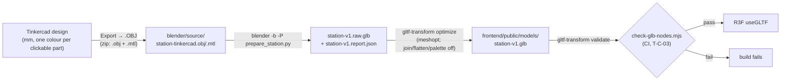

# 03: 3D integration (Tinkercad → Blender → GLB → React Three Fiber)

← [02 Architecture](02-architecture.md) · Next: [04 Wokwi integration](04-wokwi-integration.md)

This document is deliverable 3 (3D workflow). It also covers the 3D half of deliverable 7 (sensor → 3D mapping), which is completed in [05](05-synchronisation.md).

## 3.1 What the 3D model is and is not

* It **is** a static description of what the station looks like and where each part sits. It has named nodes that the app can find and recolour.
* It **is not** a simulation. It holds no values, no thresholds and no animation of its own. Every colour, glow, pulse or label comes from the station snapshot returned by `GET /api/v1/stations/{code}/state` (rule R1/R2 in the [README](README.md#5-engineering-rules-checkable)). With no snapshot, the model renders in neutral grey with the label "No data".

## 3.2 Component inventory and node names

The parts come from the station anatomy in `WaterWatch.png`. Node names are `snake_case` with no `.` `:` `/` `[` `]`, because three.js removes those characters from node names, which would break lookups. The authoritative list lives in `shared/registry/HWW-KNG-001.json` → `model.components[]` and is checked in CI (T-C-03).

| Node name | Part | Kind | Clickable | Bound to (from the snapshot) | `extras.hww_id` |
|-----------|------|------|-----------|------------------------------|-----------------|
| `sensor_ph` | pH electrode head | sensor | yes | `sensors[channel=ph].status`, activity pulse on new `measured_at` | `HWW-KNG-001:ph` |
| `sensor_do` | Dissolved-oxygen head | sensor | yes | `sensors[channel=do]` | `HWW-KNG-001:do` |
| `sensor_turbidity` | Turbidity head | sensor | yes | `sensors[channel=turbidity]` | `HWW-KNG-001:turbidity` |
| `sensor_temp` | Temperature probe (DS18B20) | sensor | yes | `sensors[channel=temp]` | `HWW-KNG-001:temp` |
| `probe_body` | Multi-sensor probe housing | structure | yes (info) | — | `component:probe_body` |
| `guide_tube` | Guide tube on embankment | structure | yes (info) | — | `component:guide_tube` |
| `cabinet` | Electronics cabinet (ESP32, power) | structure | yes (info) | — | `component:cabinet` |
| `cabinet_door` | Cabinet door | structure | no | Exploded view only | `component:cabinet_door` |
| `display` | Front display | indicator | yes (info) | `station_status` (screen tint) | `component:display` |
| `led_green` | Status lamp: normal | indicator | no | on iff `station_status = normal` | `component:led_green` |
| `led_yellow` | Status lamp: degraded | indicator | no | on iff `station_status = degraded` | `component:led_yellow` |
| `led_red` | Status lamp: abnormal | indicator | no | on iff `station_status = abnormal` | `component:led_red` |
| `beacon` | Red alert light | indicator | yes (info) | pulses iff `station_status = abnormal` | `component:beacon` |
| `antenna` | Cellular antenna | indicator | yes (info) | tip green if `freshness_s < offline_after_s`, else grey | `component:antenna` |
| `solar_panel` | Solar panel | structure | yes (info) | — (power is not simulated; the info panel says so) | `component:solar_panel` |
| `mast` | Mast | structure | no | — | `component:mast` |
| `mount_bracket` | Mounting bracket | structure | no | — | `component:mount_bracket` |
| `embankment` | Concrete embankment (context) | context | no | — | `component:embankment` |

When the station is `offline`, all three lamps go dark and the beacon is off. The model never shows a "normal" lamp for data it has not received.

## 3.3 Format decision

| Option | Colour | Separate parts | Web support | Verdict |
|--------|--------|---------------|-------------|---------|
| Tinkercad **STL** | No | No (one mesh) | Needs a loader; no materials | Rejected |
| Tinkercad **OBJ + MTL** | Yes (per-colour materials in MTL) | Per object or group; groups may merge on export | Not for runtime (text, large) | **Source format** |
| Tinkercad **GLB/glTF** (if your account offers it) | Unverified | Unverified | Native | Spike S1 tries it; use it as the Blender input only if it beats OBJ |
| **GLB** (glTF 2.0 binary) from Blender | PBR materials | Named nodes, extras | Native for three.js, `useGLTF`, meshopt | **Runtime format** |
| FBX / USDZ | — | — | Extra loaders / iOS-only | Rejected |

**Decision (ADR-0003):** Tinkercad OBJ+MTL → Blender (part separation, naming, scale, materials) → GLB → gltf-transform meshopt → `frontend/public/models/station-v1.glb`.

## 3.4 Pipeline



### 3.4.1 Spike S1 (week 1, half a day): find out how Tinkercad exports

1. In Tinkercad, build a test design: three boxes in three different colours, one cylinder, and one group of two shapes.
2. Export as OBJ. If the export dialog offers GLB/glTF, export that too.
3. Import into Blender 4.x with `File → Import → Wavefront (.obj)`.
4. Record in `blender/README.md`:
   * Are separate shapes separate objects, or one mesh?
   * What are the material names in the `.mtl` (colour names, hex, `mat0…`)?
   * What unit and up-axis does the file use?
   * Did the group stay as one mesh?
   * Did the GLB (if offered) keep colours and part names?
5. Fill in `blender/scripts/material_map.json` from what you observed.

The script below is written so it works whichever way Tinkercad behaves. It separates parts **by material**, so the only modelling rule that matters is *one unique colour per clickable part*.

### 3.4.2 Tinkercad modelling rules

| Rule | Why |
|------|-----|
| Model at real-world size in **millimetres**. Suggested sizes: mast 2,400 mm, cabinet 600 × 400 × 250 mm, guide tube Ø110 mm, probe Ø60 mm, sensor heads Ø22 mm, embankment slab 3,000 × 1,500 mm. | Correct proportions; Blender scales by 0.001 to metres. |
| Give **each clickable or bindable part its own colour**, distinct from every other part. Static parts may share a colour only if they will never be bound (e.g. `mast` + `mount_bracket`). | Blender separates by material; one colour = one node. |
| Do not group a sensor head with its probe. If groups are needed, export with the group-preserving option where Tinkercad offers it, and check in S1. | Groups can be merged into one mesh on export. |
| Set cylinder "Sides" to 24–32 for small parts and 48 for the mast. | Keeps triangles under budget. |
| Place the model so the ground under the mast centre is at the origin, with the cabinet front facing the default view. | Predictable camera and orientation. |
| Keep the Tinkercad design **shared with both developers**, and record its URL in `blender/README.md`. | Single source of truth for geometry. |

### 3.4.3 Blender script `blender/scripts/prepare_station.py`

Run it headless:

```bash
blender -b -P blender/scripts/prepare_station.py -- --input blender/source/station-tinkercad.obj --map blender/scripts/material_map.json --registry shared/registry/HWW-KNG-001.json --out blender/out/station-v1.raw.glb
```

| Step | Blender API used | Result |
|------|-----------------|--------|
| 1. Reset the scene | `bpy.ops.wm.read_factory_settings(use_empty=True)` | Clean scene |
| 2. Import | `bpy.ops.wm.obj_import(filepath=…, global_scale=0.001)` (axis options set from the S1 findings) | Metres |
| 3. Join, then separate by material | `bpy.ops.object.join()` → edit mode → `bpy.ops.mesh.separate(type='MATERIAL')` | One object per colour |
| 4. Rename | Look up each object's material in `material_map.json` → node name. **Fail** if a registry component is unmapped or a material is unknown. | Stable node names |
| 5. Tag | `obj["hww_id"] = …` from the registry | Exported as glTF `extras` |
| 6. Origins | `bpy.ops.object.origin_set(type='ORIGIN_GEOMETRY', center='BOUNDS')` for sensors and indicators | Correct hotspot centre and explode pivot |
| 7. Materials | Replace each with a Principled BSDF named `mat_<node>`. Sensor heads use neutral light grey (`#C9CED6`, roughness 0.5) so status tints read clearly. Indicators get an emissive slot. | Predictable runtime recolouring |
| 8. Clean-up | Apply transforms; merge by distance (0.1 mm); recalculate normals; `object.shade_smooth_by_angle` (30°) | Clean shading |
| 9. Report | Write `station-v1.report.json`: node names, bounding-box centres, triangles per node | Hotspot coordinates for the registry |
| 10. Export | `bpy.ops.export_scene.gltf(filepath=…, export_format='GLB', export_yup=True, export_extras=True, export_apply=True, export_cameras=False, export_lights=False)` | `station-v1.raw.glb` |

`station.blend` is saved too, for manual touch-ups. Re-running the script must give the same node names (it is idempotent).

### 3.4.4 Optimisation and validation

```bash
npx gltf-transform optimize blender/out/station-v1.raw.glb frontend/public/models/station-v1.glb --compress meshopt --texture-compress false --join false --flatten false --instance false --palette false --simplify false
```

```bash
npx gltf-transform validate frontend/public/models/station-v1.glb
```

```bash
node frontend/scripts/check-glb-nodes.mjs frontend/public/models/station-v1.glb
```

* **Why join, flatten, instance, palette and simplify are disabled:** they merge meshes, collapse the node hierarchy or share materials, and any of those breaks per-node lookup and recolouring. Check the exact flag names with `npx gltf-transform optimize --help` for the version pinned in `package.json`. The node check is the safety net.
* **`check-glb-nodes.mjs`** loads the GLB with `@gltf-transform/core` (meshopt decoder registered) and **fails** if:
  * a component in the registry is missing;
  * a sensor node's `extras.hww_id` differs from the sensor UID;
  * the file is larger than 2 MB, or has more than 100,000 triangles;
  * a registry `hotspot` is more than 5 cm from its node's bounding-box centre.
* The `make glb` target runs all three steps. CI runs only the check (T-C-03), on the committed GLB.

### 3.4.5 Budgets

| Metric | Budget | Target |
|--------|--------|--------|
| GLB size (after meshopt) | ≤ 2 MB | < 600 KB |
| Triangles | < 100,000 | ≈ 40,000 |
| Nodes / draw calls | < 40 | ≈ 20 |
| Textures | none (flat PBR colours) | — |
| Frame rate (model page, idle orbit) | ≥ 30 fps on a mid-range laptop iGPU and a mid-range Android phone | 60 fps desktop |
| Model page usable (Fast 4G profile) | < 4 s | < 2.5 s |

## 3.5 Scene set-up: orientation, scale and lighting

| Item | Choice |
|------|--------|
| Units and axes | 1 unit = 1 m. glTF Y-up (Blender converts on export). Origin = ground under the mast. |
| Default camera | Perspective, fov 40°, position `(2.4, 1.7, 3.0)`, target `(0, 0.9, 0)`. "Reset view" button returns here. |
| Controls | drei `OrbitControls`, damping on. Distance 1.2–8 m. Polar angle limited to 85° so the camera never goes below ground. Pan disabled on touch devices. |
| Lighting | `hemisphereLight` (sky `#dfe9f5`, ground `#6b6f5c`, 0.6), one `directionalLight` (position (3, 5, 2), 1.4), and a drei `Environment` built from local `Lightformer`s. **No HDR files from a CDN**, so the venue network cannot break lighting. |
| Shadows | drei `ContactShadows` under the station (one cheap pass); no shadow maps. |
| Colour | Status materials and emissive indicators use `toneMapped={false}`, so status colours match the 2D UI tokens exactly. |
| Background | Transparent canvas over a CSS gradient; dark mode changes only the CSS. |

## 3.6 Interactivity

| Interaction | Desktop | Touch | Keyboard / assistive tech |
|-------------|---------|-------|---------------------------|
| Rotate / zoom | Drag / wheel | One finger / pinch | `ModelControls` buttons: rotate ±15°, zoom ±, reset |
| Hover sensor | Cursor pointer, soft outline glow, tooltip with label | — | — |
| Select sensor | Click | Tap | `SensorList` buttons (always visible beside the canvas) |
| Deselect | Click empty space (`onPointerMissed`) | Tap empty space | Esc |
| Show labels | Toggle | Toggle (off by default on small screens) | Labels are also in the list |
| Exploded view (stretch, B-61) | Toggle | Toggle | Toggle |
| Follow alerts | Toggle (on in demo mode) | Toggle | Toggle |

* **Selection is shared state.** `uiStore.selectedComponent` (Zustand) is written by both canvas clicks and `SensorList`, so the 3D highlight, list item, detail panel and URL (`?sensor=turbidity`) stay in step.
* **Detail panel** (`SensorDetailPanel`) shows:
  * label, value and unit (or "—"), measured time in ICT and "x s ago", and status with icon and text;
  * the active alert link, component description and Wokwi part/pin (from the registry);
  * a 10-minute sparkline from the same history query the dashboard uses.
* **Follow alerts:** when a sensor's status changes to `abnormal`, the camera eases to it over 800 ms and selects it. This only happens if the user has not touched the controls in the last 10 s.

## 3.7 Status visuals in 3D

Status values and colours come from `shared/registry/status_visuals.json`. They are generated into `frontend/src/generated/registry.ts` and exposed through `domain/statusVisuals.ts`; this is the same table the 2D UI, map markers and device LEDs use ([05 §5.6](05-synchronisation.md#56-visual-mapping)).

| Sensor status | Sensor head material | Pattern | Redundant cue (not colour-only) |
|---------------|---------------------|---------|----------------------------------|
| `normal` | Green tint `#16A34A`, emissive 0.25 | steady | ✓ icon in label/list |
| `abnormal` | Red tint `#DC2626`, emissive 0.8 | slow pulse 1 Hz | ▲ icon; beacon pulses; red lamp on |
| `sensor_fault` | Amber tint `#D97706`, emissive 0.4 | steady with hatch decal | "!" icon; value "—" |
| `offline` | Grey `#6B7280`, 60 % opacity | none | ⦸ icon; "Offline since …" |
| `unavailable` | Light grey `#CBD5E1`, flat | none | "–" icon; "No sensor data" |

* **Activity pulse:** when a sensor's `measured_at` advances, its head glows for 1.5 s (emissive +0.4, eased). The pulse shows that data *arrived*; it does not encode status.
* **Reduced motion:** with `prefers-reduced-motion: reduce`, pulses and blinking become steady states. No effect flashes more than 3 times per second (WCAG 2.3.1).
* **Per-node materials:** `StationModel` clones the material of each bindable node once on load. This stops a tint from leaking to other meshes that share a material.

## 3.8 Rendering architecture in React Three Fiber

```text
ModelPage
├── SimulatedDataBanner (from AppShell)
├── StationHeader         station name, status badge, FreshnessLabel, SourceBadge
├── ModelViewport
│   ├── useWebGLSupport() ── false ──► StationSchematic2D
│   └── CanvasErrorBoundary ── error ──► StationSchematic2D + "3D unavailable"
│       └── StationCanvas  <Canvas frameloop="demand" dpr={[1, 1.75]}>
│           ├── Lights, Environment(Lightformers), ContactShadows
│           ├── Suspense(fallback=<ModelLoadingProgress/>)
│           │   └── StationModel  (useGLTF('/models/station-v1.glb'))
│           │       ├── binds nodes ← registry.components + snapshot.sensors
│           │       └── SensorHotspot × n (only for components whose node is missing)
│           ├── SensorLabels (drei Html; toggle)
│           ├── OrbitControls (makeDefault), AdaptiveDpr, PerformanceMonitor, Bvh
│           └── FollowAlertsController
├── ModelControls          rotate/zoom/reset, labels, follow alerts, 2D view, explode
├── SensorList             keyboard-accessible list, same selection state
└── SensorDetailPanel
```

**Binding contract** (no values are kept inside the 3D layer):

```ts
// features/model/StationModel.tsx (interface sketch only, written in Phase 5)
type StationModelProps = {
  components: ModelComponent[];      // from generated registry (node, kind, hwwId, hotspot)
  snapshot: StationState | undefined; // from useStationState(code): the only data input
  selected?: string;                  // uiStore.selectedComponent
  onSelect(node: string | null): void;
};
```

* `StationModel` builds `Map<nodeName, Object3D>` once with `scene.getObjectByName`. On every snapshot `version` change, it sets material colour, emissive and opacity from `statusVisuals[status]`, then calls `invalidate()`.
* With `frameloop="demand"`, the canvas renders only when something changes. Pulse animations request frames from `useFrame` until they finish, then stop, so an idle page uses almost no GPU.
* **Test hook:** when built with `VITE_E2E=1`, the model writes `window.__hww3d = { nodeStatus: Record<node, status>, version }`. Playwright uses it to prove the 3D model and dashboard show the same snapshot version and statuses (AC-06). It is not present in production builds.

## 3.9 Separate meshes vs hotspots

| Approach | When | How |
|----------|------|-----|
| **Separate named meshes (primary)** | S1 confirms parts can be separated by colour | Raycast picking on the real geometry; tint the real part |
| **Hotspots (fallback)** | A component's node is missing (merged export, a later model edit, partial failure) | `SensorHotspot` renders an invisible sphere (r = 4 cm) at `registry.hotspot` for picking, plus a visible status ring (`ringGeometry`, camera-facing) for colour |

The fallback is chosen **per component, automatically**, and logs a console warning. CI still fails the build when a node is missing (T-C-03), so the fallback protects the live demo without hiding a broken asset during development.

## 3.10 Accessible non-WebGL fallback

`StationSchematic2D.tsx` is an SVG side elevation of the station (mast, cabinet with three lamps, guide tube, probe with four heads), drawn from the same registry components.

* Each sensor is a real `<button>` positioned over the drawing, with an accessible name such as "Turbidity sensor: 142.5 NTU, abnormal, measured 15:30:14". The illustration itself is `aria-hidden`.
* Colours, icons and text come from `statusVisuals`. Selection uses the same `uiStore`, and the same `SensorDetailPanel` is shown.
* It is shown when:
  * `useWebGLSupport()` finds no WebGL2;
  * `CanvasErrorBoundary` catches an error (including GLB load failure);
  * `webglcontextlost` fires;
  * the user picks "2D view" (saved in `localStorage`).
* The 3D canvas has `role="img"` and an `aria-label` that summarises station status. All 3D functions are also available from `SensorList` and `ModelControls`, so the canvas is never the only way to reach information (AC-10, AC-14).

## 3.11 Performance and loading

* The model route is a lazy chunk (`React.lazy`). three.js and R3F load only when a model is shown. `useGLTF.preload` starts when the user hovers or focuses the "3D model" link.
* `/models/station-v1.glb` is served with `Cache-Control: public, max-age=31536000, immutable`. A new geometry version gets a new file name (`station-v2.glb`) and a registry update. Files are never overwritten in place.
* `PerformanceMonitor` lowers the DPR to 1 when fps drops below 45. `AdaptiveDpr` lowers it during interaction.
* The station overview map never loads three.js.

## 3.12 Risks

| Risk | Likelihood | Mitigation |
|------|-----------|------------|
| Tinkercad merges parts or loses colours | Medium | S1 spike in week 1; separation by material; hotspot fallback |
| `optimize` merges nodes or materials | Medium | Disable join/flatten/instance/palette/simplify; CI node check |
| Status colours look different under lighting | Medium | `toneMapped={false}` on status materials; visual check against tokens |
| Low-end devices drop frames | Low–medium | Demand rendering, DPR clamp, triangle budget, 2D fallback |
| Model edits silently rename nodes | Medium | Script fails on unmapped materials; CI node check; versioned file names |
