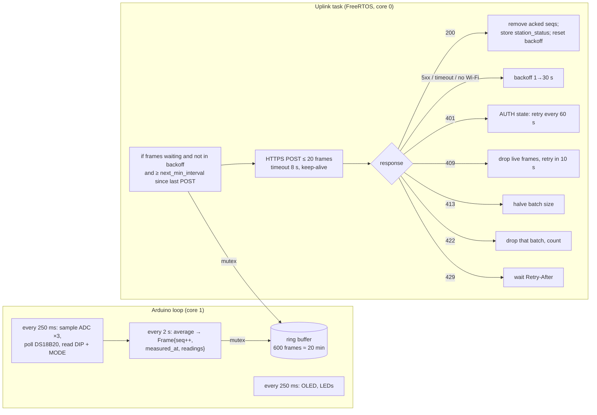

# 04: Wokwi integration (ESP32 circuit, firmware and transport)

← [03 3D integration](03-3d-integration.md) · Next: [05 Synchronisation](05-synchronisation.md)

This document is deliverable 2 (the data flow from Wokwi to the backend). It covers the circuit, firmware, scenarios, the transport decision, the payload contract and security. No existing Wokwi project was supplied, so everything here is new. If one turns up, compare it with §4.3 and reuse its parts and wiring where they match.

## 4.1 What Wokwi does in this project

Wokwi stands in for the **station electronics**: an ESP32 reads four signals, builds timestamped frames, buffers them through outages and sends them to the backend over HTTPS. The 3D model shows what the station looks like; Wokwi shows how its electronics behave. Neither one does the other's job (rule R1).

### 4.1.1 Native parts and substitutes

| Quantity | Real station would use | In Wokwi | Native? | Notes |
|----------|-----------------------|----------|---------|-------|
| Controller | ESP32 | `board-esp32-devkit-c-v4` | Native | Wi-Fi via `Wokwi-GUEST` |
| Temperature (°C) | DS18B20 waterproof probe | `wokwi-ds18b20`, interactive temperature control (−55 to 125 °C) | **Native** | Real 1-Wire protocol, `OneWire` + `DallasTemperature` |
| pH | Glass electrode + amplifier board (mV → V) | `wokwi-slide-potentiometer` on GPIO34 | **Substitute** | Wokwi has no pH part. The slider sets a voltage; firmware maps it to pH. |
| Dissolved oxygen (mg/L) | Galvanic/optical DO probe + transmitter | `wokwi-slide-potentiometer` on GPIO35 | **Substitute** | Same approach |
| Turbidity (NTU) | Optical turbidity sensor (analog out) | `wokwi-slide-potentiometer` on GPIO32 | **Substitute** | Same approach; quadratic mapping (§4.4) |
| Fault injection | — (real faults happen) | `wokwi-dip-switch-8` | Native part, demo-only function | Firmware marks the channel faulty |
| Scenario selection | — | `wokwi-pushbutton` (MODE) | Native part, demo-only function | Cycles scripted profiles |
| Local display | Cabinet display | `board-ssd1306` OLED 128×64 (I²C 0x3C) | Native | |
| Status lamps, beacon, buzzer | Cabinet LEDs, red alert light | `wokwi-led` × 5, `wokwi-buzzer` | Native | Mirror server status (§4.5.4) |
| Stretch: realistic probe | — | Custom chip `hww-probe` (C → WASM) with `range` controls and `pin_dac_write` outputs | Custom chip API (documented) | B-62. Gives labelled pH/DO/NTU knobs instead of bare sliders. Not on the critical path. |

### 4.1.2 What is physically simulated and what is synthetic

| Layer | Simulated faithfully | Synthetic (stated in the UI and docs) |
|-------|---------------------|-----------------------------------------|
| Electrical signal | Slider voltage on an ADC1 pin; 12-bit `analogRead` | The *meaning* of that voltage. A slider is not a pH electrode: no drift, fouling, response time or temperature compensation. |
| Temperature | DS18B20 1-Wire protocol, conversion time, `−127` on disconnect | The water temperature is whatever the presenter dials in |
| Firmware | Sampling, averaging, framing, buffering, retries, TLS, real HTTP | Scenario profiles (`gen: "profile"`) are scripted curves |
| Network | Real outbound HTTPS through the Wokwi IoT gateway to the deployed API | Outages are injected with a DIP switch |
| Location | — | Station coordinates are *illustrative*, not a real monitoring site |

Every reading carries `gen: "input"` (presenter-controlled) or `gen: "profile"` (scripted). The server adds `source: "simulated_wokwi"` based on the device record. **Nothing in this pipeline is evidence about water quality in Hanoi**, and every page says so ([01 §1.5](01-mvp-and-stack.md#15-data-honesty-rules)).

### 4.1.3 Can Wokwi be embedded in the app?

**Finding (17 Nov 2026):**
* Wokwi's documentation describes no supported way to embed a running simulation in a third-party page.
* The only embedding found is an `_alpha/wembed` prototype in a Wokwi example repository (`wokwi-embed-bridge-example`). It is undocumented and marked alpha.
* We did **not** verify whether project pages allow framing.

**Decision:** do not embed. The Simulation page:
* links out with "Open the Wokwi simulation ↗" (`target="_blank" rel="noopener"`), using the URL from env `WOKWI_PROJECT_URL`;
* shows a static circuit image (`docs/assets/circuit.png`, exported from the editor);
* shows **live link status** from the backend (`GET /api/v1/stations/HWW-KNG-001/link`): connected or not, last frame time, frames per minute, last payload, last rejection reason.

**Extra reason not to embed:** an embedded copy would start a *second* simulated ESP32 with the same key. The station would then have two producers, and the second one would get `409 station_busy` (failure E9 in [02 §2.6](02-architecture.md#26-error-handling-and-offline-behaviour-deliverable-9)).

**Optional 30-minute check during spike S2:** try an `<iframe>` of the public project URL and record the result in `docs/adr/0001-device-transport.md`. Even if it loads, the decision above stands for the demo.

## 4.2 Plans and prerequisites

| Need | Plan | Notes (verify on [wokwi.com/pricing](https://wokwi.com/pricing) when you start) |
|------|------|-------------------------------------------|
| Run the simulation in the browser, public gateway, public project | **Community (free)** | Enough for the MVP and the demo (topology T-A) |
| Unlisted project, private gateway (`host.wokwi.internal`) | Hobby | Optional; not needed |
| Wokwi for VS Code with PlatformIO builds | Hobby+ (VS Code listed from this tier) | Optional (T-D); the team can work entirely on wokwi.com |
| Wokwi CI / `wokwi-cli` minutes | Pro | Stretch B-63 only |
| Browser | Chrome, Edge or Firefox | Private gateway is not supported in Safari |
| Accounts | One Wokwi account owns the public project; the other developer forks it | Record the project URL in `.env` as `WOKWI_PROJECT_URL` |

## 4.3 Circuit

### 4.3.1 Pin map

ADC inputs use **ADC1 (GPIO32–39) only**: ADC2 cannot be read while Wi-Fi is active. Strapping pins 0, 5, 12 and 15 are avoided, and GPIO2 drives only an LED.

| Function | Wokwi part (id) | ESP32 pin | Mode | Notes |
|----------|-----------------|-----------|------|-------|
| pH signal | `wokwi-slide-potentiometer` (`pot_ph`) | GPIO34 (ADC1_CH6) | analog in | VCC→3V3, GND→GND, SIG→34 |
| DO signal | `wokwi-slide-potentiometer` (`pot_do`) | GPIO35 (ADC1_CH7) | analog in | |
| Turbidity signal | `wokwi-slide-potentiometer` (`pot_turb`) | GPIO32 (ADC1_CH4) | analog in | |
| Temperature | `wokwi-ds18b20` (`temp1`) | GPIO4 | 1-Wire | 4.7 kΩ pull-up (`wokwi-resistor` `r_ow`) DQ→3V3 |
| Fault pH / DO / turbidity / temp | `wokwi-dip-switch-8` (`dip1`) SW1–SW4 | GPIO16, 17, 18, 19 | `INPUT_PULLUP` | ON pulls the pin LOW = inject fault |
| Network drop | `dip1` SW5 | GPIO23 | `INPUT_PULLUP` | ON = firmware disconnects Wi-Fi |
| (spare) | `dip1` SW6–SW8 | — | — | unconnected |
| MODE button | `wokwi-pushbutton` (`btn_mode`) | GPIO33 | `INPUT_PULLUP` | debounced 50 ms |
| OLED | `board-ssd1306` (`oled1`) | SDA GPIO21, SCL GPIO22 | I²C | address 0x3C |
| Lamp green / yellow / red | `wokwi-led` (`led_g`, `led_y`, `led_r`) | GPIO25, 26, 27 | out | 220 Ω each |
| Beacon | `wokwi-led` red (`led_beacon`) | GPIO14 | out | |
| TX activity | `wokwi-led` blue (`led_tx`) | GPIO2 | out | 50 ms flash per POST |
| Buzzer | `wokwi-buzzer` (`bz1`) | GPIO13 | out (`tone`) | two short beeps when status becomes abnormal |

The Wokwi part ids above (`pot_ph`, `temp1`, …) are copied into `shared/registry/HWW-KNG-001.json` as `sensors[].wokwi.part_id` and `sensors[].wokwi.pin`. That keeps the circuit, firmware and 3D model on the same identifiers ([05 §5.4](05-synchronisation.md#54-master-mapping-table)).

### 4.3.2 `diagram.json` (excerpt)

Pin names follow the Wokwi part reference pages. Check every connection in the editor when building B-19.

```json
{
  "version": 1,
  "author": "Hanoi WaterWatch team",
  "editor": "wokwi",
  "parts": [
    { "type": "board-esp32-devkit-c-v4", "id": "esp", "top": 0, "left": 0, "attrs": {} },
    { "type": "wokwi-slide-potentiometer", "id": "pot_ph", "top": -180, "left": -260, "attrs": { "travelLength": "30" } },
    { "type": "wokwi-slide-potentiometer", "id": "pot_do", "top": -120, "left": -260, "attrs": { "travelLength": "30" } },
    { "type": "wokwi-slide-potentiometer", "id": "pot_turb", "top": -60, "left": -260, "attrs": { "travelLength": "30" } },
    { "type": "wokwi-ds18b20", "id": "temp1", "top": 120, "left": -200, "attrs": {} },
    { "type": "wokwi-resistor", "id": "r_ow", "top": 90, "left": -120, "attrs": { "value": "4700" } },
    { "type": "wokwi-dip-switch-8", "id": "dip1", "top": 220, "left": 120, "attrs": {} },
    { "type": "wokwi-pushbutton", "id": "btn_mode", "top": 200, "left": -40, "attrs": { "color": "blue", "label": "MODE" } },
    { "type": "board-ssd1306", "id": "oled1", "top": -150, "left": 160, "attrs": { "i2cAddress": "0x3c" } },
    { "type": "wokwi-led", "id": "led_g", "top": -40, "left": 260, "attrs": { "color": "green" } },
    { "type": "wokwi-led", "id": "led_y", "top": -40, "left": 300, "attrs": { "color": "yellow" } },
    { "type": "wokwi-led", "id": "led_r", "top": -40, "left": 340, "attrs": { "color": "red" } },
    { "type": "wokwi-buzzer", "id": "bz1", "top": 60, "left": 300, "attrs": {} }
  ],
  "connections": [
    [ "pot_ph:SIG", "esp:34", "orange", [] ],
    [ "pot_ph:VCC", "esp:3V3", "red", [] ],
    [ "pot_ph:GND", "esp:GND.1", "black", [] ],
    [ "temp1:DQ", "esp:4", "green", [] ],
    [ "r_ow:1", "temp1:DQ", "green", [] ],
    [ "r_ow:2", "esp:3V3", "red", [] ]
  ]
}
```

The full file is `firmware/diagram.json`. `tools/bundle_wokwi_web.py` copies it into `firmware/wokwi-web/`.

### 4.3.3 Default positions for the demo

| Channel | Default raw | Value | Note |
|---------|-------------|-------|------|
| pH | 2109 | 7.21 | Neutral |
| DO | 1310 | 6.40 mg/L | Typical oxygenated surface water (illustrative) |
| Turbidity | 555 | 18.4 NTU | Low |
| Temperature | — | 27.3 °C | Dial on the DS18B20 |

## 4.4 Transfer functions (raw → engineering units)

ADC raw values run from 0 to 4095 (12 bits, 0–3.3 V). These are **presentation mappings for a demo**. Real sensors need two-point (pH) or one-point (DO) calibration and their own transfer curves; the registry stores the coefficients, so changing them needs no code change.

| Channel | Function | Range | Example | Registry `transfer` |
|---------|----------|-------|---------|---------------------|
| pH | `pH = 14 × raw / 4095` | 0–14 | 2109 → 7.21 | `{ "kind": "linear", "out_min": 0, "out_max": 14 }` |
| DO | `DO = 20 × raw / 4095` | 0–20 mg/L | 1310 → 6.40 | `{ "kind": "linear", "out_min": 0, "out_max": 20 }` |
| Turbidity | `NTU = 1000 × (raw / 4095)²` | 0–1000 NTU | 555 → 18.4; 1546 → 142.5 | `{ "kind": "quadratic", "out_max": 1000 }` |
| Temperature | DS18B20 value in °C (10-bit, 0.25 °C steps) | −55–125 | — | `{ "kind": "native" }` |

* **Why turbidity is quadratic:** low turbidity values (0–50 NTU) take a usable part of the slider's travel, while 1,000 NTU stays reachable.
* **Averaging and rounding:** firmware averages 8 samples (4 Hz × 2 s) per frame. It reports the mean raw value, applies the transfer function and rounds to the registry `decimals` (pH 2, DO 2, turbidity 1, temp 2).
* **Pure code:** the functions live in `firmware/src/transfer.cpp`, with no Arduino calls, so they are unit-tested on the host (T-W-01). The coefficients come from `src/generated/registry.h`.

## 4.5 Firmware architecture

### 4.5.1 Modules

| File | Responsibility | Arduino-free (native tests) |
|------|---------------|------------------------------|
| `src/main.cpp` | `setup()`, task creation, top-level state machine | — |
| `src/transfer.{h,cpp}` | raw → value, rounding | yes (T-W-01) |
| `src/sensors.{h,cpp}` | 4 Hz ADC sampling, non-blocking DS18B20 (`setWaitForConversion(false)`, 10-bit), fault switches → `Reading{v, raw, q, fr, gen}` | — |
| `src/scenario.{h,cpp}` | MODE button, profile curves, seeded noise (xorshift32) | yes |
| `src/frame_buffer.{h,cpp}` | Ring buffer of 600 frames; push, select batch, ack by seq, drop count | yes (T-W-02) |
| `src/backoff.{h,cpp}` | 1, 2, 4, 8, 16, 30 s cap, ±20 % jitter | yes (T-W-03) |
| `src/timekeeper.{h,cpp}` | NTP (`configTime`), server-time offset, `time_source` | — |
| `src/uplink.{h,cpp}` | Wi-Fi, `GET /meta` handshake, batch JSON (ArduinoJson 7), HTTPS POST, response handling | serializer is (T-W-04) |
| `src/display.{h,cpp}` | OLED pages, lamps, beacon, TX LED, buzzer patterns | — |
| `src/generated/registry.h` | Station/device codes, channels, units, pins, transfer coefficients, decimals | generated by `tools/gen_registry.py` |
| `include/config.h` (git-ignored) | `WIFI_SSID "Wokwi-GUEST"`, `INGEST_BASE_URL`, `DEVICE_KEY`, `ROOT_CA_PEM` | copy from `config.example.h` |

### 4.5.2 Tasks and timing



* **Why a separate uplink task:** an HTTPS POST can block for up to 8 s. Running it in its own FreeRTOS task keeps the 4 Hz sampling and 2 s framing on schedule during slow or failed requests. Spike S2 checks this timing inside Wokwi.
* **Batch selection (live first):** each POST carries the **newest** unsent frame plus up to 19 of the **oldest** unsent frames. After an outage, the dashboard shows live data immediately while the backlog drains in the background. Frames older than 4 s when sent get `buffered: true`.
* **Memory:** about 64 bytes per frame × 600 frames ≈ 38 KB, plus about 10 KB for the JSON document. This fits beside the Wi-Fi and TLS stacks.

### 4.5.3 Start-up, identity and clock

1. Connect to `Wokwi-GUEST` (channel 6, no password) with a 15 s timeout, then retry.
2. Start NTP: `configTime(0, 0, "pool.ntp.org", "time.google.com")`. Wait up to 10 s for a sync.
3. Call `GET {INGEST_BASE_URL}/api/v1/meta`, which returns `server_time`. If NTP did not sync, the firmware sets its clock offset from it (`time_source: "server"`). If neither works, frames carry `measured_at: null` and `time_source: "uptime"`, and the server reconstructs the time (§4.8).
4. `boot_id` = first 8 hex characters of CRC32(`esp_random()` ‖ `server_time` ‖ `millis()`). Including the server time keeps `boot_id` unique even if the simulator's random generator repeats after a restart. Spike S2 records whether `esp_random()` repeats across 3 restarts.
5. `seq` starts at 0 on every boot. The pair (`boot_id`, `seq`) is unique per device.

Sampling starts straight after Wi-Fi setup begins. Frames made before step 4 wait in the buffer, because `boot_id` lives in the batch envelope, not in each frame.

### 4.5.4 Local indicators mirror the server

The device does **not** run alert rules. Its lamps show the `station_status` from the most recent ingest response, so the device, dashboard, map and 3D model can never disagree on status.

| Condition | Green | Yellow | Red | Beacon | Buzzer | OLED line 5 |
|-----------|-------|--------|-----|--------|--------|-------------|
| Last ack `normal` | on | off | off | off | — | `SRV normal` |
| Last ack `degraded` | off | on | off | off | — | `SRV degraded` |
| Last ack `abnormal` | off | off | on | on | 2 beeps on transition | `SRV ABNORMAL` |
| No ack for 15 s, or before the first ack | off | blink 1 Hz | off | off | — | `LINK ✗ 42q` |
| `AUTH` (401) | off | off | blink 2 Hz | off | — | `AUTH ERR` |

OLED layout (128 × 64):

```text
HWW-KNG-001   M0 MANUAL
pH  7.21     DO  6.40
TUR 18.4     T  27.31C
LINK OK  q:0   #417
SRV normal     200
```

## 4.6 Demonstration scenarios

The MODE button cycles M0 → M1 → M2 → M3 → M0. When a profile ends, the device returns to M0 by itself. A profile drives only its own channel (`gen: "profile"`); the other channels still follow their sliders (`gen: "input"`). Timings assume one frame every 2 s. The alert rules are defined in [07 §7.4](07-backend-database-api.md#74-rule-engine).

| # | Scenario | How to trigger | Device behaviour | Expected server/UI outcome | Test |
|---|----------|---------------|------------------|----------------------------|------|
| SC1 | **Normal** | Defaults (§4.3.3), M0 | All `q:"ok"`, green lamp | Station `normal`; values match the OLED to the registry decimals | T-W-05, AC-02 |
| SC2 | **Gradual change** | Press MODE once → M1 `GRADUAL_PH` | pH falls linearly 7.2 → 5.4 over 120 s, holds 60 s, then returns to the slider | pH below 6.0 at about 80 s; `REF_PH_BAND` opens a *critical, preliminary* alert after 3 frames (about 86 s); station `abnormal`; sensor status returns to `normal` after 3 in-band frames, while the alert stays open for review | T-B-07 |
| SC3a | **Sudden abnormal (manual)**: the 9-step scenario | Wait ≥ 60 s (baseline warm-up), then slide turbidity from 555 to 1546 | 18.4 → 142.5 NTU | Baseline ≈ 18.4; threshold = max(3 × 18.4, 18.4 + 50) = 68.4; `CHG_TURB_SPIKE` opens after 2 frames (≈ 4 s) | AC-03, T-E-05 |
| SC3b | Sudden abnormal (profile) | MODE twice → M2 `SPIKE_TURB` | 180 NTU for 60 s | As SC3a | T-B-08 |
| SC3c | DO drop | MODE three times → M3 `DO_DROP` | 1.8 mg/L for 60 s | Baseline 6.4: 1.8 ≤ 3.2 and 6.4 − 1.8 ≥ 2.0 → `CHG_DO_DROP` after 3 frames | T-B-09 |
| SC4 | **Sensor failure** | DIP SW3 ON (turbidity) | `v:null, q:"fault", fr:"injected"` | `VALID_RANGE` equipment alert (warning); sensor `sensor_fault`; station `degraded`; dashboard and 3D show "—" and amber; **no pollution rule runs on the faulty channel** | AC-04, T-B-10 |
| SC5 | **Network disconnect and recovery** | DIP SW5 ON for 60 s, then OFF | `WiFi.disconnect()`; buffers about 30 frames; yellow blinks; on OFF it reconnects and sends the newest frame first, then the backlog | Offline within 15 s (`STN_OFFLINE` info alert, grey UI); on recovery: back online at the first new frame, about 30 frames back-filled with `buffered=true`, no duplicates, chart gap filled | AC-05, T-E-06 |
| SC6 | Simulator restart | Stop and start Wokwi | New `boot_id`, `seq` from 0 | New simulation session; the previous session ends after 60 s without frames | T-B-12 |
| SC7 | Bad key | Wrong `DEVICE_KEY` | `AUTH ERR` | 401; nothing stored; Simulation page shows "device rejected: auth" | AC-12 |

## 4.7 Transport evaluation and decision

| Criterion | **HTTPS POST (chosen)** | MQTT over TLS | Serial bridge | WebSocket from the ESP32 |
|-----------|------------------------|---------------|---------------|-------------------------|
| Works on free wokwi.com with the public gateway | Yes (outbound HTTPS allowed) | Yes (outbound MQTT allowed) | No: browser serial is not reachable from outside. Possible only in VS Code via `rfc2217ServerPort` | Probably (outbound TCP), unverified |
| Reaches a deployed backend with no inbound connection | Yes | Yes, via a broker | Needs a local bridge process | Yes |
| Server acknowledgement per batch (needed for buffer flush and lamp mirroring) | **Built in**: HTTP response | Needs a downlink topic and correlation | Custom | Custom |
| Extra infrastructure | None | Broker (managed or public) + a subscriber service in the backend | Bridge process on a laptop | WS endpoint and session handling |
| Credential exposure in a public sketch | Demo-scoped device key (§4.9) | Broker credentials in the sketch; public brokers let **anyone** publish to the topic | — | Same as HTTP |
| Idempotency | Simple: unique (device, boot, seq) | Same rule, plus QoS 1 redelivery | Same | Same |
| Effort for two developers in six weeks | Low | Medium–high | Medium; Wokwi Hobby+ needed | Medium |
| Demo resilience | High (stateless, retries) | Broker becomes another point of failure | Laptop becomes a point of failure | Reconnect logic needed |

**Decision (ADR-0001):** HTTPS POST of JSON frame batches from the ESP32 to `POST /api/v1/ingest/frames` on the deployed backend.
* MQTT is the natural choice for a real fleet of many stations. It is recorded as the migration path once a managed broker with per-device credentials exists.
* A serial bridge is kept only as a debugging aid in VS Code.

## 4.8 Payload contract `hww.frames.v1`

The JSON Schema is `shared/schemas/frame-batch.v1.schema.json` (`additionalProperties: false` throughout). Fixtures are in `shared/fixtures/payloads/`. Server-side validation is described in [07 §7.2](07-backend-database-api.md#72-ingest-pipeline).

**Request:** `POST /api/v1/ingest/frames`, headers `Content-Type: application/json`, `X-Device-Key: hwwk_…`.

```json
{
  "schema": "hww.frames.v1",
  "station_code": "HWW-KNG-001",
  "device_code": "wokwi-esp32-01",
  "boot_id": "6f1c2a9e",
  "fw_version": "0.4.0",
  "sent_at": "2026-11-17T08:30:14.512Z",
  "sent_uptime_ms": 834632,
  "diag": { "buffer_depth": 0, "dropped_frames": 0, "rejected_batches": 0, "wifi_rssi": -42 },
  "frames": [
    {
      "seq": 417,
      "measured_at": "2026-11-17T08:30:14.000Z",
      "time_source": "ntp",
      "uptime_ms": 834120,
      "buffered": false,
      "mode": "manual",
      "readings": {
        "ph":        { "v": 7.21,  "u": "pH",   "q": "ok", "raw": 2109, "gen": "input" },
        "do":        { "v": 6.40,  "u": "mg/L", "q": "ok", "raw": 1310, "gen": "input" },
        "turbidity": { "v": 18.4,  "u": "NTU",  "q": "ok", "raw": 555,  "gen": "input" },
        "temp":      { "v": 27.31, "u": "degC", "q": "ok", "raw": null, "gen": "input" }
      }
    }
  ]
}
```

| Field | Rule |
|-------|------|
| `schema` | const `hww.frames.v1`; a new major version gets a new value |
| `station_code` | `^HWW-[A-Z]{3}-\d{3}$`; must equal the station bound to the key, otherwise 403 `station_mismatch` |
| `device_code` | must equal the device bound to the key |
| `boot_id` | `^[0-9a-f]{8}$` |
| `sent_uptime_ms`, `frames[].uptime_ms` | Lets the server rebuild `measured_at` when `time_source = "uptime"`: `received_at − (sent_uptime_ms − uptime_ms)` |
| `frames` | 1–50 items (the device sends ≤ 20); body ≤ 64 KB |
| `seq` | integer 0 … 2³¹−1 |
| `measured_at` | ISO 8601 UTC with `Z`, or `null` only when `time_source = "uptime"` |
| `time_source` | `ntp` \| `server` \| `uptime` |
| `mode` | `manual` \| `gradual_ph` \| `spike_turb` \| `do_drop` |
| `readings` | keys ⊆ the station's channels in the registry; at least one key |
| `u` | must equal the registry unit for that channel, otherwise 422 `unit_mismatch` (no conversion on the server) |
| `v` | number, or `null` iff `q = "fault"` |
| `q` | `ok` \| `fault`; `fr` (fault reason) is required when `q = "fault"`: `injected` \| `disconnected` \| `out_of_range` |
| `raw` | integer 0–4095 or `null` |
| `gen` | `input` \| `profile` |
| *(not accepted)* | `source`, `status`, `is_simulated`. Provenance and status are assigned by the server only (rule R4). |

**Fault frame example** (turbidity switch ON):

```json
{ "seq": 512, "measured_at": "2026-11-17T08:33:24.000Z", "time_source": "ntp", "uptime_ms": 1024120, "buffered": false, "mode": "manual",
  "readings": { "ph": { "v": 7.21, "u": "pH", "q": "ok", "raw": 2109, "gen": "input" },
                "do": { "v": 6.40, "u": "mg/L", "q": "ok", "raw": 1310, "gen": "input" },
                "turbidity": { "v": null, "u": "NTU", "q": "fault", "fr": "injected", "raw": null, "gen": "input" },
                "temp": { "v": 27.31, "u": "degC", "q": "ok", "raw": null, "gen": "input" } } }
```

**Response (200):**

```json
{
  "results": [ { "seq": 417, "status": "accepted" } ],
  "accepted": 1, "duplicates": 0, "rejected": 0,
  "station_status": "normal",
  "state_version": 18342,
  "server_time": "2026-11-17T08:30:15.104Z",
  "next_min_interval_ms": 2000
}
```

`results[].status` is `accepted` | `duplicate` | `rejected` (with `reason`, e.g. `too_old` for frames more than 24 h old). The device removes every listed seq from its buffer, because resending a rejected frame never helps.

**Errors** use `application/problem+json` (RFC 9457):

| HTTP | `code` | Device action |
|------|--------|---------------|
| 401 | `invalid_device_key` | AUTH state; retry every 60 s |
| 403 | `station_mismatch`, `device_disabled` | AUTH state |
| 409 | `station_busy` (another source is active, e.g. a replay) | drop live frames; retry in 10 s |
| 413 | `payload_too_large` | halve batch size |
| 422 | `schema_invalid`, `unit_mismatch`, `unknown_channel` | drop the batch, count it in `rejected_batches` |
| 429 | `rate_limited` (+ `Retry-After`) | wait |
| 503 | `ingest_disabled`, `db_unavailable` (+ `Retry-After`) | backoff, keep frames |

## 4.9 Authentication and security on a public simulator

A Community-plan Wokwi project is **public**: anyone can read the sketch, including any key in it. The design therefore assumes the device key *will* be seen and limits what it can do.

| Control | Detail |
|---------|--------|
| **Demo-scoped key** | `hwwk_` + 32 random bytes (base62). It is bound to one device (`wokwi-esp32-01`) and one station (`HWW-KNG-001`), and it can only call `POST /ingest/frames`. It is not a user account and has no read or admin rights. |
| No production credentials | There is no production deployment of real monitoring. Staging and demo use **different** keys. Database, JWT and admin secrets live only in the host's env vars and never appear in firmware or the repo (`config.h` is git-ignored; gitleaks runs in CI). |
| Server-side provenance | Everything sent with this key is stored as `simulated_wokwi`. A leaked key can only create more *labelled simulated* data on a demo station. |
| Storage | The server stores `key_prefix` (first 8 characters) and SHA-256 of the key, and compares in constant time. (Argon2 is for user passwords. A 256-bit random key does not need a slow hash.) |
| Abuse limits | 2 requests/s sustained per key (burst 10) and per IP; 50 frames and 64 KB per request; strict schema; physical-range checks. |
| Kill switches | `devices.enabled` flag; `INGEST_ENABLED` env; `POST /admin/devices/{code}/rotate-key` (shows the new key once); `POST /admin/demo-reset` removes demo sessions. |
| Transport | HTTPS only. `WiFiClientSecure::setCACert(ROOT_CA_PEM)` with the host's root CA. **Never** `setInsecure()`. HSTS on the host. |
| Monitored gateway | Wokwi states that public-gateway traffic is monitored. Payloads hold only simulated measurements and diagnostics, never personal data. |
| After the demo | Rotate the key (runbook step), or turn the project private on a paid plan. |

## 4.10 Retries, ordering and duplicates

| Concern | Rule |
|---------|------|
| Delivery | At least once. The device keeps a frame until the server lists its seq in `results`. |
| Duplicates | Unique key `(device_id, boot_id, seq)`; `INSERT … ON CONFLICT DO NOTHING`; reported as `duplicate`, which the device treats as acked (E7). |
| Ordering | The device sends newest + oldest. The server sorts each batch by `seq`. **History** stores every frame by `measured_at`. **Current state** advances only when a frame's `measured_at` is newer than `sensor_state.measured_at`, so back-filled frames never move the live view backwards. |
| Late alerts | Rules evaluated over back-filled frames can open alerts; these get `detected_late = true` and the UI labels them "detected after reconnection". |
| Gaps | The server detects seq gaps within a boot and records a `frames_missing` timeline event. `diag.dropped_frames` reports buffer overflow (E2). |
| Backoff | 1, 2, 4, 8, 16, 30 s cap, ±20 % jitter, reset on success. HTTP timeout 8 s. Keep-alive (`HTTPClient::setReuse(true)`) avoids a TLS handshake per request. |
| Pacing | The device waits at least `next_min_interval_ms` (server-controlled, default 2,000) between POSTs, and drains a backlog at that rate (20 frames per POST → 600 frames in about 60 s). |

## 4.11 Project files and how to run them

| Form | Files | Use |
|------|-------|-----|
| **wokwi.com project** (main path, free) | `firmware/wokwi-web/`: `sketch.ino` (from `src/main.cpp`), the other `src/*.{h,cpp}` flattened into one folder with includes rewritten, `registry.h`, `config.h` with the *demo* key, `diagram.json`, `libraries.txt` | Generated by `python tools/bundle_wokwi_web.py`, then pasted or uploaded into the public project. `libraries.txt`: `OneWire`, `DallasTemperature`, `ArduinoJson`, `Adafruit SSD1306`, `Adafruit GFX Library`. |
| **PlatformIO + Wokwi for VS Code** (optional, Hobby+) | `firmware/platformio.ini` (`env:esp32`, `env:native`), `firmware/wokwi.toml`, `firmware/diagram.json` | Real builds, native unit tests, private gateway (`http://host.wokwi.internal:8000`, T-D) |
| **Software device** (no Wokwi) | `tools/sim_device.py` | Same payloads, scenarios and fault/outage switches from the CLI, e.g. `python tools/sim_device.py --base-url http://localhost:8000 --key $HWW_DEVICE_KEY --scenario spike_turb`. Used in CI E2E and daily development (T-B). |

`wokwi.toml`:

```toml
[wokwi]
version = 1
firmware = ".pio/build/esp32/firmware.bin"
elf = ".pio/build/esp32/firmware.elf"
# rfc2217ServerPort = 4000   # debug only: exposes the serial port to local tools
```

`INGEST_BASE_URL` for each topology ([02 §2.5](02-architecture.md#25-runtime-topologies)):

| Topology | Value |
|----------|-------|
| T-A | `https://<app-host>` |
| T-C | `https://<random>.trycloudflare.com` |
| T-D | `http://host.wokwi.internal:8000` |

TLS is skipped only for T-D, which is a private loopback path.

### 4.11.1 Spike S2 (week 1, one day): prove the risky parts first

1. Build a minimal sketch: join `Wokwi-GUEST`, sync NTP, then HTTPS POST to a deployed echo endpoint (`/api/v1/health` echo, or a temporary FastAPI app) every 2 s for 10 minutes.
2. Record:
   * TLS handshake time, request round-trip times, and failures;
   * whether keep-alive works through the gateway;
   * NTP success, and drift against `server_time`;
   * the simulator speed percentage;
   * whether `esp_random()` repeats across 3 restarts;
   * whether sampling stays at 4 Hz during a blocked POST (two-task design);
   * the optional iframe check.
3. Write the results into ADR-0001. If HTTPS through the public gateway proves unreliable, fall back to HTTP to a tunnel endpoint for development only, keep HTTPS for the demo, and re-plan with replay as the primary demo path.

## 4.12 Limitations to state openly

* Slider inputs are not sensor physics. Values and scenario curves are synthetic and have no environmental meaning.
* Wokwi's ADC is idealised. Real ESP32 ADCs are non-linear near the rails, so a field build would use an external ADC (e.g. ADS1115) and calibration.
* The simulation can run slower than real time. Device time can then drift, so freshness and offline detection use server `received_at`.
* The public gateway is "slower, medium stability" by Wokwi's own description. Keep replay (B-36) ready as the demo fallback.
* Wokwi features and plans can change. Every Wokwi claim here was checked on 17 Nov 2026; re-check the linked pages before the demo.
