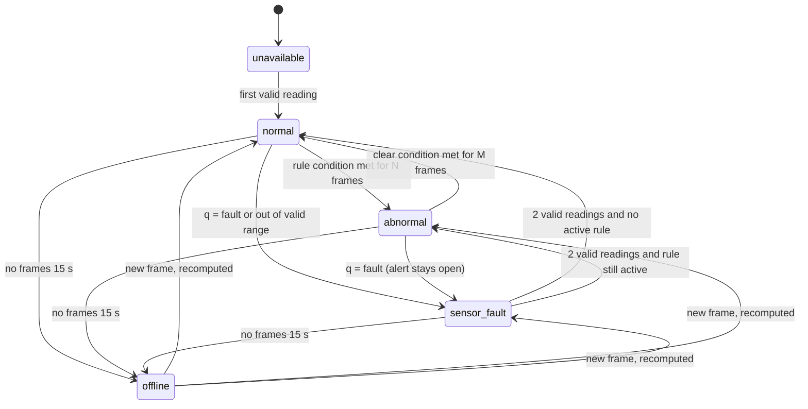
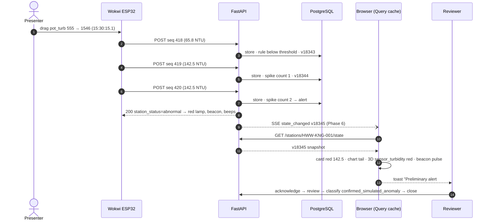

# 05: Synchronisation between Wokwi, backend, dashboard and 3D model

← [04 Wokwi integration](04-wokwi-integration.md) · Next: [06 UI/UX](06-ui-ux.md)

This document completes deliverable 7 (sensor → 3D mapping). It defines identifiers, the status model, frontend state, update strategy and latency, then walks through the 9-step turbidity scenario with concrete data.

## 5.1 Who owns what

| Concern | Single owner | Everyone else |
|---------|--------------|---------------|
| Identity: station, device, channels, units, decimals, Wokwi parts and pins, 3D node names, hotspots | `shared/registry/*.json` | Read it: seeded into the DB, generated into `registry.h` and `registry.ts`, checked against `diagram.json` and the GLB in CI |
| Measured values | PostgreSQL `measurements`, written only by `IngestService` | Read through the API |
| Current value and status per sensor, station status | `sensor_state` and `station_state` (with `version`), written only by `StateService` in the ingest transaction or by the freshness monitor | `GET /stations/{code}/state` |
| Alert open/clear decisions | `RuleEngine` + `AlertService` | Device lamps, UI badges and 3D colours *display* them |
| Status → colour, icon, text, LED | `shared/registry/status_visuals.json` | `domain/statusVisuals.ts`, 3D materials, map markers, firmware `display.cpp` |
| UI-only state (selection, toggles, chart range) | Zustand `uiStore` | — |
| Geometry | `station-v1.glb` | — |

## 5.2 Identifiers

| Identifier | Format | Example | Defined in | Used by |
|------------|--------|---------|-----------|---------|
| Station code | `HWW-<RIVER3>-<NNN>` | `HWW-KNG-001` | registry | API paths, payload, DB, URLs |
| Device code | `<kind>-<model>-<NN>` | `wokwi-esp32-01` | registry → `devices` | payload, key binding |
| Channel | lowercase word | `turbidity` | `sensor_types.json` | payload keys, API, charts |
| Sensor UID | `<station>:<channel>` | `HWW-KNG-001:turbidity` | registry | DB `sensors.uid`, GLB `extras.hww_id`, alerts |
| Wokwi part id | `snake_case` | `pot_turb` | `diagram.json` and registry | docs, Simulation page |
| Wokwi pin | ESP32 GPIO | `32` | `diagram.json` and registry → `registry.h` | firmware |
| 3D node | `snake_case`, no `. : / [ ]` | `sensor_turbidity` | registry, Blender script | `StationModel`, `check-glb-nodes.mjs` |
| Boot / frame | `boot_id` 8 hex + `seq` | `6f1c2a9e` / `420` | firmware | idempotency |
| Session | UUID | `0b6d…` | server | Simulation page, replay, export |
| Alert | bigint | `731` | server | `/alerts/731` |
| Rule | `UPPER_SNAKE` | `CHG_TURB_SPIKE` | `alert_rules` seed | alerts, UI basis text |

Internal DB keys are `bigint` identities. The API exposes codes and UIDs, never internal keys of stations or sensors.

## 5.3 Registry files

`shared/registry/sensor_types.json` (excerpt):

```json
{
  "registry_version": 1,
  "types": {
    "ph":        { "unit": "pH",   "unit_display": "pH",   "decimals": 2, "valid_min": 0,  "valid_max": 14,   "label": { "en": "pH", "vi": "pH" } },
    "do":        { "unit": "mg/L", "unit_display": "mg/L", "decimals": 2, "valid_min": 0,  "valid_max": 20,   "label": { "en": "Dissolved oxygen", "vi": "Oxy hòa tan" } },
    "turbidity": { "unit": "NTU",  "unit_display": "NTU",  "decimals": 1, "valid_min": 0,  "valid_max": 1000, "label": { "en": "Turbidity", "vi": "Độ đục" } },
    "temp":      { "unit": "degC", "unit_display": "°C",   "decimals": 2, "valid_min": -5, "valid_max": 60,   "label": { "en": "Water temperature", "vi": "Nhiệt độ nước" } }
  }
}
```

`shared/registry/HWW-KNG-001.json` (abridged: the other 2 sensors and 14 components follow the same shape):

```json
{
  "$schema": "../schemas/registry.schema.json",
  "registry_version": 1,
  "station": {
    "code": "HWW-KNG-001",
    "name": { "en": "Kim Ngưu River, demo station 1", "vi": "Sông Kim Ngưu, trạm mô phỏng 1" },
    "river": "Kim Ngưu",
    "location": { "lat": 20.995, "lng": 105.861, "precision": "illustrative" },
    "data_mode": "live_wokwi",
    "timezone": "Asia/Ho_Chi_Minh"
  },
  "device": { "code": "wokwi-esp32-01", "kind": "wokwi_esp32", "frame_interval_ms": 2000 },
  "model": {
    "glb_path": "/models/station-v1.glb",
    "version": 1,
    "components": [
      { "node": "cabinet", "kind": "structure", "hotspot": [0.42, 1.10, 0.10],
        "label": { "en": "Electronics cabinet", "vi": "Tủ thiết bị" },
        "description": { "en": "Houses the ESP32 controller, power regulation and the status lamps.", "vi": "Chứa bộ điều khiển ESP32, nguồn và đèn trạng thái." } },
      { "node": "beacon", "kind": "indicator", "hotspot": [0.42, 1.52, 0.10],
        "label": { "en": "Alert beacon", "vi": "Đèn cảnh báo" },
        "description": { "en": "Lights when the server reports an abnormal station status.", "vi": "Sáng khi máy chủ báo trạng thái bất thường." } }
    ]
  },
  "sensors": [
    { "channel": "ph", "uid": "HWW-KNG-001:ph", "model_node": "sensor_ph", "hotspot": [0.03, 0.22, 0.61],
      "wokwi": { "part_id": "pot_ph", "pin": "34", "substitute": true },
      "transfer": { "kind": "linear", "raw_max": 4095, "out_min": 0, "out_max": 14 } },
    { "channel": "turbidity", "uid": "HWW-KNG-001:turbidity", "model_node": "sensor_turbidity", "hotspot": [-0.03, 0.22, 0.61],
      "wokwi": { "part_id": "pot_turb", "pin": "32", "substitute": true },
      "transfer": { "kind": "quadratic", "raw_max": 4095, "out_max": 1000 } }
  ]
}
```

* `HWW-TLH-001.json` has `"data_mode": "replay_loop"` and `"device": { "code": "replay-tlh-01", "kind": "replay" }`.
* `HWW-NHU-001.json` has `"data_mode": "planned"`, no device, and the same sensors. Its status is always `unavailable`.
* Coordinates are rounded and marked `illustrative`. The UI shows "Illustrative location" next to every map marker.

**Code generation and checks** (B-05):
* `tools/gen_registry.py` writes `firmware/src/generated/registry.h` (codes, pins, transfer coefficients, decimals, units) and `frontend/src/generated/registry.ts` (typed components and sensors).
* `tools/check_registry.py` (CI, T-C-01/02) validates the JSON Schema and checks that:
  * every `wokwi.part_id` and pin exists in `firmware/diagram.json`;
  * generated files are up to date (regenerate, then `git diff --exit-code`);
  * channels exist in `sensor_types.json`.
* `check-glb-nodes.mjs` (T-C-03) checks the GLB side.

## 5.4 Master mapping table

| Channel | UI label (en / vi) | Wire unit → display | Decimals | Wokwi part → pin | Transfer | DB sensor UID | 3D node | Rules |
|---------|-------------------|---------------------|----------|------------------|----------|---------------|---------|-------|
| `ph` | pH / pH | `pH` → pH | 2 | `pot_ph` → GPIO34 | linear 0–14 | `HWW-KNG-001:ph` | `sensor_ph` | VALID_RANGE, REF_PH_BAND |
| `do` | Dissolved oxygen / Oxy hòa tan | `mg/L` → mg/L | 2 | `pot_do` → GPIO35 | linear 0–20 | `HWW-KNG-001:do` | `sensor_do` | VALID_RANGE, CHG_DO_DROP |
| `turbidity` | Turbidity / Độ đục | `NTU` → NTU | 1 | `pot_turb` → GPIO32 | quadratic 0–1000 | `HWW-KNG-001:turbidity` | `sensor_turbidity` | VALID_RANGE, CHG_TURB_SPIKE |
| `temp` | Water temperature / Nhiệt độ nước | `degC` → °C | 2 | `temp1` (DS18B20) → GPIO4 | native | `HWW-KNG-001:temp` | `sensor_temp` | VALID_RANGE, REF_TEMP_MAX |
| (station) | — | — | — | DIP SW5 → GPIO23 (network) | — | — | `led_*`, `beacon`, `antenna`, `display` | STN_OFFLINE |

## 5.5 Status model

**Sensor statuses** (computed only on the server; precedence from top to bottom):

| Status | Condition | `value` in the snapshot |
|--------|-----------|------------------------|
| `unavailable` | The sensor has never reported in this station's history, or the station is `planned` | `null` |
| `offline` | The station has had no frames for `OFFLINE_AFTER_S` (15 s), measured by server `received_at` | `null`; `last_valid` filled |
| `sensor_fault` | The latest reading has `q = fault`, or is outside the physical valid range (VALID_RANGE active). Clears after 2 consecutive valid readings. | `null`; `last_valid` filled |
| `abnormal` | At least one water-quality rule is active for this sensor (its persistence count was met and its clear condition has not been met) | the value |
| `normal` | None of the above | the value |

**Station status** (rollup):
* `unavailable` if the station is planned;
* otherwise `offline` if no frames have arrived for 15 s;
* otherwise `abnormal` if any sensor is `abnormal`;
* otherwise `degraded` if any sensor is `sensor_fault` or `unavailable`;
* otherwise `normal`.

**Status vs alert.** A sensor's *status* follows its condition: it returns to `normal` when the rule's clear condition holds. The *alert* the condition opened stays in the review workflow (open → acknowledged → under review → closed) until a person closes it. The alert records `cleared_at` when the condition ends, so "active now" and "awaiting review" are both visible.

**Faulty data never drives pollution rules.** Water-quality rules skip readings with `quality = fault` or `invalid`. A rule that was active stays active, but its sensor shows `sensor_fault` (higher precedence) until valid data returns.



## 5.6 Visual mapping

`shared/registry/status_visuals.json` is the only place colours, icons and wording for statuses are defined.

| Status | Fill / text colour | Icon (lucide) | Label en / vi | 3D | Map marker | Device |
|--------|-------------------|---------------|---------------|----|-----------|--------|
| `normal` | `#16A34A` / `#14532D` | `CheckCircle2` | Normal / Bình thường | green tint, steady | green circle ✓ | green lamp |
| `abnormal` | `#DC2626` / `#7F1D1D` | `AlertTriangle` | Abnormal (preliminary) / Bất thường (sơ bộ) | red, 1 Hz pulse | red triangle ▲ | red lamp + beacon + 2 beeps |
| `sensor_fault` | `#D97706` / `#78350F` | `Wrench` | Sensor fault / Lỗi cảm biến | amber + hatch | — (sensor level) | yellow lamp (station degraded) |
| `offline` | `#6B7280` / `#1F2937` | `WifiOff` | Offline / Mất kết nối | grey, 60 % opacity | grey circle ⦸ | yellow blink (no ack) |
| `unavailable` | `#CBD5E1` / `#475569` | `MinusCircle` | No data / Không có dữ liệu | light grey, flat | hollow circle | — |
| station `degraded` | `#CA8A04` / `#713F12` | `AlertCircle` | Degraded / Suy giảm | yellow lamp on | yellow circle ! | yellow lamp |

* Status is never shown by colour alone. Every badge has an icon and text, and every marker has a distinct shape (WCAG 1.4.1).
* Text colours meet 4.5:1 contrast against white and the light fills (checked by axe in T-A-02).

## 5.7 Frontend state

```text
TanStack Query cache (server state, the only place measurements live)
├── ['stationState', 'HWW-KNG-001']   ← GET /stations/HWW-KNG-001/state       refetch 2 s (15 s while SSE is connected)
├── ['stationState', 'HWW-TLH-001']   ← same, for the overview
├── ['stationState', 'HWW-NHU-001']   ← same (always unavailable; refetch 60 s)
├── ['stations']                       ← GET /stations (static metadata only)    staleTime 10 min
├── ['history', code, channel, range]  ← GET /stations/{code}/measurements       refetch 10 s for live ranges
├── ['timeline', code, range]          ← GET /stations/{code}/timeline           refetch 10 s
├── ['alerts', filters]                ← GET /alerts                             refetch 5 s, invalidated on alert_opened
├── ['alert', id]                      ← GET /alerts/{id}
└── ['link', code]                     ← GET /stations/{code}/link (Simulation page only) refetch 2 s

Zustand uiStore (never values)
└── selectedComponent, labelsVisible, followAlerts, exploded, view2D, chartRange
```

| Hook (`frontend/src/api/hooks.ts`) | Behaviour |
|-----------------------------------|-----------|
| `useStationState(code)` | `refetchInterval: 2000`; `refetchIntervalInBackground: false`; `staleTime: 1000`. The **version guard** in `queryFn` keeps the cached snapshot if a late response has a lower `version`. |
| `useSensorState(code, channel)` | `useStationState` with `select`. Same cache entry, so no extra request. |
| `useStationStates(codes)` | `useQueries` over the same `['stationState', code]` keys. The map marker and the model page share cache entries. |
| `useHistory(code, channel, range)` | Server-side bucketing (`date_bin`). The **tail merge** appends the snapshot's latest value at render time if it is newer than the last history point (derived, not stored). |
| `useConnection()` | Derived from query status: **Live** (last success < 5 s), **Delayed** (5–15 s), **Disconnected** (> 15 s or error). This is browser-to-API health, kept separate from station freshness. |

**HTTP caching:** the state endpoint returns `ETag: W/"HWW-KNG-001:18345"` and `Cache-Control: no-cache`. The browser then revalidates on its own (`If-None-Match` → `304`), so unchanged polls cost a few hundred bytes with no client code.

## 5.8 Update strategy: polling, SSE or WebSockets

| Option | Latency added | Complexity | Proxy/host friendliness | Decision |
|--------|---------------|-----------|-------------------------|----------|
| REST polling, 2 s | ≤ 2 s | Lowest | Works everywhere | **MVP** |
| SSE nudge + REST refetch | ≈ 0.2 s | Low (sse-starlette, `EventSource`) | Plain HTTP; needs `X-Accel-Buffering: no` and heartbeats behind proxies | **Phase 6 (MVP+)** |
| WebSockets | ≈ 0.1 s | Medium (bidirectional protocol, auth, reconnect) | Usually fine | Rejected: no client→server messages needed |

SSE events (`GET /api/v1/stream?stations=HWW-KNG-001,HWW-TLH-001`):
* `state_changed {station_code, version}`
* `alert_opened {alert_id, station_code, rule_code, severity}`
* `alert_updated {alert_id}`
* a `: ping` comment every 15 s

SSE **never carries values**. The client invalidates the matching query and the normal REST snapshot is fetched, so there is one data path and one consistency model. While SSE is connected, polling slows to 15 s as a safety net.

## 5.9 Latency budget

AC-01 measures latency as **UI render time − `measured_at`**, p95 over a 10-minute run.

| Segment | Wokwi path (T-A) | `sim_device.py` (T-B) |
|---------|------------------|------------------------|
| Frame created → uplink picks it up | 0.3 s | 0.1 s |
| Device → gateway → internet → API (TLS keep-alive) | 1.5 s (S2 measures) | 0.05 s |
| Ingest transaction (validate, store, rules, state) | 0.1 s | 0.1 s |
| Wait for the next browser poll | ≤ 2.0 s (SSE: 0.2 s) | ≤ 2.0 s |
| API fetch | 0.3 s | 0.05 s |
| React render + 3D `invalidate()` | 0.1 s | 0.1 s |
| **Total** | **≈ 4.3 s → target p95 ≤ 6 s** | **≈ 2.4 s → target p95 ≤ 4 s** |

Input to alert (AC-03) also includes the 2 s frame period, averaging, and the rule's persistence (2 frames for the turbidity spike). Target: **red in the UI within 10 s of moving the slider.** `tools/measure_latency.py` and the `__hww3d` test hook produce `docs/reports/latency.md`.

## 5.10 Consistency guarantees

| # | Guarantee | Mechanism | Test |
|---|-----------|-----------|------|
| G1 | A batch is all-or-nothing | Frames, measurements, rule state, alerts, `sensor_state` and `station_state.version` commit in **one transaction**; events are published only after commit | T-B-05 |
| G2 | A snapshot is never torn | The state endpoint reads `station_state` and `sensor_state` in one `REPEATABLE READ` transaction | T-B-13 |
| G3 | Versions only go up | `station_state.version` increments in the same transaction; the client version guard ignores lower versions | T-F-02 |
| G4 | Every view shows the same snapshot | Cards, 3D, map marker and detail panel read `['stationState', code]`. The debug footer shows `v18345` | AC-06 (T-E-03) |
| G5 | Same number, same text | One `formatValue(value, decimals, unit)` and one `formatTime(iso)` (ICT) in `domain/format.ts` | T-F-04 |
| G6 | Chart agrees with cards | Tail merge from the snapshot, plus history refetch on version change (throttled to 10 s) | T-F-06 |
| G7 | Device lamps agree with the UI | Lamps show the ack's `station_status` (same server computation). They can lag the UI by up to one POST (≈ 2 s); this is documented | AC-03 |
| G8 | Back-fill never rewinds the live view | `sensor_state` advances only when `measured_at` is newer | T-B-11 |

## 5.11 Walkthrough: the turbidity scenario step by step

Times are ICT (UTC+7) on 17 Nov 2026. Frames arrive every 2 s. The station has run since 15:28:02, so the turbidity baseline is warmed up (≥ 30 samples, ≥ 60 s).

| Step (prompt) | Time | What happens | Data |
|---------------|------|--------------|------|
| **1. Start Wokwi** | 15:28:02 | Presenter presses ▶ on the public Wokwi project. Firmware joins `Wokwi-GUEST`, syncs NTP, calls `GET /meta`, sets `boot_id = 6f1c2a9e`, starts sending. The server opens simulation session `0b6d…` (`source = simulated_wokwi`); the station moves from `offline` to `normal`. | Frames `seq 0…417`; turbidity 18.4 NTU (raw 555) |
| **2. Change the turbidity input** | 15:30:15.1 | Presenter drags `pot_turb` from raw 555 to raw 1546. | — |
| **3. Wokwi transmits** | 15:30:16.0 / 18.0 / 20.0 | `seq 418` averages 4 old and 4 new samples: raw 1050.5 → **65.8 NTU**. `seq 419` and `seq 420` are fully new: raw 1546 → **142.5 NTU**. Each frame is POSTed on its own (≈ 0.4 s through the gateway). | `{"seq":420,"measured_at":"2026-11-17T08:30:20.000Z",…,"turbidity":{"v":142.5,"u":"NTU","q":"ok","raw":1546,"gen":"input"}}` |
| **4. Backend validates and stores** | 15:30:20.45 → 20.52 | Key → device `wokwi-esp32-01` → station. Schema and units are checked. Frame and 4 measurements are inserted. Rules run: baseline (median 15:25:20–15:30:10) = 18.4; threshold = max(3 × 18.4, 18.4 + 50) = **68.4**. `seq 418` (65.8) was below it; 419 and 420 are above, so persistence 2 is met → **alert #731 `CHG_TURB_SPIKE` opens**. Sensor `turbidity → abnormal`; station → `abnormal`; `version 18344 → 18345`; commit. Response to the device: `station_status: "abnormal"`. | `alerts(731, rule CHG_TURB_SPIKE, severity warning, evidence_class simulated_anomaly, is_preliminary true, review_status open, observed 142.5, baseline 18.4, threshold 68.4)` |
| (device) | 15:30:20.9 | Device receives the ack: red lamp + beacon on, two beeps, OLED `SRV ABNORMAL`. | — |
| **5. App retrieves state** | 15:30:21.3 (poll; SSE nudge would be 15:30:20.6) | `GET /api/v1/stations/HWW-KNG-001/state` → `200`, `ETag W/"HWW-KNG-001:18345"`. | Snapshot below |
| **6. Dashboard updates** | 15:30:21.4 | Turbidity card: **142.5 NTU**, red ▲ "Abnormal (preliminary)", "measured 15:30:20 · 1 s ago". Chart: tail point 142.5 appended at once; history refetch adds 65.8 and 142.5 points; an alert marker is drawn at 15:30:20. | — |
| **7. 3D highlights the turbidity sensor** | 15:30:21.4 (same render) | `StationModel` sees `version 18345`. `sensor_turbidity` turns red and pulses at 1 Hz, with a 1.5 s activity glow. `led_green` off, `led_red` on, `beacon` pulses. Follow-alerts eases the camera to the probe and opens the detail panel. | `window.__hww3d.nodeStatus.sensor_turbidity === "abnormal"`, version 18345 |
| **8. Anomaly flagged** | (opened in step 4, shown now) | The Overview's recent-anomalies list and the Alerts page show #731 with **SIMULATED** and **PRELIMINARY** badges, plus basis "Demo heuristic: ≥ 3× the 5-minute median and ≥ +50 NTU. No regulatory meaning." | — |
| **9. Preliminary alert for authorised review** | 15:30:21.5 | Signed-in operators and reviewers get a toast and the bell count increases. A reviewer opens #731 → **Acknowledge** → **Start review** → outcome `confirmed_simulated_anomaly`, note "Triggered by presenter in demo" → **Close**. Each step is written to `alert_events`. | `POST /alerts/731/acknowledge`, `POST /incident-reviews`, `POST /incident-reviews/{id}/submit` |

Slider move to red in the UI takes **6.2 s** (target ≤ 10 s). `measured_at` to render takes **1.4 s** (target p95 ≤ 6 s).

Snapshot at step 5 (abridged to 2 of 4 sensors):

```json
{
  "station_code": "HWW-KNG-001",
  "version": 18345,
  "generated_at": "2026-11-17T08:30:21.302Z",
  "data_source": "simulated_wokwi",
  "is_simulated": true,
  "station_status": "abnormal",
  "station_status_since": "2026-11-17T08:30:20.000Z",
  "last_frame_at": "2026-11-17T08:30:20.452Z",
  "freshness_s": 0.85,
  "offline_after_s": 15,
  "session": { "id": "0b6d5c2e-8f3a-4c1d-9a77-2f4e6b1c9d10", "source": "simulated_wokwi", "device_code": "wokwi-esp32-01", "started_at": "2026-11-17T08:28:02.871Z" },
  "sensors": [
    { "channel": "turbidity", "uid": "HWW-KNG-001:turbidity", "label": "Turbidity", "unit": "NTU", "decimals": 1,
      "value": 142.5, "measured_at": "2026-11-17T08:30:20.000Z", "quality": "ok", "gen": "input",
      "status": "abnormal", "status_since": "2026-11-17T08:30:20.000Z", "last_valid": null,
      "active_alert_id": 731, "model_node": "sensor_turbidity" },
    { "channel": "ph", "uid": "HWW-KNG-001:ph", "label": "pH", "unit": "pH", "decimals": 2,
      "value": 7.21, "measured_at": "2026-11-17T08:30:20.000Z", "quality": "ok", "gen": "input",
      "status": "normal", "status_since": "2026-11-17T08:28:04.000Z", "last_valid": null,
      "active_alert_id": null, "model_node": "sensor_ph" }
  ],
  "open_alert_count": 1
}
```



**When the presenter slides back to 555:** the spike baseline stayed frozen at 18.4 while the alert was active. After 5 frames below 68.4, the condition clears: the sensor returns to `normal` and the alert gets `cleared_at`, but it stays open for review until a reviewer closes it.

## 5.12 Banned patterns (checked in review and CI)

| Banned | Instead | Enforced by |
|--------|---------|-------------|
| A 3D or dashboard component fetching its own data or holding a copy of values | `useStationState(code)` and `select` | Code review; ESLint `no-restricted-imports` of `api/client` outside `api/` |
| Sensor names, node names or units typed as literals in components | `generated/registry.ts` | `tools/check_literals.py` (T-C-05) fails on `sensor_*`, `HWW-…:` and unit literals outside `generated/` and `domain/` |
| Threshold or status logic in the frontend | Status from the API; `statusVisuals` mapping only | Review; the client fetches rules (E10) only to display their basis text, never to evaluate them |
| Animations that suggest data without data (random flicker, demo counters, placeholder `0.00`) | Skeleton or "—" while loading; pulses only on real `measured_at` changes | T-F-03, review |
| Showing `last_valid` as the current value | "—" plus "last valid 142.5 NTU at 15:31:02" in secondary text | T-F-03 |
| Device firmware deciding alerts | Lamps mirror the ack's `station_status` | T-W-05 |
| Using device time for freshness or offline detection | Server `received_at` | T-B-11 |
| Measurements in Zustand, `localStorage` or component state | Query cache only | Review |
| Chart lines drawn across gaps | Break the line when the gap is > 3 frame intervals | T-F-06 |
