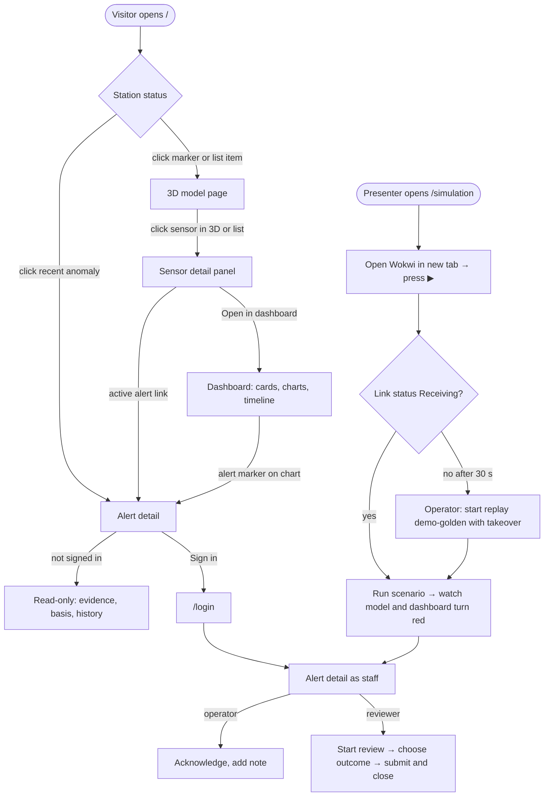

# 06: UI/UX: pages, component hierarchy and user flows

← [05 Synchronisation](05-synchronisation.md) · Next: [07 Backend, database and API](07-backend-database-api.md)

This document covers deliverables 4 (frontend component hierarchy) and 8 (user flow), and specifies the five required pages.

## 6.1 Design principles

| # | Principle | Consequence in the UI |
|---|-----------|----------------------|
| P1 | **Honest about data** | `SimulatedDataBanner` on every route; `SourceBadge` next to every value group; alerts carry an evidence-class badge; locations are marked "Illustrative location". |
| P2 | **One snapshot, many views** | Cards, 3D, map, 2D schematic and detail panels all read `useStationState(code)` ([05 §5.7](05-synchronisation.md#57-frontend-state)). |
| P3 | **No value without its time** | Every value is shown with `FreshnessLabel` ("measured 15:30:20 · 1 s ago"). |
| P4 | **Status is never colour alone** | Colour + icon + text, from `status_visuals.json` ([05 §5.6](05-synchronisation.md#56-visual-mapping)). |
| P5 | **Faults are not pollution** | `sensor_fault` and `offline` show "—" and the last valid value as secondary text; equipment alerts are labelled as such. |
| P6 | **The 3D model is a view, not a requirement** | Every 3D function is reachable from `SensorList`, `ModelControls` and the 2D schematic. |
| P7 | **Nothing animates without a reason** | Pulses run only when `measured_at` advances or a status is `abnormal`; `prefers-reduced-motion` turns them off. |

## 6.2 Routes and access

| Route | Page | Who can open it | Main data | Code split |
|-------|------|-----------------|-----------|-----------|
| `/` | Monitoring Overview | Everyone | `useStationStates([...])`, `['alerts', {limit: 5}]` | main chunk (Leaflet lazy) |
| `/stations/:code/model` | Station Digital Model | Everyone | `useStationState(code)`, `useHistory` (sparkline) | lazy (three.js, R3F) |
| `/stations/:code/dashboard` | Monitoring Dashboard | Everyone | `useStationState`, `useHistory` × 4, `['timeline']` | lazy (Recharts) |
| `/stations/:code` | → redirects to `/stations/:code/dashboard` | Everyone | — | — |
| `/alerts` | Alerts & Incident Review (list) | Everyone reads; actions need sign-in | `['alerts', filters]` | lazy |
| `/alerts/:id` | Alert detail and review | Everyone reads; notes and actor names only for staff | `['alert', id]`, `useHistory` (±10 min) | lazy |
| `/simulation` | Simulation Demonstration | Everyone; replay controls need operator | `['link', code]`, `/meta` | lazy |
| `/login` | Sign in | Everyone | — | lazy |
| `*` | Not found | Everyone | — | main |

Unknown station codes render a "Station not found" state with a link to `/`. Staff-only controls are hidden for anonymous users and disabled with a reason ("Requires reviewer role") for signed-in users without the role. The server enforces every permission; the UI only reflects it.

## 6.3 App shell (every route)

```text
┌──────────────────────────────────────────────────────────────────────────────┐
│ ⚠ Simulated data. All readings on this site come from a Wokwi electronics    │ ← SimulatedDataBanner (not dismissible)
│   simulation or a recorded replay. They are not measurements of water in     │
│   Hanoi. Station locations are illustrative.                     [EN | VI]   │
├──────────────────────────────────────────────────────────────────────────────┤
│ ◉ Hanoi WaterWatch   Overview  Model ▾  Dashboard ▾  Alerts  Simulation      │ ← NavBar
│                                  ● Live   🔔 1   Reviewer: demo.reviewer ▾   │   ConnectionIndicator, bell (staff)
├──────────────────────────────────────────────────────────────────────────────┤
│                                  <route>                                     │
├──────────────────────────────────────────────────────────────────────────────┤
│ Simulated data notice · app 1.0.0 · api v1 · model station-v1 · snapshot     │ ← Footer (debug info: G4 in 05 §5.10)
│ v18345 · times in ICT (UTC+7) · © OpenStreetMap contributors                 │
└──────────────────────────────────────────────────────────────────────────────┘
```

* **Banner:** fixed copy from [01 §1.5](01-mvp-and-stack.md#15-data-honesty-rules), `role="note"`, always visible, at most 2 lines on desktop and 3 on mobile (it collapses to "⚠ Simulated data · details" on screens under 640 px, with the full text in a disclosure).
* **ConnectionIndicator:** browser-to-API health, **Live / Delayed / Disconnected**, derived in `useConnection()` ([05 §5.7](05-synchronisation.md#57-frontend-state)). This is separate from a station being offline.
* **Bell and toasts:** staff only, see §6.9.
* **Model ▾ / Dashboard ▾:** station picker with the three stations and their status badges.

## 6.4 Page specifications

### 6.4.1 Page 1: Monitoring Overview (`/`)

**Purpose:** see all stations, their state and recent anomalies in one glance.

```text
┌──────────────────────────────────────────────┬───────────────────────────────┐
│ Summary  ● 1 normal  ▲ 1 abnormal  ⦸ 0 offline  – 1 no data   Open alerts: 1   │
├──────────────────────────────────────────────┼───────────────────────────────┤
│                                              │ Stations                      │
│        Leaflet map (OSM tiles)               │ ▲ HWW-KNG-001 Kim Ngưu 1       │
│                                              │   Abnormal (preliminary)      │
│      ▲ KNG-001     ● TLH-001                 │   Wokwi live · 1 s ago        │
│                                              │   [3D model] [Dashboard]      │
│              ○ NHU-001 (planned)             │ ● HWW-TLH-001 Tô Lịch 1        │
│                                              │   Normal · Replay · 2 s ago   │
│ [Illustrative locations]   Legend ▸          │ – HWW-NHU-001 Nhuệ 1           │
│                                              │   No data · Planned station   │
├──────────────────────────────────────────────┴───────────────────────────────┤
│ Recent anomalies                                              [All alerts →] │
│ #731 15:30:20 KNG-001 Turbidity spike  Warning  SIMULATED  PRELIMINARY  Open │
│ #728 15:12:44 TLH-001 DO drop          Warning  SIMULATED  Closed: confirmed │
└──────────────────────────────────────────────────────────────────────────────┘
```

| Element | Component | Behaviour |
|---------|-----------|-----------|
| Summary strip | `OverviewPage` | Counts from the three snapshots; "Open alerts" = alerts with `review_status != closed`. |
| Map | `StationMap`, `StationMarker` | Marker shape + colour + icon per station status; tooltip with status, source, freshness; click opens the list item. The map is `aria-hidden` for screen readers because the list has the same content. Tiles fail → grey background with the message "Map tiles unavailable"; markers still render. |
| Legend | in `StationMap` | Five statuses plus **evidence classes**: Simulated anomaly; Environmental observation ("reserved: no field data in this project"); Verified incident ("field data only"). |
| Station list | `StationListPanel` | Primary, accessible version of the map. Each item: status badge, `SourceBadge` ("Wokwi live", "Replay", "Planned"), `FreshnessLabel`, links to model and dashboard. |
| Recent anomalies | `RecentAlertsPanel` | Last 5 alerts; `EvidenceClassBadge`, "PRELIMINARY" until a review closes it, then the outcome. |

### 6.4.2 Page 2: Station Digital Model (`/stations/:code/model`)

**Purpose:** show the station as a 3D object whose parts reflect the live state, and explain what each part is.

```text
┌──────────────────────────────────────────────────────────────────────────────┐
│ HWW-KNG-001 Kim Ngưu 1   ▲ Abnormal (preliminary)  Wokwi live · measured     │ ← StationHeader
│ 15:30:20 · 1 s ago                                    [Dashboard →]         │
├────────────────────────────────────────────────┬─────────────────────────────┤
│                                                │ Sensors                     │ ← SensorList
│                 ┌──────┐  ◉ beacon             │ ● pH            7.21 pH     │
│        mast ─── │cab.  │ ●●▲ lamps             │ ● DO            6.40 mg/L   │
│                 └──────┘                       │ ▲ Turbidity   142.5 NTU  ◀  │
│                    │ guide tube                │ ● Temperature  27.50 °C     │
│                    ▼                           ├─────────────────────────────┤
│                 [probe: ▲ turbidity red pulse] │ Turbidity sensor            │ ← SensorDetailPanel
│                                                │ ▲ Abnormal (preliminary)    │
│  StationCanvas (role="img", aria-label=…)      │ 142.5 NTU                   │
│                                                │ measured 15:30:20 · 1 s ago │
├────────────────────────────────────────────────┤ quality ok · input: slider  │
│ ⟲ Reset  ＋ ─  ☐ Labels  ☑ Follow alerts       │ Wokwi part pot_turb, GPIO32 │
│ ☐ Exploded  ☐ 2D view                          │ ▁▁▁▁▁▁▁▁▂▇ last 10 min      │
│                                     ModelControls│ Alert #731 Turbidity spike →│
└────────────────────────────────────────────────┴─────────────────────────────┘
```

* **Interactions:** orbit (drag), zoom (wheel or pinch, distance 1.2–8 m), pan disabled, reset view; hover highlights a part (outline) and shows its name; click or Enter on a list item selects it; Esc clears selection. Rendering, binding and fallback rules are in [03 §3.6–§3.10](03-3d-integration.md#38-rendering-architecture-in-react-three-fiber).
* **Detail panel for a sensor:** label, value + unit (or "—" with last valid value), `StatusBadge`, `FreshnessLabel`, quality, input kind (`gen`: "slider" for `input`, "scenario profile" for `profile`), Wokwi part and pin from the registry, description, 10-minute sparkline (`useHistory`), active alert link, "Open in dashboard".
* **Detail panel for a non-sensor part** (cabinet, lamps, beacon, antenna, solar panel, display): description from the registry and the station-level information it represents (for example, the beacon shows the station status and its meaning; the antenna shows "last frame received 1 s ago").
* **Planned station (`HWW-NHU-001`):** the model renders with all sensors `unavailable` and an overlay "Planned station: no device installed".
* **Station selector:** changing station keeps the camera and toggles; selection resets.

### 6.4.3 Page 3: Monitoring Dashboard (`/stations/:code/dashboard`)

**Purpose:** current values, history and events for one station.

```text
┌──────────────────────────────────────────────────────────────────────────────┐
│ HWW-KNG-001 ▲ Abnormal (preliminary) · Wokwi live · session started 15:28:02 │
│ Range: [15 min] [1 h] [6 h] [24 h] [Custom]       Availability (1 h): 97.8 % │
├───────────────────┬───────────────────┬───────────────────┬──────────────────┤
│ pH          ● Nml │ DO          ● Nml │ Turbidity   ▲ Abn │ Temperature ● Nml│ ← SensorCard × 4
│ 7.21              │ 6.40 mg/L         │ 142.5 NTU         │ 27.50 °C         │
│ 15:30:20 · 1 s    │ 15:30:20 · 1 s    │ 15:30:20 · 1 s    │ 15:30:20 · 1 s   │
│ ref. band 6.0–9.0*│                   │ Alert #731 →      │ ref. max 40 °C*  │
├───────────────────┴───────────────────┴───────────────────┴──────────────────┤
│ Turbidity (NTU)                                       [Table view] [⤓ CSV]   │ ← SensorChart × 4
│ 150 ┤                                                   ┃▲ #731   ●──●       │
│  50 ┤                                                   ┃                    │
│   0 ┼──●──●──●──●──●──●──●──●──●──●──●──●──●──●──●──●──●┃──                  │
│     15:16        15:20        15:24        15:28   15:30                     │
├──────────────────────────────────────────────────────────────────────────────┤
│ Event timeline                                             ← EventTimeline   │
│ 15:30:20  ▲ Turbidity abnormal · alert #731 opened (CHG_TURB_SPIKE)          │
│ 15:28:02  ● Session started · Wokwi wokwi-esp32-01 · boot 6f1c2a9e           │
│ 15:27:40  ⦸ Station offline (no frames for 15 s)                             │
└──────────────────────────────────────────────────────────────────────────────┘
* reference band, verification of official text pending
```

* **Cards** read the snapshot only. The band text under pH and temperature comes from the rules endpoint (E10) and is display text, never used to colour the card ([05 §5.12](05-synchronisation.md#512-banned-patterns-checked-in-review-and-ci)).
* **Charts** (Recharts `LineChart`, one per channel so units never share an axis):
  * data from `GET /stations/{code}/measurements` with server bucketing; 15 min → raw 2 s points; 1 h → 10 s; 6 h → 1 min; 24 h → 5 min;
  * the snapshot's newest value is appended as the tail point ([05 §5.7](05-synchronisation.md#57-frontend-state));
  * lines break at gaps longer than 3 intervals; fault points are not drawn as values but as amber ticks on the axis;
  * periods with `abnormal` status are shaded (from the timeline), with a vertical marker and alert ID at each alert opening;
  * "Table view" shows the same data as an HTML table (accessibility); "CSV" downloads the visible range.
* **Availability:** received frames ÷ expected frames for the range, computed by the server in the timeline response.
* **Event timeline:** status changes, alert opened / cleared / closed, session start and end, `frames_missing` gaps, takeover by replay. Newest first, filter by type.

### 6.4.4 Page 4: Alerts & Incident Review (`/alerts`, `/alerts/:id`)

**List**

```text
Filters: Station [All ▾] Status [Open+Ack+Review ▾] Severity [All ▾] Category [All ▾]
         Evidence [All ▾] Rule [All ▾] Range [24 h ▾]                  [Reset]
┌─────┬──────────┬─────────┬───────────┬────────────────┬─────────┬─────────┬───────────────┬──────────────┐
│ ID  │ Opened   │ Station │ Sensor    │ Rule           │ Severity│ Category│ Evidence      │ Review       │
├─────┼──────────┼─────────┼───────────┼────────────────┼─────────┼─────────┼───────────────┼──────────────┤
│ 731 │ 15:30:20 │ KNG-001 │ Turbidity │ Turbidity spike│ Warning │ Water   │ SIMULATED     │ Open · active│
│ 730 │ 15:21:06 │ KNG-001 │ DO        │ Valid range    │ Warning │ Equip.  │ SIMULATED     │ Ack · cleared│
└─────┴──────────┴─────────┴───────────┴────────────────┴─────────┴─────────┴───────────────┴──────────────┘
```

* Default sort: newest first; default filter: not closed. Filters are reflected in the URL query string so a view can be shared.
* "Active" (condition still true) and "cleared at 15:33:10" are shown separately from the review status ([05 §5.5](05-synchronisation.md#55-status-model)).
* Category **Equipment** (`VALID_RANGE`, `STN_OFFLINE`) is visually distinct (wrench or plug icon) from **Water quality** so faults are not read as pollution.

**Detail**

```text
┌──────────────────────────────────────────────────────────────────────────────┐
│ Alert #731 · Turbidity spike · Warning · SIMULATED ANOMALY · PRELIMINARY     │
│ HWW-KNG-001 · Turbidity · opened 15:30:20 ICT (detected 15:30:20) · active   │
├──────────────────────────────────────┬───────────────────────────────────────┤
│ Observed   142.5 NTU                 │  mini chart ±10 min around the alert  │
│ Baseline    18.4 NTU (5-min median)  │  baseline and threshold as dashed     │
│ Threshold   68.4 NTU                 │  lines (values from the alert record) │
│ Persistence 2 frames                 │                                       │
│ Basis: Demo heuristic: ≥ 3× the 5-minute median and ≥ +50 NTU.               │
│        No regulatory meaning.                                                │
│ Source: Wokwi live · session 0b6d… · device wokwi-esp32-01                   │
├──────────────────────────────────────┴───────────────────────────────────────┤
│ Actions:  [Acknowledge]  [Add note]  [Start review]                          │ ← role-gated
├──────────────────────────────────────────────────────────────────────────────┤
│ Review (reviewer)                                                            │ ← ReviewForm
│ Outcome  (•) Confirmed simulated anomaly  ( ) Sensor or equipment fault      │
│          ( ) False positive  ( ) Test or calibration                         │
│          ( ) Verified incident  [disabled: only for field data]              │
│ Also include alerts: [#732 DO drop, 15:30:40 ▾]                              │
│ Note: [Triggered by presenter in demo                                    ]   │
│                                                     [Submit and close]       │
├──────────────────────────────────────────────────────────────────────────────┤
│ History (alert_events)                                    ← ReviewHistory    │
│ 15:30:20 opened by rule CHG_TURB_SPIKE                                       │
│ 15:31:02 acknowledged by Operator (demo.operator)                            │
│ 15:31:40 review started by Reviewer (demo.reviewer)                          │
└──────────────────────────────────────────────────────────────────────────────┘
```

* **Evidence classes in the UI.** This is how the page distinguishes the three classes the prompt names:

  | Class | Badge | Can be created here? | Copy |
  |-------|-------|---------------------|------|
  | Simulated anomaly | grey-blue "SIMULATED ANOMALY" with a flask icon | Yes, by rules on simulated data | "Raised on simulated data. Not evidence about real water." |
  | Environmental observation | teal "ENVIRONMENTAL OBSERVATION" | Not in this project (no field data); shown in legends and filters only | "Raised on field data, not yet verified." |
  | Verified incident | dark red "VERIFIED INCIDENT" with a seal icon | No: the option is disabled for simulated alerts, and the DB rejects it | "Confirmed by a reviewer with a lab reference." |

* **Preliminary label:** every alert shows "PRELIMINARY" until a review closes it; after that the outcome badge replaces it.
* Acknowledge, note, review and close each write an `alert_events` row; anonymous visitors see the event types and times but not notes or user names.
* An incident review can group several alerts from the same episode ("Also include alerts"), stored in `incident_review_alerts`.

### 6.4.5 Page 5: Simulation Demonstration (`/simulation`)

**Purpose:** explain the simulation, start it, and prove that data flows.

```text
┌──────────────────────────────────────────────────────────────────────────────┐
│ How the demo works                                       ← PipelineDiagram   │
│ [Wokwi ESP32] ─HTTPS─► [Wokwi gateway] ─► [FastAPI] ─► [PostgreSQL] ─► [this app]
│   ● frames 1 s ago        ● accepted 421   rejected 0   duplicates 3         │
├─────────────────────────────────────┬────────────────────────────────────────┤
│ Circuit (static image + pin table)  │ Live link status (HWW-KNG-001)         │ ← LinkStatusPanel
│ pot_ph → GPIO34  (pH 0–14)          │ ● Receiving · last frame 1 s ago       │
│ pot_do → GPIO35  (DO 0–20 mg/L)     │ Source: Wokwi live (wokwi-esp32-01)    │
│ pot_turb → GPIO32 (0–1000 NTU)      │ Session 0b6d… since 15:28:02           │
│ DS18B20 → GPIO4                     │ Boot 6f1c2a9e · fw 1.0.0 · RSSI −45    │
│ DIP 1–4 sensor faults, DIP 5 network│ Buffer depth 0 · dropped 0             │
│                                     │ Last error: none                       │
│ [Open the Wokwi simulation ↗]       │                                        │
├─────────────────────────────────────┴────────────────────────────────────────┤
│ Scenarios                                                 ← ScenarioGuide    │
│ SC1 Normal · SC2 Gradual pH (MODE ×1) · SC3a Turbidity slider · SC3b spike   │
│ (MODE ×2) · SC3c DO drop (MODE ×3) · SC4 Sensor fault (DIP 3) · SC5 Network  │
│ drop (DIP 5, 60 s) · SC6 Restart · SC7 Bad key                               │
│ Each: steps · what you should see · expected time to red                     │
├──────────────────────────────────────────────────────────────────────────────┤
│ Last payload (sanitised)                                  ← PayloadInspector │
│ { "schema": "hww.frames.v1", "station_code": "HWW-KNG-001", "frames": [ … ] }│
├──────────────────────────────────────────────────────────────────────────────┤
│ Replay (operator)                                         ← ReplayControls   │
│ Recording [demo-golden ▾]  Station [HWW-KNG-001 ▾]  Speed [1× ▾]             │
│ ☐ Take over station (stops accepting Wokwi frames until replay ends)  [Start]│
└──────────────────────────────────────────────────────────────────────────────┘
```

* **Wokwi is linked, not embedded.** The button opens `wokwi_project_url` from `GET /meta` in a new tab (`target="_blank" rel="noopener noreferrer"`). The reason (no supported embed API; a second simulation instance would compete for the station and be rejected with 409) is in [04 §4.1.3](04-wokwi-integration.md#413-can-wokwi-be-embedded-in-the-app). The circuit is shown as a static image exported from Wokwi plus the pin table from the registry.
* **Run instructions** (in `ScenarioGuide`): open the link → press ▶ → wait for "Receiving" here (≈ 10 s for Wi-Fi, NTP and the first POST) → wait 60 s for the baseline warm-up → run a scenario.
* **Link status states:** "Waiting for device" (no session), "Receiving" (frame < 6 s), "Delayed" (6–15 s), "Offline" (> 15 s), "Replay in control" (takeover), "Rejected" (the last batch failed: the error code is shown, e.g. `invalid_device_key`, `station_busy`).
* **Payload inspector** shows the latest accepted batch as returned by `GET /stations/{code}/link`. The device key is never part of a stored payload, so there is nothing to hide.

### 6.4.6 Sign in (`/login`)

Username and password, "Sign in" button, error "Incorrect username or password" (no hint about which). Demo accounts are created from environment variables at deploy time; **no credentials appear in the UI, the repo or the docs**. After sign-in the user returns to the page they came from. Session handling is in [07 §7.8](07-backend-database-api.md#78-conventions-auth-errors-pagination).

## 6.5 Component hierarchy (deliverable 4)

```text
main.tsx
└── QueryClientProvider · I18nextProvider · RouterProvider
    └── App.tsx → routes.tsx
        └── AppShell                                   components/layout
            ├── SimulatedDataBanner
            ├── NavBar ── StationPicker, ConnectionIndicator, AlertBell (staff), UserMenu, LanguageToggle
            ├── AlertToaster (staff; listens to ['alerts'] and SSE alert_opened)
            ├── <Outlet/>
            │   ├── OverviewPage                       features/overview
            │   │   ├── SummaryStrip
            │   │   ├── StationMap (lazy) ── StationMarker × 3, Legend
            │   │   ├── StationListPanel ── StatusBadge, SourceBadge, FreshnessLabel
            │   │   └── RecentAlertsPanel ── EvidenceClassBadge
            │   ├── ModelPage (lazy)                   features/model
            │   │   ├── StationHeader
            │   │   ├── ModelViewport
            │   │   │   ├── StationSchematic2D (fallback / 2D view)
            │   │   │   └── CanvasErrorBoundary → StationCanvas → StationModel, SensorHotspot,
            │   │   │       SensorLabels, FollowAlertsController
            │   │   ├── ModelControls
            │   │   ├── SensorList
            │   │   └── SensorDetailPanel ── Sparkline (SensorChart compact mode)
            │   ├── DashboardPage (lazy)               features/dashboard
            │   │   ├── StationHeader, TimeRangePicker, AvailabilityBadge
            │   │   ├── SensorCard × 4
            │   │   ├── SensorChart × 4 ── ChartTable (table view)
            │   │   └── EventTimeline
            │   ├── AlertsPage (lazy)                  features/alerts
            │   │   ├── AlertFilters
            │   │   └── AlertList ── AlertRow / AlertCard (mobile)
            │   ├── AlertDetailPage (lazy)
            │   │   ├── AlertSummary, AlertEvidenceChart, AlertActions (RequireRole)
            │   │   ├── ReviewForm (RequireRole reviewer)
            │   │   └── ReviewHistory
            │   ├── SimulationPage (lazy)              features/simulation
            │   │   ├── PipelineDiagram, LinkStatusPanel, ScenarioGuide, PayloadInspector
            │   │   └── ReplayControls (RequireRole operator)
            │   └── LoginPage (lazy)                   features/auth
            └── Footer
```

Shared building blocks (`components/status/`): `StatusBadge`, `FreshnessLabel`, `EvidenceClassBadge`, `SourceBadge`. Sub-components named here but not in the [02 §2.7](02-architecture.md#27-repository-structure-deliverable-10) tree (`SummaryStrip`, `StationHeader`, `AlertSummary`, …) live in the same folder as their page.

**Rules for components:**
* Pages call hooks; leaf components receive props. Only `api/hooks.ts` imports `api/client.ts`.
* No component formats numbers or times itself: `domain/format.ts` only.
* No component maps a status to colours itself: `domain/statusVisuals.ts` only.

## 6.6 UI states

| State | Where | What the user sees |
|-------|-------|-------------------|
| Loading (first load) | cards, list, charts | Skeletons with the layout's shape; never "0.00" |
| 3D loading | model | Progress ring with "Loading 3D model (412 KB)"; `SensorList` and the detail panel already work |
| No data yet (station never reported) | cards, model | "—" and "No data yet"; status `unavailable` |
| Planned station | all | "Planned station: no device installed" |
| Normal | all | Value, green ✓ "Normal" |
| Abnormal | all | Value, red ▲ "Abnormal (preliminary)", link to the alert |
| Sensor fault | card, model | "—", amber "Sensor fault", "last valid 142.5 NTU at 15:31:02" in small text, reason (`injected`, `disconnected`, `out_of_range`) |
| Station offline | header, cards, model | Grey ⦸ "Offline · last frame 15:27:40 (2 min ago)"; values "—"; 3D at 60 % opacity |
| API unreachable | shell | ConnectionIndicator "Disconnected"; a top notice "Can't reach the server. Showing the last data received at 15:30:21."; data is greyed and no relative times count up as "live" |
| History gap | chart | Line break + "No data 15:31:10–15:32:10" marker |
| Empty alert list | alerts | "No alerts match these filters." |
| Permission denied | actions | Button hidden (anonymous) or disabled with reason (wrong role); 403 from the server shows a toast |
| WebGL unavailable / context lost | model | 2D schematic and the notice "3D view unavailable on this device. Showing the 2D schematic." |
| Not found | any | "Page not found" or "Station HWW-XXX-000 not found" |

## 6.7 User flows (deliverable 8)



**Journeys** (each is an E2E test in [10](10-testing-demo-deploy.md)):

| ID | Persona | Goal | Steps | Success |
|----|---------|------|-------|---------|
| J1 | Visitor (anonymous) | Understand station health | `/` → marker KNG-001 → 3D model → click turbidity → "Open in dashboard" | Sees the same value and status in all three places; sees "Simulated data" throughout |
| J2 | Presenter | Show live data flow | `/simulation` → open Wokwi → ▶ → "Receiving" → slide turbidity → switch to model tab | Sensor turns red ≤ 10 s after the slide |
| J3 | Operator | Respond to a new alert | Toast "Preliminary alert #731" → View → Acknowledge → Add note | Event history shows both actions with time and name |
| J4 | Reviewer | Classify an alert | `/alerts` filtered "Open" → #731 → Start review → "Confirmed simulated anomaly" + note → Submit and close | Alert closed with outcome; "Verified incident" was not selectable |
| J5 | Operator (fallback) | Demo without Wokwi | `/simulation` → Replay `demo-golden`, take over KNG-001 → Start | Same flow as J2 with `SourceBadge` "Replay" |
| J6 | Visitor without WebGL | Inspect sensors | Model page → 2D schematic → Tab to turbidity → Enter | Same detail panel and values as the 3D view |

## 6.8 Accessibility (target: WCAG 2.2 AA)

* **Keyboard:** every action is reachable by Tab; visible focus ring (2 px, 3:1 contrast); skip link to main content; Esc closes panels and toasts; no keyboard trap in the canvas (the canvas is one tab stop; arrow keys rotate when focused, documented in its `aria-describedby`).
* **Screen readers:** the canvas has `role="img"` and a status summary label; `SensorList` and the 2D schematic carry the full information; status changes are announced in one polite live region (`aria-live="polite"`), throttled to status changes only, never every value; charts have a table view; times use `<time datetime="…">`.
* **Colour and contrast:** status = colour + icon + text; text contrast ≥ 4.5:1; marker shapes differ per status.
* **Motion:** `prefers-reduced-motion` disables pulses, camera easing and chart animations; nothing flashes more than 3 times per second (the abnormal pulse is 1 Hz).
* **Targets:** interactive targets ≥ 24 × 24 px (WCAG 2.2 SC 2.5.8); 3D picking also works through the list, so small meshes are not the only target.
* **Language:** `<html lang>` follows the selected language.
* **Checks:** axe in Playwright on every route (T-A-01), keyboard-only journey J6 (T-A-03), manual NVDA pass once before the demo (T-A-04).

## 6.9 Notifications

| Channel | Who | When | Behaviour |
|---------|-----|------|-----------|
| Toast (`AlertToaster`) | Signed-in operator, reviewer, admin | New alert (`alert_opened` via SSE, or a new ID in the polled alert list) | "Preliminary alert #731 · Turbidity spike · HWW-KNG-001 · SIMULATED" with "View". Critical stays until dismissed; warning and info hide after 10 s. At most 3 visible; more collapse into "+2 more". |
| Bell (`AlertBell`) | Staff | Always | Count of alerts with `review_status = open`; opens `/alerts?review_status=open`. |
| Tab title | Staff | Open alerts > 0 | "(1) Hanoi WaterWatch" |
| Overview "Recent anomalies" | Everyone | Always | Passive list, no pop-ups for anonymous visitors |
| Device lamps and buzzer | Presenter | Ingest ack | Mirror server status ([04 §4.5.4](04-wokwi-integration.md#454-local-indicators-mirror-the-server)) |

No sound in the browser, and no email, SMS or push: these are out of scope ([01 §1.4](01-mvp-and-stack.md#14-excluded-from-the-mvp-and-why)).

## 6.10 Internationalisation and formatting

* Languages: English (default) and Vietnamese, with `react-i18next`, `locales/en.json` and `locales/vi.json`. The choice is saved in `localStorage` and initialised from `navigator.language`.
* Server-provided text (rule names, basis text, station names, component descriptions) arrives as `{ "en": …, "vi": … }`; the UI picks the active language.
* Times: stored in UTC, **always displayed in ICT** (`Asia/Ho_Chi_Minh`) with the suffix "ICT", whatever the browser time zone. en: `17 Nov 2026, 15:30:20 ICT`; vi: `15:30:20 17/11/2026 (ICT)`.
* Numbers: `Intl.NumberFormat(locale, { minimumFractionDigits: decimals, maximumFractionDigits: decimals })` with `decimals` from the registry (en `142.5`, vi `142,5`). Units are not translated (`NTU`, `mg/L`, `°C`, `pH`).
* Relative times ("1 s ago", "1 giây trước") come from `Intl.RelativeTimeFormat`, driven by one shared 1 s ticker so all labels change together.
* CI fails if a key exists in one locale file and not the other (T-F-09).

## 6.11 Responsive layout

| Width | Overview | Model | Dashboard | Alerts |
|-------|----------|-------|-----------|--------|
| < 640 px | List first, map below (300 px) | Canvas 55 vh; list and detail as a bottom sheet | 1 card per row; charts full width | Cards instead of a table |
| 640–1023 px | Map 60 %, list 40 % stacked | Canvas 60 vh; panels below | 2 cards per row | Table with fewer columns |
| ≥ 1024 px | Map and list side by side | Canvas left, panels right (as wireframe) | 4 cards per row | Full table |

Performance targets per page are in [10](10-testing-demo-deploy.md) (model page < 4 s on Fast 4G, ≥ 30 fps on a mid-range phone).

## 6.12 Visual tokens

* Status colours, icons and labels come from `shared/registry/status_visuals.json`. `domain/statusVisuals.ts` imports it through the Vite alias `@shared`, and `AppShell` writes the colours as CSS custom properties (`--hww-status-normal`, …) so Tailwind classes such as `bg-[var(--hww-status-abnormal)]` use the same values as the 3D materials.
* Neutral palette: Tailwind `slate`; brand accent: `sky-700` (not used for any status).
* Typography: system font stack, tabular numerals (`font-variant-numeric: tabular-nums`) for all values so digits don't jump as they update.
* Icons: `lucide-react`.

## 6.13 Key copy (en / vi)

| Key | English | Tiếng Việt |
|-----|---------|-----------|
| `banner.simulated` | Simulated data. All readings on this site come from a Wokwi electronics simulation or a recorded replay. They are not measurements of water in Hanoi. Station locations are illustrative. | Dữ liệu mô phỏng. Mọi số đo trên trang này đến từ mô phỏng điện tử Wokwi hoặc bản phát lại đã ghi. Đây không phải số đo nước thực tế tại Hà Nội. Vị trí trạm chỉ mang tính minh họa. |
| `status.abnormal` | Abnormal (preliminary) | Bất thường (sơ bộ) |
| `alert.preliminary` | Preliminary: awaiting review | Sơ bộ: đang chờ xem xét |
| `evidence.simulated_anomaly` | Simulated anomaly | Bất thường mô phỏng |
| `evidence.environmental_observation` | Environmental observation | Quan sát môi trường |
| `evidence.verified_incident` | Verified incident | Sự cố đã xác minh |
| `basis.demo_heuristic` | Demo heuristic, no regulatory meaning | Ngưỡng minh họa, không có giá trị pháp lý |
| `basis.reference_pending` | Reference band, verification of official text pending | Ngưỡng tham chiếu, đang chờ đối chiếu văn bản chính thức |
| `model.unavailable` | 3D view unavailable on this device. Showing the 2D schematic. | Không hiển thị được mô hình 3D trên thiết bị này. Đang hiển thị sơ đồ 2D. |
| `link.waiting` | Waiting for the device. Open the Wokwi simulation and press ▶. | Đang chờ thiết bị. Mở mô phỏng Wokwi và nhấn ▶. |

The Vietnamese copy must be checked by a native speaker on the team before the demo (backlog B-50).
