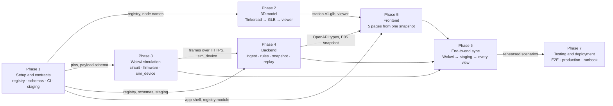

# 08: Development roadmap

← [07 Backend, database and API](07-backend-database-api.md) · Next: [09 Team and timeline](09-team-and-timeline.md)

This document is deliverable 9: the seven phases in dependency order, with tasks, modules, dependencies, outputs, effort, acceptance criteria and risks, plus the minimum viable demonstration (MVD) and the critical path. Every task is a GitHub issue (`B-nn`) specified in full in [11](11-github-backlog.md). Test IDs (`T-…`) and acceptance criteria (`AC-…`) are defined in [10](10-testing-demo-deploy.md).

## 8.1 Phase overview

The phases are ordered by dependency, not by calendar. They overlap: 3D work (Phase 2) and firmware (Phase 3) start in week 1 next to the setup work, because the shared contracts from Phase 1 let them run in parallel. Effort is in **person-days** (one day = about 6 focused hours; see [09 §9.10](09-team-and-timeline.md#910-capacity-and-availability)).

| Phase | Name | Issues | Track A | Track B | Total | MVD part | Weeks | Exit milestone |
|-------|------|--------|---------|---------|-------|----------|-------|----------------|
| 1 | [Project setup and contracts](#84-phase-1-project-setup-and-contracts) | 8 | 3 | 1.25 | **4.25** | 4.25 | W1–W1 | M0 |
| 2 | [3D model preparation](#85-phase-2-3d-model-preparation) | 6 | 0 | 5.5 | **5.5** | 5.5 | W1–W2 | M1 |
| 3 | [Wokwi simulation](#86-phase-3-wokwi-simulation) | 8 | 5.5 | 0.5 | **6** | 6 | W1–W3 | M2 |
| 4 | [Backend integration](#87-phase-4-backend-integration) | 15 | 9.5 | 2.5 | **12** | 9 | W2–W5 | M4 |
| 5 | [Frontend development](#88-phase-5-frontend-development) | 13 | 0.5 | 11 | **11.5** | 7.5 | W2–W6 | M5 |
| 6 | [End-to-end synchronisation](#89-phase-6-end-to-end-synchronisation) | 6 | 2.75 | 1.25 | **4** | 2 | W3–W5 | M4 |
| 7 | [Testing and deployment](#810-phase-7-testing-and-deployment) | 4 | 2 | 1 | **3** | 0 | W6–W6 | M5 |
| | **Total** | **60** | **23.25** | **23** | **46.25** | **34.25** | W1–W6 | M5 |

## 8.2 Dependency hand-offs between the two tracks

Work is split into two tracks (details and the proposed owners are in [09](09-team-and-timeline.md)): **Track A, "Device → Data"** (firmware, ingest, rules, state, replay, auth, deployment) and **Track B, "Model → Experience"** (3D, frontend, read APIs, E2E, accessibility). Most dependencies stay inside a track. The ones below cross from one track to the other; they are the integration points that need a merged PR, not a conversation. "Slack" is the planned gap between the dependency being merged and the dependent task starting.

| Producer (track) | Merged by | Consumer (track) | Starts | Slack (days) |
|------------------|-----------|------------------|--------|--------------|
| B-01 Repo skeleton (B) | Mon 23 Nov | B-02 Backend skeleton (A) | Mon 23 Nov | 0 |
| B-01 Repo skeleton (B) | Mon 23 Nov | B-04 Registry files (A) | Mon 23 Nov | 0.5 |
| B-04 Registry files (A) | Tue 24 Nov | B-10 Tinkercad model (B) | Tue 24 Nov | 0.5 |
| B-03 Frontend shell + S3 (B) | Tue 24 Nov | B-07 CI pipeline (A) | Wed 25 Nov | 1 |
| B-06 Payload contracts (A) | Wed 25 Nov | B-22 sim_device (B) | Thu 26 Nov | 1 |
| B-05 Registry codegen (A) | Tue 24 Nov | B-12 GLB optimise (B) | Tue 1 Dec | 4.25 |
| B-05 Registry codegen (A) | Tue 24 Nov | B-38 Status primitives (B) | Thu 3 Dec | 6.75 |
| B-23 DB models (A) | Mon 30 Nov | B-30 Alerts API (B) | Mon 7 Dec | 4 |
| B-06 Payload contracts (A) | Wed 25 Nov | B-39 State hooks (B) | Mon 7 Dec | 8.5 |
| B-35 API client (A) | Wed 9 Dec | B-39 State hooks (B) | Mon 7 Dec | soft (see below) |
| B-28 Snapshot API (A) | Tue 8 Dec | B-31 History API (B) | Wed 9 Dec | 0 |
| B-22 sim_device (B) | Thu 26 Nov | B-36 Replay (A) | Wed 16 Dec | 13.25 |
| B-27 Rule engine (A) | Tue 15 Dec | B-53 Consistency E2E (B) | Thu 17 Dec | 2 |
| B-29 Offline detection (A) | Thu 17 Dec | B-53 Consistency E2E (B) | Thu 17 Dec | 0 |
| B-32 Auth (A) | Mon 21 Dec | B-33 Review API (B) | Tue 22 Dec | 0.25 |
| B-41 3D status binding (B) | Fri 11 Dec | B-54 Latency report (A) | Tue 22 Dec | 6.75 |
| B-39 State hooks (B) | Tue 8 Dec | B-55 SSE nudge (A) | Wed 23 Dec | 10.25 |
| B-32 Auth (A) | Mon 21 Dec | B-46 Review UI (B) | Wed 23 Dec | 1.25 |
| B-45 Alerts pages (B) | Wed 16 Dec | B-48 Notifications (A) | Mon 28 Dec | 6.5 |
| B-46 Review UI (B) | Thu 24 Dec | B-48 Notifications (A) | Mon 28 Dec | 0.75 |
| B-57 E2E in CI (B) | Mon 28 Dec | B-58 Production deploy (A) | Tue 29 Dec | 0.75 |

Joint issues (B-56 Scenario rehearsal, B-60 Acceptance + release) are done together in one session, so both tracks must have finished their inputs first.

The single soft dependency is planned on purpose: B-39 is built against the `station-state.v1` fixture from B-06 with a mocked fetch; merges after B-35.

## 8.3 Critical path

The longest chain of dependencies, counting effort only, is **10 person-days**:

[B-01](11-github-backlog.md#b-01-repository-skeleton-and-team-conventions) Repo skeleton (0.25) → [B-02](11-github-backlog.md#b-02-backend-skeleton-with-postgresql-in-docker-compose) Backend skeleton (0.5) → [B-23](11-github-backlog.md#b-23-database-models-and-migration-0001) DB models (1) → [B-24](11-github-backlog.md#b-24-registry-loader-seed-cli-and-rule-seeds) Seed CLI (0.5) → [B-25](11-github-backlog.md#b-25-ingest-endpoint-with-device-authentication) Ingest endpoint (1) → [B-28](11-github-backlog.md#b-28-state-service-event-bus-and-snapshot-api) Snapshot API (1) → [B-35](11-github-backlog.md#b-35-openapi-types-and-api-client) API client (0.5) → [B-39](11-github-backlog.md#b-39-station-state-hooks-and-connection-indicator) State hooks (1) → [B-43](11-github-backlog.md#b-43-page-3-dashboard-cards-and-history-charts) Dashboard (1.5) → [B-53](11-github-backlog.md#b-53-cross-view-consistency-e2e) Consistency E2E (1) → [B-57](11-github-backlog.md#b-57-e2e-suite-in-ci) E2E in CI (0.5) → [B-58](11-github-backlog.md#b-58-production-deployment-and-operations) Production deploy (0.75) → [B-60](11-github-backlog.md#b-60-final-acceptance-run-and-release) Acceptance + release (0.5)

```mermaid
flowchart LR
  B01["B-01<br/>Repo skeleton<br/>0.25 d, B"]
  B02["B-02<br/>Backend skeleton<br/>0.5 d, A"]
  B23["B-23<br/>DB models<br/>1 d, A"]
  B24["B-24<br/>Seed CLI<br/>0.5 d, A"]
  B25["B-25<br/>Ingest endpoint<br/>1 d, A"]
  B28["B-28<br/>Snapshot API<br/>1 d, A"]
  B35["B-35<br/>API client<br/>0.5 d, A"]
  B39["B-39<br/>State hooks<br/>1 d, B"]
  B43["B-43<br/>Dashboard<br/>1.5 d, B"]
  B53["B-53<br/>Consistency E2E<br/>1 d, B"]
  B57["B-57<br/>E2E in CI<br/>0.5 d, B"]
  B58["B-58<br/>Production deploy<br/>0.75 d, A"]
  B60["B-60<br/>Acceptance + release<br/>0.5 d, AB"]
  B01 --> B02 --> B23 --> B24 --> B25 --> B28 --> B35 --> B39 --> B43 --> B53 --> B57 --> B58 --> B60
```

Because that chain is short compared with 27 working days, the schedule is decided by each track's **load**, not by the dependency chain. The chain still matters for one reason: in week 3 both tracks wait on the snapshot work (B-25 → B-28 → B-35). B-31 starts the moment B-28 is merged (no slack), and B-39 cannot merge before B-35, so a day lost on B-25 or B-28 is also lost on Track B. Mitigations:

* Track A does B-25, B-28 and B-35 first in week 3, before the firmware uplink (B-21).
* Track B starts B-39 against the `station-state.v1` fixture, so it never waits for the generated client.
* The E05 response shape is frozen at M0 (B-06). B-28 can change internals, never the shape.

## 8.4 Phase 1: Project setup and contracts

**Goal.** One repository both developers can run on day 1; the contracts that let the two tracks work apart (registry, payload and snapshot schemas, fixtures); CI; and a deployed staging URL that the Wokwi spike can reach. The stack itself is already decided in [01 §1.5](01-mvp-and-stack.md); this phase *installs* it and records the decisions as ADRs.

| Issue | Task | Track | Est. (pd) | Week | Depends on | Exact components and modules | Tier |
|-------|------|-------|-----------|------|------------|------------------------------|------|
| [B-01](11-github-backlog.md#b-01-repository-skeleton-and-team-conventions) | Repository skeleton and team conventions | B | 0.25 | W1 | — | `README.md` `CONTRIBUTING.md` (the team GitHub workflow, [09 §9.6](09-team-and-timeline.md#96-git-branching-and-review-plan)) `LICENSE` `Makefile` +9 more | MVD |
| [B-02](11-github-backlog.md#b-02-backend-skeleton-with-postgresql-in-docker-compose) | Backend skeleton with PostgreSQL in Docker Compose | A | 0.5 | W1 | B-01 | `docker-compose.yml` `backend/pyproject.toml` `backend/alembic.ini` `backend/alembic/env.py` +4 more | MVD |
| [B-03](11-github-backlog.md#b-03-frontend-skeleton-app-shell-and-spike-s3) | Frontend skeleton, app shell and spike S3 | B | 1 | W1 | B-01 | `frontend/{package.json,package-lock.json,vite.config.ts,tsconfig.json,index.html}` `frontend/src/{main.tsx,App.tsx,routes.tsx,i18n.ts,index.css}` `frontend/src/components/layout/{AppShell,NavBar,SimulatedDataBanner,Footer}.tsx` `frontend/src/locales/{en,vi}.json` +1 more | MVD |
| [B-04](11-github-backlog.md#b-04-shared-registry-files-and-registry-schema) | Shared registry files and registry schema | A | 0.5 | W1 | B-01 | `shared/registry/{sensor_types,status_visuals,HWW-KNG-001,HWW-TLH-001,HWW-NHU-001}.json` `shared/schemas/registry.schema.json` | MVD |
| [B-05](11-github-backlog.md#b-05-registry-code-generation-and-consistency-check) | Registry code generation and consistency check | A | 0.5 | W1 | B-04 | `tools/gen_registry.py` `tools/check_registry.py` `firmware/src/generated/registry.h` `frontend/src/generated/registry.ts` +1 more | MVD |
| [B-06](11-github-backlog.md#b-06-payload-and-snapshot-contracts-with-fixtures) | Payload and snapshot contracts with fixtures | A | 0.5 | W1 | B-04 | `shared/schemas/{frame-batch.v1,station-state.v1}.schema.json` `shared/fixtures/payloads/{valid_batch,duplicate_batch,fault_frame,backlog_batch,invalid_unit}.json` `backend/tests/contract/test_fixtures.py` | MVD |
| [B-07](11-github-backlog.md#b-07-ci-pipeline) | CI pipeline | A | 0.5 | W1 | B-02, B-03 | `.github/workflows/ci.yml` `tools/check_literals.py` `.gitleaks.toml` | MVD |
| [B-08](11-github-backlog.md#b-08-choose-the-host-and-deploy-the-skeleton-to-staging) | Choose the host and deploy the skeleton to staging | A | 0.5 | W1 | B-02 | `Dockerfile` `.github/workflows/deploy.yml` (manual trigger) `docs/adr/0004-single-instance-runtime.md` `docs/reports/hosting.md` | MVD |

**Dependencies.** None outside the phase. B-01 is the first merge of the project; the registry (B-04) blocks code generation, the payload contract and the Wokwi circuit.

**Expected outputs.** Repository skeleton with conventions and ADR stubs; `docker compose` dev stack; React app shell with the simulated-data banner; `shared/registry/*.json` with schema and generated `registry.h` / `registry.ts`; `frame-batch.v1` and `station-state.v1` schemas with fixtures; CI workflow; a deployed staging URL with managed PostgreSQL; reports for spike S3 (and S2, which runs in Phase 3 but needs this staging URL).

**Effort.** 4.25 person-days (Track A 3, Track B 1.25); 4.25 of them are in the MVD.

**Exit acceptance criteria (milestone M0, Fri 27 Nov).**
1. A fresh clone runs `make dev` and E01 `/api/v1/health` reports `"db": "ok"` on both developers' laptops (T-B-02).
2. CI is green on `main` in under 10 minutes and includes gitleaks and `check_literals.py` (T-C-05, T-S-05).
3. `make gen` is reproducible and CI rejects a stale generated file (T-C-01, T-C-02); fixtures validate (T-C-04).
4. `https://<staging-host>/api/v1/health` returns 200 over HTTPS (T-D-01).
5. `frame-batch.v1` and `station-state.v1` are tagged as frozen; both developers approved them.

**Risks and mitigation.**

| Risk | Mitigation |
|------|------------|
| A free hosting tier sleeps, so Wokwi's first POST times out | Host criteria in [10 §10.6](10-testing-demo-deploy.md#106-deployment-plan) require an always-on instance; spike S2 measures cold starts |
| Contracts keep changing after M0 and break the other track | `v1` frozen at M0; breaking change = new `v2` file plus both approvals (CODEOWNERS on `shared/`) |
| Windows and macOS set-ups differ (line endings, Python versions) | `.gitattributes` with `eol=lf`; Docker for PostgreSQL; versions pinned in `pyproject.toml` and the lockfile |
| Secrets committed by accident | `.env` and `config.h` git-ignored from the first commit; gitleaks in CI; demo passwords only in env vars |

## 8.5 Phase 2: 3D model preparation

**Goal.** The Tinkercad station appears in the browser as a GLB whose node names equal the registry, and every sensor can be selected by click, list or keyboard. Statuses are bound in Phase 5 (B-41); this phase proves the asset pipeline and the viewer.

| Issue | Task | Track | Est. (pd) | Week | Depends on | Exact components and modules | Tier |
|-------|------|-------|-----------|------|------------|------------------------------|------|
| [B-09](11-github-backlog.md#b-09-spike-s1-find-out-how-tinkercad-exports) | Spike S1: find out how Tinkercad exports | B | 0.5 | W1 | — | `blender/README.md` `blender/scripts/material_map.json` `docs/adr/0003-3d-format-and-pipeline.md` | MVD |
| [B-10](11-github-backlog.md#b-10-tinkercad-station-model) | Tinkercad station model | B | 1.5 | W1 | B-09, B-04 | `blender/source/station-tinkercad.{obj,mtl}` `docs/assets/tinkercad-station.png` `blender/README.md` (link to the Tinkercad design) | MVD |
| [B-11](11-github-backlog.md#b-11-blender-preparation-script) | Blender preparation script | B | 1 | W2 | B-10 | `blender/scripts/prepare_station.py` `blender/station.blend` | MVD |
| [B-12](11-github-backlog.md#b-12-glb-optimisation-budgets-and-node-check) | GLB optimisation, budgets and node check | B | 0.5 | W2 | B-11, B-05 | Makefile (target `glb`) `frontend/public/models/station-v1.glb` `frontend/scripts/check-glb-nodes.mjs` | MVD |
| [B-13](11-github-backlog.md#b-13-react-three-fiber-viewer) | React Three Fiber viewer | B | 1 | W2 | B-03, B-12 | `frontend/src/features/model/{ModelPage,StationCanvas,StationModel,CanvasErrorBoundary}.tsx` `frontend/src/features/model/useWebGLSupport.ts` | MVD |
| [B-14](11-github-backlog.md#b-14-3d-selection-hover-and-sensor-list) | 3D selection, hover and sensor list | B | 1 | W2 | B-13 | `frontend/src/features/model/{SensorHotspot,SensorList,ModelControls}.tsx` `frontend/src/state/uiStore.ts` | MVD |

**Dependencies.** Registry node names (B-04, B-05); app shell (B-03).

**Expected outputs.** `station-tinkercad.obj/.mtl`; `prepare_station.py`; `station-v1.glb` within budget; `check-glb-nodes.mjs` in CI; the model page with orbit, reset view, hover names, `SensorList` and shared selection in `uiStore`.

**Effort.** 5.5 person-days (Track A 0, Track B 5.5); 5.5 of them are in the MVD.

**Exit acceptance criteria (milestone M1, Fri 4 Dec).**
1. Spike S1 answered; ADR-0003 accepted.
2. `make glb` produces a GLB within the budgets in [03 §3.4.5](03-3d-integration.md#345-budgets) (≤ 2 MB, < 100,000 triangles, < 40 nodes); CI node check passes (T-C-03).
3. The model page is usable in < 4 s on the Fast 4G profile, and every sensor is selectable by click, list and keyboard (AC-11, T-E-07, T-F-05).

**Risks and mitigation.**

| Risk | Mitigation |
|------|------------|
| Tinkercad merges parts or loses colours on export | Spike S1 in week 1; one unique colour per clickable part so Blender can separate by material; hotspot fallback ([03 §3.9](03-3d-integration.md#39-separate-meshes-vs-hotspots)) |
| Optimisation merges or renames nodes | `gltf-transform` options that keep nodes; CI node check against the registry |
| Low-end phones drop frames | Demand rendering, DPR clamp, triangle budget; spike S3 on real phones; 2D fallback (B-42) |
| The model takes longer than planned to build | Model only what the registry needs (sensors, enclosure, beacon, lamps); detail is the first thing to cut |

## 8.6 Phase 3: Wokwi simulation

**Goal.** An ESP32 in Wokwi samples four channels, frames them every 2 s, runs the demonstration scenarios, shows values on its OLED and posts HTTPS batches to the deployed backend. `sim_device.py` produces the same payloads without Wokwi.

| Issue | Task | Track | Est. (pd) | Week | Depends on | Exact components and modules | Tier |
|-------|------|-------|-----------|------|------------|------------------------------|------|
| [B-15](11-github-backlog.md#b-15-spike-s2-https-from-wokwi-through-the-public-gateway) | Spike S2: HTTPS from Wokwi through the public gateway | A | 1 | W1 | B-08 | `firmware/spikes/s2_https/{sketch.ino,diagram.json}` `docs/reports/spike-s2.md` `docs/adr/0001-device-transport.md` | MVD |
| [B-16](11-github-backlog.md#b-16-firmware-project-skeleton-and-wokwi-web-bundler) | Firmware project skeleton and Wokwi web bundler | A | 0.5 | W2 | B-05 | `firmware/platformio.ini` `firmware/wokwi.toml` `firmware/include/config.example.h` `firmware/src/main.cpp` +3 more | MVD |
| [B-17](11-github-backlog.md#b-17-pure-firmware-modules-with-native-tests) | Pure firmware modules with native tests | A | 1 | W2 | B-16 | `firmware/src/{transfer,backoff,frame_buffer}.{h,cpp}` `firmware/test/test_{transfer,backoff,frame_buffer}/test_main.cpp` | MVD |
| [B-18](11-github-backlog.md#b-18-timekeeper-and-boot-identity) | Timekeeper and boot identity | A | 0.5 | W2 | B-16, B-02 | `firmware/src/timekeeper.{h,cpp}` | MVD |
| [B-19](11-github-backlog.md#b-19-wokwi-circuit-build) | Wokwi circuit build | A | 0.5 | W1 | B-04 | `firmware/diagram.json` `firmware/wokwi-web/diagram.json` `docs/assets/circuit.png` | MVD |
| [B-20](11-github-backlog.md#b-20-sampling-scenarios-and-local-display) | Sampling, scenarios and local display | A | 1 | W2 | B-17, B-19 | `firmware/src/{sensors,scenario,display}.{h,cpp}` | MVD |
| [B-21](11-github-backlog.md#b-21-uplink-task-batching-https-post-and-ack-handling) | Uplink task: batching, HTTPS POST and ack handling | A | 1 | W3 | B-06, B-15, B-17, B-18 | `firmware/src/uplink.{h,cpp}` `firmware/test/test_uplink/test_main.cpp` | MVD |
| [B-22](11-github-backlog.md#b-22-software-device-sim_devicepy) | Software device `sim_device.py` | B | 0.5 | W1 | B-06 | `tools/sim_device.py` `tools/tests/test_sim_device.py` | MVD |

**Dependencies.** Staging URL (B-08) for spike S2; registry and pin map (B-04, B-05); payload schema (B-06); `/meta` server time (B-02) for the clock fallback. The uplink (B-21) is written in week 3 so it can be tested against the real ingest endpoint (B-25).

**Expected outputs.** Spike S2 report and ADR-0001; `firmware/` PlatformIO project with `wokwi.toml`; the public wokwi.com project produced by `bundle_wokwi_web.py`; native unit tests; `diagram.json` with three slide potentiometers, DS18B20, DIP switches, MODE button, LEDs and OLED; `sim_device.py` with every scenario and `--out` for replay files.

**Effort.** 6 person-days (Track A 5.5, Track B 0.5); 6 of them are in the MVD.

**Exit acceptance criteria (M0 for the spike and circuit, M1 for firmware, M2 for the uplink).**
1. Spike S2: a 10-minute HTTPS run from Wokwi to staging is recorded, with round-trip times and failures (ADR-0001 accepted or the fallback triggered).
2. `pio test -e native` passes T-W-01 to T-W-04; raw 555 → 18.4 NTU and 1546 → 142.5 NTU.
3. SC1 to SC4 behave on the device as in [04 §4.6](04-wokwi-integration.md#46-demonstration-scenarios) (OLED values, fault flags) (T-W-06).
4. `sim_device.py` payloads validate against `frame-batch.v1` for every scenario (T-C-04).
5. By M2: batches from Wokwi are accepted by staging (`201`, per-seq acks), and the device handles 401/409/422/429/503 as specified.

**Risks and mitigation.**

| Risk | Mitigation |
|------|------------|
| The public gateway is unstable or slow ("medium stability") | Spike S2 in week 1; ring buffer and back-off on the device; replay fallback (B-36) is part of the MVD |
| TLS fails inside the simulator | `setCACert` with the host's root CA, tested in S2; never `setInsecure()` |
| Simulator runs below 100 % speed, so device time drifts | Freshness uses server `received_at`; frames carry `time_source` |
| The wokwi.com project and the PlatformIO project drift apart | One source in `firmware/src`; `bundle_wokwi_web.py` generates the web copy |
| The device key is public in the Community-plan project | Demo-scoped key that can only post simulated data to one station; rotated after the demo ([04 §4.9](04-wokwi-integration.md#49-authentication-and-security-on-a-public-simulator)) |

## 8.7 Phase 4: Backend integration

**Goal.** FastAPI validates and stores frames with provenance, runs the six rules, maintains one versioned snapshot per station, serves history, alerts and reviews, and replays recorded sessions through the same pipeline.

| Issue | Task | Track | Est. (pd) | Week | Depends on | Exact components and modules | Tier |
|-------|------|-------|-----------|------|------------|------------------------------|------|
| [B-23](11-github-backlog.md#b-23-database-models-and-migration-0001) | Database models and migration 0001 | A | 1 | W2 | B-02, B-04 | `backend/app/models/*.py` `backend/alembic/versions/0001_initial.py` `backend/tests/integration/test_migrations.py` | MVD |
| [B-24](11-github-backlog.md#b-24-registry-loader-seed-cli-and-rule-seeds) | Registry loader, seed CLI and rule seeds | A | 0.5 | W2 | B-23, B-05 | `backend/app/services/registry_loader.py` `backend/app/cli.py` `backend/alembic/versions/0002_seed_rules.py` `backend/tests/integration/test_seed.py` | MVD |
| [B-25](11-github-backlog.md#b-25-ingest-endpoint-with-device-authentication) | Ingest endpoint with device authentication | A | 1 | W3 | B-24, B-06 | `backend/app/api/v1/ingest.py` `backend/app/services/{ingest_service,device_auth}.py` `backend/app/core/rate_limit.py` `backend/app/schemas/ingest.py` +1 more | MVD |
| [B-26](11-github-backlog.md#b-26-simulation-sessions-and-station-takeover) | Simulation sessions and station takeover | A | 0.5 | W4 | B-25 | `backend/app/services/session_service.py` `backend/tests/integration/test_sessions.py` | MVD |
| [B-27](11-github-backlog.md#b-27-rule-engine-six-rules-alert-opening-and-clearing) | Rule engine, six rules, alert opening and clearing | A | 1.5 | W4 | B-25 | `backend/app/services/{rule_engine,alert_service}.py` `backend/app/rules/{base,validity,reference_band,change,freshness}.py` `backend/tests/unit/test_rules_*.py` | MVD |
| [B-28](11-github-backlog.md#b-28-state-service-event-bus-and-snapshot-api) | State service, event bus and snapshot API | A | 1 | W3 | B-25 | `backend/app/services/{state_service,event_bus}.py` `backend/app/api/v1/stations.py` (E03–E05) `backend/app/schemas/{station,state}.py` `backend/tests/integration/test_state_api.py` | MVD |
| [B-29](11-github-backlog.md#b-29-freshness-monitor-and-offline-detection) | Freshness monitor and offline detection | A | 0.5 | W4 | B-28, B-27 | `backend/app/services/freshness_monitor.py` `backend/tests/integration/test_offline.py` | MVD |
| [B-30](11-github-backlog.md#b-30-alerts-and-rules-read-api) | Alerts and rules read API | B | 0.75 | W3 | B-23 | `backend/app/api/v1/{alerts,rules}.py` (E08–E10) `backend/app/schemas/alert.py` `backend/tests/integration/test_alerts_api.py` | MVD |
| [B-31](11-github-backlog.md#b-31-history-timeline-and-link-apis) | History, timeline and link APIs | B | 0.75 | W3 | B-28 | `backend/app/api/v1/stations.py` (E06, E07, E31) `backend/app/schemas/measurement.py` `backend/tests/integration/test_history_api.py` | MVD |
| [B-32](11-github-backlog.md#b-32-sign-in-sessions-and-role-checks) | Sign-in, sessions and role checks | A | 1 | W5 | B-23 | `backend/app/services/auth_service.py` `backend/app/api/v1/{auth,deps}.py` `backend/app/core/security.py` `backend/tests/integration/{test_auth,test_roles}.py` | core |
| [B-33](11-github-backlog.md#b-33-alert-actions-and-incident-review-api) | Alert actions and incident review API | B | 1 | W5 | B-30, B-32 | `backend/app/api/v1/{alerts,incident_reviews}.py` (E17, E18, E23–E27) `backend/app/schemas/review.py` `backend/tests/integration/test_reviews.py` | core |
| [B-34](11-github-backlog.md#b-34-sessions-api-and-session-export) | Sessions API and session export | A | 0.5 | W4 | B-26 | `backend/app/api/v1/sessions.py` (E11, E12, E19) `tools/record_session.py` | core |
| [B-35](11-github-backlog.md#b-35-openapi-types-and-api-client) | OpenAPI types and API client | A | 0.5 | W3 | B-28 | `frontend/src/api/{client.ts,schema.d.ts}` Makefile (target `gen`) | MVD |
| [B-36](11-github-backlog.md#b-36-replay-service-and-replay-api) | Replay service and replay API | A | 1 | W4 | B-25, B-26, B-22 | `backend/app/services/replay_service.py` `backend/app/api/v1/replays.py` (E20–E22) `shared/fixtures/replays/{demo-golden,turbidity-spike,gradual-ph,sensor-fault,network-gap,tlh-loop}.jsonl` `backend/tests/integration/test_replay.py` | MVD |
| [B-37](11-github-backlog.md#b-37-admin-endpoints-and-data-maintenance) | Admin endpoints and data maintenance | A | 0.5 | W5 | B-32, B-27 | `backend/app/api/v1/admin.py` (E28–E30) `backend/app/services/maintenance.py` `backend/tests/integration/test_admin.py` | core |

**Dependencies.** Backend skeleton (B-02), registry (B-04, B-05), payload contract (B-06), `sim_device.py` for the first replay fixtures (B-22). Nothing in this phase needs Wokwi: tests use fixtures and `sim_device.py`.

**Expected outputs.** Migrations `0001` and `0002`; seed CLI and key rotation; `POST /ingest/frames`; rule engine and alert service; state service with E05 and ETag; freshness monitor; history, timeline, link, alerts, rules, sessions, replay, auth, review and admin endpoints; generated `schema.d.ts`.

**Effort.** 12 person-days (Track A 9.5, Track B 2.5); 9 of them are in the MVD.

**Exit acceptance criteria (M2 for ingest and snapshot, M3 for rules and replay, M4 for auth and reviews).**
1. Duplicate batches are idempotent and reported per seq; a bad key stores nothing (AC-07, AC-12, T-B-04).
2. The worked numbers in [07 §7.4.4](07-backend-database-api.md#744-worked-numbers) pass as unit tests; a faulty channel never feeds a water-quality rule (T-B-06 to T-B-10).
3. The snapshot is never torn and its `version` only increases (T-B-05, T-B-13).
4. A station goes `offline` 15 s after the last `received_at` (T-B-11).
5. The same alerts open when `demo-golden` is replayed at speed 1 and speed 5 (T-B-14, AC-08).
6. Every endpoint enforces the role matrix; anonymous responses contain no notes or user names (T-S-01 to T-S-03).

**Risks and mitigation.**

| Risk | Mitigation |
|------|------------|
| Rule results read as regulatory findings | Every alert is "Preliminary" and "Simulated anomaly"; turbidity and DO rules say "Demo heuristic, no regulatory meaning"; the pH and temperature band is marked "verification pending" until QCVN 40:2025/BTNMT is checked against the official text |
| Concurrent ingest and reads give a torn snapshot | Snapshot written in the ingest transaction; read in one `REPEATABLE READ` transaction (T-B-13) |
| Background tasks run twice after scaling | One worker by design (ADR-0004); the host is set to one instance |
| Rule engine grows beyond the estimate | Six rules only; stuck-sensor rule is stretch; rule parameters are data, not code |

## 8.8 Phase 5: Frontend development

**Goal.** The five pages ([06](06-ui-ux.md)) render one snapshot through one set of hooks, show simulated-data labelling everywhere, and stay usable without WebGL.

| Issue | Task | Track | Est. (pd) | Week | Depends on | Exact components and modules | Tier |
|-------|------|-------|-----------|------|------------|------------------------------|------|
| [B-38](11-github-backlog.md#b-38-status-primitives-formatting-and-evidence-helpers) | Status primitives, formatting and evidence helpers | B | 1 | W2 | B-05 | `frontend/src/domain/{statusVisuals,format,evidence}.ts` `frontend/src/components/status/{StatusBadge,FreshnessLabel,EvidenceClassBadge,SourceBadge}.tsx` `frontend/src/index.css` (status tokens) | MVD |
| [B-39](11-github-backlog.md#b-39-station-state-hooks-and-connection-indicator) | Station-state hooks and connection indicator | B | 1 | W3 | B-35, B-06 | `frontend/src/api/hooks.ts` `frontend/src/components/layout/ConnectionIndicator.tsx` | MVD |
| [B-40](11-github-backlog.md#b-40-page-1-monitoring-overview) | Page 1: Monitoring Overview | B | 1 | W3 | B-38, B-39 | `frontend/src/features/overview/{OverviewPage,StationMap,StationMarker,StationListPanel,RecentAlertsPanel}.tsx` | MVD |
| [B-41](11-github-backlog.md#b-41-3d-status-binding-and-sensor-detail-panel) | 3D status binding and sensor detail panel | B | 1 | W3 | B-14, B-38, B-39 | `frontend/src/features/model/{StationModel,SensorDetailPanel}.tsx` | MVD |
| [B-42](11-github-backlog.md#b-42-2d-schematic-fallback) | 2D schematic fallback | B | 0.75 | W5 | B-41 | `frontend/src/features/model/StationSchematic2D.tsx` | core |
| [B-43](11-github-backlog.md#b-43-page-3-dashboard-cards-and-history-charts) | Page 3: dashboard cards and history charts | B | 1.5 | W4 | B-38, B-39, B-31 | `frontend/src/features/dashboard/{DashboardPage,SensorCard,SensorChart,TimeRangePicker}.tsx` | MVD |
| [B-44](11-github-backlog.md#b-44-event-timeline-and-availability) | Event timeline and availability | B | 0.5 | W5 | B-43, B-31 | `frontend/src/features/dashboard/EventTimeline.tsx` | core |
| [B-45](11-github-backlog.md#b-45-page-4-alert-list-and-alert-detail-read-only) | Page 4: alert list and alert detail (read only) | B | 1 | W4 | B-30, B-38 | `frontend/src/features/alerts/{AlertsPage,AlertList,AlertFilters,AlertDetailPage}.tsx` | MVD |
| [B-46](11-github-backlog.md#b-46-sign-in-role-gates-and-review-ui) | Sign-in, role gates and review UI | B | 1 | W5 | B-33, B-45, B-32 | `frontend/src/features/auth/{LoginPage.tsx,useAuth.ts,RequireRole.tsx}` `frontend/src/features/alerts/{ReviewForm,ReviewHistory}.tsx` | core |
| [B-47](11-github-backlog.md#b-47-page-5-simulation-demonstration) | Page 5: Simulation Demonstration | B | 1 | W4 | B-31, B-38 | `frontend/src/features/simulation/{SimulationPage,PipelineDiagram,LinkStatusPanel,PayloadInspector,ScenarioGuide,ReplayControls}.tsx` | MVD |
| [B-48](11-github-backlog.md#b-48-in-app-notifications) | In-app notifications | A | 0.5 | W6 | B-45, B-46 | `frontend/src/components/layout/AlertToaster.tsx` `frontend/src/components/layout/NavBar.tsx` (bell) | core |
| [B-49](11-github-backlog.md#b-49-accessibility-pass) | Accessibility pass | B | 0.75 | W6 | B-40, B-41, B-42, B-43, B-45, B-46, B-47 | `frontend/e2e/a11y.spec.ts` `docs/reports/accessibility.md` | core |
| [B-50](11-github-backlog.md#b-50-vietnamese-copy-and-native-speaker-review) | Vietnamese copy and native-speaker review | B | 0.5 | W6 | B-49 | `frontend/src/locales/vi.json` `docs/reports/vi-review.md` | plus |

**Dependencies.** App shell (B-03), registry module (B-05), the 3D viewer (B-13, B-14), the snapshot API and generated client (B-28, B-35), history and alert APIs (B-30, B-31), auth and review APIs (B-32, B-33).

**Expected outputs.** Status primitives and the single formatter; query hooks with the version guard; Overview with map and list; status-bound 3D model and detail panel; 2D schematic; dashboard cards, charts and timeline; alert list, detail and review; Simulation page; notifications; accessibility report; Vietnamese copy.

**Effort.** 11.5 person-days (Track A 0.5, Track B 11); 7.5 of them are in the MVD.

**Exit acceptance criteria (M3 for read-only pages, M4 for review and fallback, M5 for accessibility).**
1. Page E2E specs pass: Overview (T-E-01), Dashboard (T-E-02), Simulation (T-E-04), Alerts (T-E-05).
2. Fault and offline sensors show "—" with the last valid value as secondary text, never as the current value (T-F-03).
3. With WebGL disabled, the 2D schematic shows the same snapshot (AC-10, T-F-08).
4. The simulated-data banner and source badges are on every data-bearing route (AC-09, T-E-09).
5. axe reports no serious or critical issue; journey J6 works by keyboard only (AC-14).

**Risks and mitigation.**

| Risk | Mitigation |
|------|------------|
| A view computes or hardcodes a value on its own, so views disagree | One hook per snapshot; one formatter; `check_literals.py` in CI; banned patterns in [05 §5.12](05-synchronisation.md#512-banned-patterns-checked-in-review-and-ci) |
| Map tiles are slow or blocked at the venue | The Overview's station list works without the map; the map is not on the critical demo path |
| Scope creep in visuals | Status colour, icon and text come from `status_visuals.json`; exploded view and labels are stretch (B-61) |
| Vietnamese copy is late or wrong | Strings externalised from day 1; locale parity check in CI; native-speaker review (B-50) is MVP+ |

## 8.9 Phase 6: End-to-end synchronisation

**Goal.** Live Wokwi data reaches staging and every view (cards, 3D, map, detail panel, device lamps) shows the same snapshot within the latency budget, for every scenario.

| Issue | Task | Track | Est. (pd) | Week | Depends on | Exact components and modules | Tier |
|-------|------|-------|-----------|------|------------|------------------------------|------|
| [B-51](11-github-backlog.md#b-51-live-wokwi--staging-end-to-end) | Live Wokwi → staging end to end | A | 0.75 | W3 | B-21, B-28, B-08 | `docs/reports/e2e-live.md` `firmware/wokwi-web/` (published Wokwi project) | MVD |
| [B-52](11-github-backlog.md#b-52-device-lamps-mirror-the-server-status) | Device lamps mirror the server status | A | 0.25 | W4 | B-21, B-28 | `firmware/src/display.cpp` `firmware/src/uplink.cpp` `firmware/test/test_display/test_main.cpp` | MVD |
| [B-53](11-github-backlog.md#b-53-cross-view-consistency-e2e) | Cross-view consistency E2E | B | 1 | W4 | B-41, B-43, B-22, B-27, B-29 | `frontend/e2e/consistency.spec.ts` `frontend/e2e/offline.spec.ts` `frontend/playwright.config.ts` | MVD |
| [B-54](11-github-backlog.md#b-54-latency-measurement-and-report) | Latency measurement and report | A | 0.5 | W5 | B-51, B-41 | `tools/measure_latency.py` `docs/reports/latency.md` | core |
| [B-55](11-github-backlog.md#b-55-sse-nudge) | SSE nudge | A | 1 | W5 | B-28, B-39 | `backend/app/api/v1/stream.py` `frontend/src/api/useStationStream.ts` `backend/tests/integration/test_stream.py` | plus |
| [B-56](11-github-backlog.md#b-56-scenario-rehearsal-on-staging-sc1sc7) | Scenario rehearsal on staging (SC1–SC7) | A + B | 0.25 each | W5 | B-51, B-36, B-47 | `docs/reports/wokwi-scenarios.md` | core |

**Dependencies.** Uplink (B-21), snapshot (B-28), hooks (B-39), 3D binding (B-41), dashboard (B-43), rules and offline detection (B-27, B-29), replay (B-36), Simulation page (B-47).

**Expected outputs.** `e2e-live.md` report and the published Wokwi project URL; lamp mirroring in firmware; `consistency.spec.ts` and `offline.spec.ts`; `latency.md`; `wokwi-scenarios.md` with SC1 to SC7 on staging; SSE nudge (MVP+).

**Effort.** 4 person-days (Track A 2.75, Track B 1.25); 2 of them are in the MVD.

**Exit acceptance criteria (M2 for the live link, M3 for consistency, M4 for latency and rehearsal).**
1. Ten minutes of live Wokwi data on staging, all four channels every 2 s, values equal to the OLED (AC-02).
2. Moving the turbidity slider turns the sensor red in the UI within 10 s and the device red lamp follows the ack (AC-03).
3. Cards, 3D, map marker and detail panel show the same `version` at every step of the spike, fault and outage scenarios (AC-06, T-E-03).
4. p95 latency (render time − `measured_at`) ≤ 6 s over 10 minutes for Wokwi (AC-01).
5. SC1 to SC7 rehearsed on staging with observed results recorded (AC-02 to AC-05, AC-12).

**Risks and mitigation.**

| Risk | Mitigation |
|------|------------|
| Gateway latency exceeds the budget | Budget measured in S2 and B-54; polling at 2 s keeps the UI part fixed; SSE (B-55) cuts up to 2 s |
| Proxies buffer SSE | SSE is only a nudge; polling remains the data path |
| Device lamps disagree with the UI | Lamps show the ack's server-computed `station_status`; the lag of one POST is documented ([05 §5.10](05-synchronisation.md#510-consistency-guarantees)) |

## 8.10 Phase 7: Testing and deployment

**Goal.** Everything above is proven automatically in CI, deployed to production from a tag, recorded as a golden replay, and rehearsed as a demo with a working fallback.

| Issue | Task | Track | Est. (pd) | Week | Depends on | Exact components and modules | Tier |
|-------|------|-------|-----------|------|------------|------------------------------|------|
| [B-57](11-github-backlog.md#b-57-e2e-suite-in-ci) | E2E suite in CI | B | 0.5 | W6 | B-53, B-22 | `frontend/e2e/{overview,model,dashboard,alerts,simulation,fallback,banner}.spec.ts` .github/workflows/ci.yml (job `e2e`) | core |
| [B-58](11-github-backlog.md#b-58-production-deployment-and-operations) | Production deployment and operations | A | 0.75 | W6 | B-08, B-57 | `.github/workflows/deploy.yml` (on tag) `docs/demo/runbook.md` (operations part) | core |
| [B-59](11-github-backlog.md#b-59-golden-recording-and-demo-runbook) | Golden recording and demo runbook | A | 0.75 | W6 | B-34, B-36, B-56 | `shared/fixtures/replays/demo-golden.jsonl` `docs/demo/runbook.md` `docs/demo/script.md` | core |
| [B-60](11-github-backlog.md#b-60-final-acceptance-run-and-release) | Final acceptance run and release | A + B | 0.5 each | W6 | B-57, B-58, B-59 | `docs/reports/acceptance.md` git tag `v1.0-demo` | core |

**Dependencies.** Consistency E2E (B-53), staging deployment (B-08), session export and replay (B-34, B-36), scenario rehearsal (B-56).

**Expected outputs.** CI `e2e` job; tag-triggered production deployment with rollback; `demo-golden.jsonl` re-recorded from live Wokwi; `docs/demo/runbook.md` and `script.md`; `acceptance.md`; tag `v1.0-demo`.

**Effort.** 3 person-days (Track A 2, Track B 1); 0 of them are in the MVD.

**Exit acceptance criteria (milestone M5, Wed 30 Dec).**
1. The `e2e` job is green five runs in a row (T-E-01 to T-E-09).
2. A `v*` tag deploys to production; rollback to the previous image takes under 5 minutes (T-D-01, T-D-02).
3. The runbook in [10 §10.5](10-testing-demo-deploy.md#105-demonstration-runbook) has been rehearsed twice, once switching to the replay fallback (AC-08).
4. AC-01 to AC-14 pass on the production URL with evidence in `docs/reports/acceptance.md`.

**Risks and mitigation.**

| Risk | Mitigation |
|------|------------|
| Flaky E2E tests | E2E uses `sim_device.py`, not Wokwi; waits on `version`, not time; five green runs required |
| Wokwi or the gateway fails during the presentation | Replay takeover in under 30 s, rehearsed ([10 §10.7](10-testing-demo-deploy.md#107-replay-fallback)) |
| Venue internet fails | Local `docker compose` with replay on the presenter's laptop; recorded video as the last resort |
| Last-minute changes break the demo | Code freeze at M5; only fixes from the acceptance run are merged; tag `v1.0-demo` is what is presented |

## 8.11 Minimum viable demonstration (milestone M3, Fri 18 Dec)

The MVD defined in [01 §1.3](01-mvp-and-stack.md#13-minimum-viable-demonstration-mvd-milestone-m3) maps to issues as follows. No MVP+ or stretch issue starts before all of these are merged. The 43 MVD issues total 34.25 person-days (Track A 17, Track B 17.25). In the schedule the last of them is merged on Fri 18 Dec, the M3 date, so M3 has no slack: any slip in weeks 1–4 comes out of the cut list in §8.12, never out of the MVD.

| # | MVD step | Issues that deliver it | Proven by |
|---|----------|------------------------|-----------|
| 1 | Wokwi ESP32 → HTTPS → deployed FastAPI → PostgreSQL, 4 parameters every 2 s | B-08, B-15–B-21, B-23–B-25, B-51 | AC-02 |
| 2 | Dashboard cards and the 3D model page show the same snapshot | B-28, B-35, B-39, B-41, B-43, B-53 | AC-06, T-E-03 |
| 3 | Turbidity spike → `CHG_TURB_SPIKE` → sensor red in 3D, beacon on, device red lamp | B-20, B-27, B-41, B-45, B-52 | AC-03 |
| 4 | Fault switch → `sensor_fault`, "—", no pollution alert | B-20, B-27, B-38, B-41, B-43 | AC-04 |
| 5 | Network drop → `offline` within 15 s; back-fill without duplicates | B-21, B-25, B-29, B-53 | AC-05, T-E-06 |
| 6 | `demo-golden.jsonl` replay reproduces steps 3 to 5 without Wokwi | B-22, B-26, B-36 | AC-08 |
| 7 | Simulated-data banner on every route | B-03, B-38, B-40 | AC-09 |

Pages in the MVD: Overview (B-40), Model (B-13, B-14, B-41), Dashboard (B-43), read-only Alerts (B-45), Simulation connection panel (B-47).

## 8.12 What to cut if time runs short

Cut in this order, and only as far as needed. [09 §9.10](09-team-and-timeline.md#910-capacity-and-availability) shows which cuts each level of availability needs.

| Cut | Issues | What is lost | What still holds |
|-----|--------|--------------|------------------|
| 1 (MVP+) | B-55 SSE nudge; B-50 Vietnamese review | Up to 2 s of latency; reviewed Vietnamese copy | Polling every 2 s meets AC-01; strings stay externalised, English ships |
| 2 | B-37 admin endpoints; B-48 notifications; B-44 event timeline | Rule editing, key rotation and demo reset over the API; toasts and bell; the event list under the charts | `python -m app.cli devices rotate-key` still rotates keys and rule parameters stay in `0002_seed_rules.py`; the Alerts page lists new alerts; chart shading still marks abnormal periods |
| 3 | B-49 reduced to the axe scan | Keyboard journey and screen-reader pass | No serious or critical axe issues |

**Never cut:** any MVD issue; simulated-data labelling; the replay fallback; T-B-05, T-B-13 and T-E-03 (consistency); T-S-05 (no credentials in the public project); key rotation after the demo.

## 8.13 Not in the roadmap

* Everything excluded in [01 §1.4](01-mvp-and-stack.md#14-excluded-from-the-mvp-and-why): real sensors and Hanoi data, SMS or Zalo notifications, resident accounts, ML anomaly detection.
* Stretch issues, started only after M4 and only by someone whose track is done: [B-61](11-github-backlog.md#b-61-exploded-view-and-labels-toggle) Exploded view and labels toggle (0.75 d, Track B); [B-62](11-github-backlog.md#b-62-wokwi-custom-chip-hww-probe) Wokwi custom chip `hww-probe` (1.5 d, Track A); [B-63](11-github-backlog.md#b-63-wokwi-ci-scenario-tests) Wokwi CI scenario tests (1 d, Track A).
