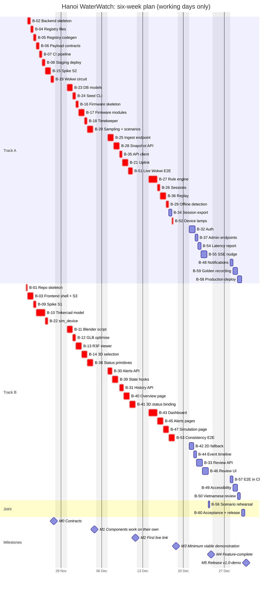

# 09: Team and timeline

← [08 Development roadmap](08-roadmap.md) · Next: [10 Testing, demonstration and deployment](10-testing-demo-deploy.md)

This document covers deliverables 10 and 11: how the work is divided between Ngân and Akai (responsibility matrix, integration boundaries, task ownership, Git branching, integration milestones) and the six-week timeline, with what to change if either person has less time. Issue numbers (`B-nn`) refer to [11](11-github-backlog.md); every table here is generated from the same backlog data as 08 and 11, so the three documents agree.

## 9.1 How the work is split

* **Nobody is assumed to own anything yet.** The work is first cut into two balanced tracks; people are matched to tracks at kickoff (§9.2).
* **The cut follows the data flow.** Track A carries data from the simulated device to the database and the snapshot API. Track B carries the snapshot to the screen and the 3D model. The three shared contracts between them (registry, `frame-batch.v1`, `station-state.v1`) are frozen at M0 and change only with both people's sign-off (§9.4).
* **Each track crosses layers on purpose.** Track B writes `sim_device.py` (a second, independent producer of the device payload, which tests the contract) and three backend read and review APIs. Track A writes the generated API client and the in-app notifications. Both people therefore touch firmware or backend code *and* frontend code.
* **Effort is balanced to within one person-day** over six weeks, and per week to within one day (§9.10).
* **Every change is read by the other person.** The integrator reviews and merges the other developer's pull requests; the other developer reads the integrator's commits on `main` (§9.6). By M5 each person has read every part of the code and either of them can run the demo or fix a fault in it.

## 9.2 The two tracks

| | Track A: "Device → Data" | Track B: "Model → Experience" |
|---|---|---|
| Issues (joint issues counted for both) | 34 | 28 |
| Effort to M5 (person-days) | 23.25 | 23 |
| of which MVD | 17 | 17.25 |
| Utilisation of 27 working days | 86 % | 85 % |

**Track A, "Device → Data":** shared contracts and CI, the Wokwi circuit and ESP32 firmware, the uplink, the database, ingest, the rule engine (anomaly detection), state and snapshot, replay, sign-in, staging and production deployment, the golden recording.

**Track B, "Model → Experience":** the Tinkercad model and Blender pipeline, the React Three Fiber viewer and 3D status binding, the 2D fallback, all five pages, `sim_device.py`, the history, alert and review APIs, cross-view consistency tests, the E2E suite in CI and accessibility.

**Proposed assignment: Ngân → Track A, Akai → Track B.** This proposal is arbitrary. Neither person is assumed to have a particular skill or an existing responsibility. At the kickoff each person says which track suits them; swap the tracks if that is better. Nothing in the plan depends on who holds which track: issues carry the labels `track:A` and `track:B`, not names, and the assignee is set when the issues are imported (§9.11).

If one person has never used a tool their track needs (for example Blender, C++ for the ESP32 or SQLAlchemy), keep the tracks as they are and pair for the first issue in that area (B-10/B-11, B-16/B-17 or B-23). Moving single issues between tracks breaks the hand-off plan in [08 §8.2](08-roadmap.md#82-dependency-hand-offs-between-the-two-tracks).

## 9.3 Responsibility matrix

The areas are the ones the project brief names. **Lead** does most of the work in the area and keeps its documentation current; the other person reviews every change in the area (§9.6). Effort is in person-days (pd); joint issues are counted for both people.

| Area | Lead | Also contributes | Track A issues | Track B issues | A (pd) | B (pd) |
|------|------|------------------|----------------|----------------|--------|--------|
| Repository, CI and shared contracts (`area:setup`) | **A** | B (Repo skeleton) | B-04, B-05, B-06, B-07 | B-01 | 2 | 0.25 |
| 3D model and viewer (`area:3d`) | **B** | A reviews every PR | — | B-09, B-10, B-11, B-12, B-13, B-14, B-41, B-42 | 0 | 7.25 |
| Wokwi simulation and device communication (`area:wokwi`) | **A** | B (sim_device) | B-15, B-16, B-17, B-18, B-19, B-20, B-21, B-52 | B-22 | 5.75 | 0.5 |
| Backend, database and APIs (`area:backend`) | **A** | B (Alerts API, History API, Review API) | B-02, B-23, B-24, B-25, B-26, B-28, B-32, B-34, B-36, B-37, B-55 | B-30, B-31, B-33 | 8.5 | 2.5 |
| Anomaly detection and alerts (`area:rules`) | **A** | B reviews every PR | B-27, B-29 | — | 2 | 0 |
| UI/UX and frontend (`area:frontend`) | **B** | A (API client, Notifications) | B-35, B-48 | B-03, B-38, B-39, B-40, B-43, B-44, B-45, B-46, B-47, B-49, B-50 | 1 | 10.25 |
| Integration and end-to-end testing (`area:testing`) | **B** | A (Live Wokwi E2E, Latency report, Scenario rehearsal, Acceptance + release) | B-51, B-54, B-56, B-60 | B-53, B-56, B-57, B-60 | 2 | 2.25 |
| Deployment and demo operations (`area:deploy`) | **A** | B reviews every PR | B-08, B-58, B-59 | — | 2 | 0 |
| **Total** | | | | | **23.25** | **23** |

Responsibilities that cut across areas:

| Responsibility | Track A | Track B |
|----------------|---------|---------|
| Shared contracts (registry, `frame-batch.v1`, `station-state.v1`) | Writes them (B-04 to B-06) | Signs off; writes the second payload producer `sim_device.py` (B-22) |
| Simulated-data labelling ([01 §1.5](01-mvp-and-stack.md#15-data-honesty-rules)) | Provenance columns and database CHECKs (B-23, B-25) | Banner, source and evidence badges, copy (B-03, B-38, B-45) |
| Rule thresholds and their "basis" text | Implements and tests them (B-27) | Shows the basis text; reviews the wording for unsupported claims |
| Secrets and device keys | Host secret store, key rotation (B-08, B-24, B-58) | Reviews; checks that the public Wokwi project holds only the demo key |
| Status colours, icons and text | — | Owns `status_visuals.json` usage (B-38, B-41) |
| Demo presentation | Drives Wokwi and, if needed, the replay fallback | Drives the browser and narrates |

## 9.4 Integration boundaries

Everything one track gives the other goes through one of these artefacts. Nothing else is shared: no copied constants, no hand-typed sensor values ([05 §5.12](05-synchronisation.md#512-banned-patterns-checked-in-review-and-ci)).

| Boundary | Artefact | Produced by | Used by | Frozen at | How it may change | Guarded by |
|----------|----------|-------------|---------|-----------|-------------------|------------|
| Sensor and station identity | `shared/registry/*.json` → generated `registry.h`, `registry.ts` | A (B-04, B-05) | Firmware, backend, frontend, Blender script | M0 | PR signed off by both; `make gen` | T-C-01, T-C-02 |
| 3D node names | Node names in `station-v1.glb` equal the registry `model.components[].node` values | B (B-11, B-12) | B-41, B-53 | M1 | Registry first, then the GLB | T-C-03 |
| Device payload | `frame-batch.v1` | A (B-06, B-21) and B (B-22) | Ingest (B-25) | M0 | New `v2` file, never an edit of `v1` | T-C-04 |
| Station snapshot | `station-state.v1` = E05 response | A (B-28) | B-39, B-40, B-41, B-43 | M0 (shape) | Fields may be added, never removed or renamed | T-B-13, T-C-04 |
| API types | `frontend/src/api/schema.d.ts` from OpenAPI | A (B-35) | Every hook in B-39 | Regenerated | `make gen`; CI fails when stale | T-C-06 |
| Device feedback | `station_status` in the ingest ack | A (B-25, B-28) | Firmware lamps (B-52) | M2 | Same rule as the snapshot | T-W-05 |
| Replay files | `shared/fixtures/replays/*.jsonl` | B (B-22 `--out`), A (B-34) | Replay service (B-36), E2E | M3 | Re-recorded, never edited by hand | T-B-14 |
| Test hook | `window.__hww3d` (only when `VITE_E2E=1`) | B (B-13) | Consistency E2E (B-53) | M1 | Members may be added, never renamed | T-E-03 |

21 dependencies cross from one track to the other. Each is listed with its planned date and slack in [08 §8.2](08-roadmap.md#82-dependency-hand-offs-between-the-two-tracks); the daily sync checks that list (§9.11).

## 9.5 Task ownership

Sorted by planned start. "Owner" is the track; "reviewer" is the other track, except for contract issues (both sign off) and joint issues. "When" gives the planned working days inside the week; the day-level plan is in §9.9.

| Issue | Task | Owner | Reviewer | Area | Week | When | Est. | Milestone | Tier |
|-------|------|-------|----------|------|------|------|------|-----------|------|
| [B-01](11-github-backlog.md#b-01-repository-skeleton-and-team-conventions) | Repository skeleton and team conventions | B | A | setup | W1 | Mon | 0.25 | M0 | mvd |
| [B-02](11-github-backlog.md#b-02-backend-skeleton-with-postgresql-in-docker-compose) | Backend skeleton with PostgreSQL in Docker Compose | A | B | backend | W1 | Mon | 0.5 | M0 | mvd |
| [B-03](11-github-backlog.md#b-03-frontend-skeleton-app-shell-and-spike-s3) | Frontend skeleton, app shell and spike S3 | B | A | frontend | W1 | Mon–Tue | 1 | M0 | mvd |
| [B-04](11-github-backlog.md#b-04-shared-registry-files-and-registry-schema) | Shared registry files and registry schema | A | both approve | setup | W1 | Mon–Tue | 0.5 | M0 | mvd |
| [B-05](11-github-backlog.md#b-05-registry-code-generation-and-consistency-check) | Registry code generation and consistency check | A | both approve | setup | W1 | Tue | 0.5 | M0 | mvd |
| [B-09](11-github-backlog.md#b-09-spike-s1-find-out-how-tinkercad-exports) | Spike S1: find out how Tinkercad exports | B | A | 3d | W1 | Tue | 0.5 | M0 | mvd |
| [B-06](11-github-backlog.md#b-06-payload-and-snapshot-contracts-with-fixtures) | Payload and snapshot contracts with fixtures | A | both approve | setup | W1 | Tue–Wed | 0.5 | M0 | mvd |
| [B-10](11-github-backlog.md#b-10-tinkercad-station-model) | Tinkercad station model | B | A | 3d | W1 | Tue–Thu | 1.5 | M1 | mvd |
| [B-07](11-github-backlog.md#b-07-ci-pipeline) | CI pipeline | A | B | setup | W1 | Wed | 0.5 | M0 | mvd |
| [B-08](11-github-backlog.md#b-08-choose-the-host-and-deploy-the-skeleton-to-staging) | Choose the host and deploy the skeleton to staging | A | B | deploy | W1 | Wed–Thu | 0.5 | M0 | mvd |
| [B-15](11-github-backlog.md#b-15-spike-s2-https-from-wokwi-through-the-public-gateway) | Spike S2: HTTPS from Wokwi through the public gateway | A | B | wokwi | W1 | Thu–Fri | 1 | M0 | mvd |
| [B-22](11-github-backlog.md#b-22-software-device-sim_devicepy) | Software device `sim_device.py` | B | A | wokwi | W1 | Thu | 0.5 | M0 | mvd |
| [B-19](11-github-backlog.md#b-19-wokwi-circuit-build) | Wokwi circuit build | A | B | wokwi | W1 | Fri | 0.5 | M0 | mvd |
| [B-11](11-github-backlog.md#b-11-blender-preparation-script) | Blender preparation script | B | A | 3d | W2 | Mon | 1 | M1 | mvd |
| [B-23](11-github-backlog.md#b-23-database-models-and-migration-0001) | Database models and migration 0001 | A | B | backend | W2 | Mon | 1 | M1 | mvd |
| [B-12](11-github-backlog.md#b-12-glb-optimisation-budgets-and-node-check) | GLB optimisation, budgets and node check | B | A | 3d | W2 | Tue | 0.5 | M1 | mvd |
| [B-24](11-github-backlog.md#b-24-registry-loader-seed-cli-and-rule-seeds) | Registry loader, seed CLI and rule seeds | A | B | backend | W2 | Tue | 0.5 | M1 | mvd |
| [B-13](11-github-backlog.md#b-13-react-three-fiber-viewer) | React Three Fiber viewer | B | A | 3d | W2 | Tue–Wed | 1 | M1 | mvd |
| [B-16](11-github-backlog.md#b-16-firmware-project-skeleton-and-wokwi-web-bundler) | Firmware project skeleton and Wokwi web bundler | A | B | wokwi | W2 | Tue | 0.5 | M1 | mvd |
| [B-17](11-github-backlog.md#b-17-pure-firmware-modules-with-native-tests) | Pure firmware modules with native tests | A | B | wokwi | W2 | Wed | 1 | M1 | mvd |
| [B-14](11-github-backlog.md#b-14-3d-selection-hover-and-sensor-list) | 3D selection, hover and sensor list | B | A | 3d | W2 | Wed–Thu | 1 | M1 | mvd |
| [B-18](11-github-backlog.md#b-18-timekeeper-and-boot-identity) | Timekeeper and boot identity | A | B | wokwi | W2 | Thu | 0.5 | M1 | mvd |
| [B-20](11-github-backlog.md#b-20-sampling-scenarios-and-local-display) | Sampling, scenarios and local display | A | B | wokwi | W2 | Thu–Fri | 1 | M1 | mvd |
| [B-38](11-github-backlog.md#b-38-status-primitives-formatting-and-evidence-helpers) | Status primitives, formatting and evidence helpers | B | A | frontend | W2 | Thu–Fri | 1 | M1 | mvd |
| [B-25](11-github-backlog.md#b-25-ingest-endpoint-with-device-authentication) | Ingest endpoint with device authentication | A | B | backend | W3 | Mon | 1 | M2 | mvd |
| [B-30](11-github-backlog.md#b-30-alerts-and-rules-read-api) | Alerts and rules read API | B | A | backend | W3 | Mon | 0.75 | M2 | mvd |
| [B-39](11-github-backlog.md#b-39-station-state-hooks-and-connection-indicator) | Station-state hooks and connection indicator | B | A | frontend | W3 | Mon–Tue | 1 | M2 | mvd |
| [B-28](11-github-backlog.md#b-28-state-service-event-bus-and-snapshot-api) | State service, event bus and snapshot API | A | B | backend | W3 | Tue | 1 | M2 | mvd |
| [B-31](11-github-backlog.md#b-31-history-timeline-and-link-apis) | History, timeline and link APIs | B | A | backend | W3 | Wed | 0.75 | M2 | mvd |
| [B-35](11-github-backlog.md#b-35-openapi-types-and-api-client) | OpenAPI types and API client | A | B | frontend | W3 | Wed | 0.5 | M2 | mvd |
| [B-21](11-github-backlog.md#b-21-uplink-task-batching-https-post-and-ack-handling) | Uplink task: batching, HTTPS POST and ack handling | A | B | wokwi | W3 | Wed–Thu | 1 | M2 | mvd |
| [B-40](11-github-backlog.md#b-40-page-1-monitoring-overview) | Page 1: Monitoring Overview | B | A | frontend | W3 | Wed–Thu | 1 | M2 | mvd |
| [B-51](11-github-backlog.md#b-51-live-wokwi--staging-end-to-end) | Live Wokwi → staging end to end | A | B | testing | W3 | Thu–Fri | 0.75 | M2 | mvd |
| [B-41](11-github-backlog.md#b-41-3d-status-binding-and-sensor-detail-panel) | 3D status binding and sensor detail panel | B | A | 3d | W3 | Thu–Fri | 1 | M2 | mvd |
| [B-27](11-github-backlog.md#b-27-rule-engine-six-rules-alert-opening-and-clearing) | Rule engine, six rules, alert opening and clearing | A | B | rules | W4 | Mon–Tue | 1.5 | M3 | mvd |
| [B-43](11-github-backlog.md#b-43-page-3-dashboard-cards-and-history-charts) | Page 3: dashboard cards and history charts | B | A | frontend | W4 | Mon–Tue | 1.5 | M3 | mvd |
| [B-26](11-github-backlog.md#b-26-simulation-sessions-and-station-takeover) | Simulation sessions and station takeover | A | B | backend | W4 | Tue | 0.5 | M3 | mvd |
| [B-45](11-github-backlog.md#b-45-page-4-alert-list-and-alert-detail-read-only) | Page 4: alert list and alert detail (read only) | B | A | frontend | W4 | Tue–Wed | 1 | M3 | mvd |
| [B-36](11-github-backlog.md#b-36-replay-service-and-replay-api) | Replay service and replay API | A | B | backend | W4 | Wed | 1 | M3 | mvd |
| [B-47](11-github-backlog.md#b-47-page-5-simulation-demonstration) | Page 5: Simulation Demonstration | B | A | frontend | W4 | Wed–Thu | 1 | M3 | mvd |
| [B-29](11-github-backlog.md#b-29-freshness-monitor-and-offline-detection) | Freshness monitor and offline detection | A | B | rules | W4 | Thu | 0.5 | M3 | mvd |
| [B-34](11-github-backlog.md#b-34-sessions-api-and-session-export) | Sessions API and session export | A | B | backend | W4 | Thu | 0.5 | M3 | core |
| [B-53](11-github-backlog.md#b-53-cross-view-consistency-e2e) | Cross-view consistency E2E | B | A | testing | W4 | Thu–Fri | 1 | M3 | mvd |
| [B-52](11-github-backlog.md#b-52-device-lamps-mirror-the-server-status) | Device lamps mirror the server status | A | B | wokwi | W4 | Fri | 0.25 | M3 | mvd |
| [B-32](11-github-backlog.md#b-32-sign-in-sessions-and-role-checks) | Sign-in, sessions and role checks | A | B | backend | W5 | Mon | 1 | M4 | core |
| [B-42](11-github-backlog.md#b-42-2d-schematic-fallback) | 2D schematic fallback | B | A | 3d | W5 | Mon | 0.75 | M4 | core |
| [B-44](11-github-backlog.md#b-44-event-timeline-and-availability) | Event timeline and availability | B | A | frontend | W5 | Mon–Tue | 0.5 | M4 | core |
| [B-37](11-github-backlog.md#b-37-admin-endpoints-and-data-maintenance) | Admin endpoints and data maintenance | A | B | backend | W5 | Tue | 0.5 | M4 | core |
| [B-33](11-github-backlog.md#b-33-alert-actions-and-incident-review-api) | Alert actions and incident review API | B | A | backend | W5 | Tue–Wed | 1 | M4 | core |
| [B-54](11-github-backlog.md#b-54-latency-measurement-and-report) | Latency measurement and report | A | B | testing | W5 | Tue | 0.5 | M4 | core |
| [B-55](11-github-backlog.md#b-55-sse-nudge) | SSE nudge | A | B | backend | W5 | Wed | 1 | M4 | plus |
| [B-46](11-github-backlog.md#b-46-sign-in-role-gates-and-review-ui) | Sign-in, role gates and review UI | B | A | frontend | W5 | Wed–Thu | 1 | M4 | core |
| [B-56](11-github-backlog.md#b-56-scenario-rehearsal-on-staging-sc1sc7) | Scenario rehearsal on staging (SC1–SC7) | A + B | joint | testing | W5 | Thu | 0.25 | M4 | core |
| [B-48](11-github-backlog.md#b-48-in-app-notifications) | In-app notifications | A | B | frontend | W6 | Mon | 0.5 | M5 | core |
| [B-57](11-github-backlog.md#b-57-e2e-suite-in-ci) | E2E suite in CI | B | A | testing | W6 | Mon | 0.5 | M5 | core |
| [B-49](11-github-backlog.md#b-49-accessibility-pass) | Accessibility pass | B | A | frontend | W6 | Mon–Tue | 0.75 | M5 | core |
| [B-59](11-github-backlog.md#b-59-golden-recording-and-demo-runbook) | Golden recording and demo runbook | A | B | deploy | W6 | Mon–Tue | 0.75 | M5 | core |
| [B-50](11-github-backlog.md#b-50-vietnamese-copy-and-native-speaker-review) | Vietnamese copy and native-speaker review | B | A | frontend | W6 | Tue | 0.5 | M5 | plus |
| [B-58](11-github-backlog.md#b-58-production-deployment-and-operations) | Production deployment and operations | A | B | deploy | W6 | Tue | 0.75 | M5 | core |
| [B-60](11-github-backlog.md#b-60-final-acceptance-run-and-release) | Final acceptance run and release | A + B | joint | testing | W6 | Wed | 0.5 | M5 | core |
| [B-61](11-github-backlog.md#b-61-exploded-view-and-labels-toggle) | Exploded view and labels toggle | B | A | 3d | after M4 | — | 0.75 | — | stretch |
| [B-62](11-github-backlog.md#b-62-wokwi-custom-chip-hww-probe) | Wokwi custom chip `hww-probe` | A | B | wokwi | after M4 | — | 1.5 | — | stretch |
| [B-63](11-github-backlog.md#b-63-wokwi-ci-scenario-tests) | Wokwi CI scenario tests | A | B | testing | after M4 | — | 1 | — | stretch |

## 9.6 Git branching and review plan

This plan follows the team's GitHub workflow, which B-01 commits as `CONTRIBUTING.md`. One **integrator** works directly on `main`. Everyone else works on their own branch and opens a pull request (PR) to `main`; the integrator reviews, tests and merges it. With two people, "everyone else" is the other developer. Two people and six weeks need no release branches and no `develop` branch.

**Who is the integrator.** Chosen at the kickoff (§9.8), like the tracks, and for the same reason nothing in the plan depends on who it is. The integrator still works on their own track; the role adds repository admin rights, the merges and the tags. If the integrator is away for more than a day, they can let the other developer merge their own PRs for that time (the team workflow allows this when the integrator says so).

| Rule | Detail |
|------|--------|
| `main` | Always deployable. Only the integrator pushes to it directly. Nobody runs `git push --force` on `main` or rewrites its history |
| Branch protection | Optional. If GitHub offers protected branches for the repository (this depends on the plan and on whether the repository is public), protect `main` with "require a pull request" and the CI status checks, and leave "Do not allow bypassing the above settings" off. GitHub then lets people with admin rights, that is the integrator, push directly, while everyone else can change `main` only through a PR. Without protection the rule holds by team agreement |
| Branches | Created from an up-to-date `main`. The team workflow allows one personal branch, `feature/<name>`; this plan recommends one branch per issue, `feature/<issue>-<slug>`, for example `feature/B-41-3d-status-binding`, so each PR closes exactly one issue |
| Daily update | Before starting work and before opening a PR: `git switch <branch>`, `git pull`, `git fetch origin`, `git merge origin/main`. Resolve any conflict, run the tests, then continue. The plan uses merge, not rebase, so a branch that is already on GitHub never needs a force-push |
| PR | Base `main`. Title `B-41: 3D status binding`; the body says what changed and how it was tested, contains `Closes #<number>` and the Definition of Done checklist ([11 §11.4](11-github-backlog.md#114-definition-of-done)); under about 400 changed lines, not counting generated files. If the reviewer asks for changes, push more commits to the same branch and the PR updates. The author does not merge their own PR unless the integrator has said so |
| Review and merge | The integrator reviews the PR, runs it locally when the change is visible in the app, and merges it once CI is green, on the same working day (target: within 4 hours). Squash merge, so each issue becomes one commit on `main` |
| Integrator's own work | Committed directly to `main` in small commits. Before each push: `make lint` and `make test`. The subject starts with the issue ID; the last commit of an issue has `Closes #<number>` in its body, and GitHub closes the issue when that commit reaches `main`. CI also runs on every push to `main`, and a red `main` is fixed before anything else. The other developer reads the integrator's commits for each closed issue within one working day and records findings as a commit comment or a new issue |
| Contract changes | Label `contract`. The one exception for the integrator: a change under `shared/` always goes through a PR, even from the integrator, and both developers write "contract OK" in it before it is merged. `.github/CODEOWNERS` lists both developers for `shared/`, so GitHub asks the other one for a review automatically |
| Ignored and generated files | `.env`, build output, `node_modules`, Blender autosaves and other local files are in `.gitignore` and are never committed; gitleaks in CI catches secrets. Four generated files are committed on purpose and are therefore not ignored (`registry.h`, `registry.ts`, `schema.d.ts`, `station-v1.glb`); CI fails when they are stale |
| Environments | Local: `make dev`. Staging: `deploy.yml` run by hand from `main` (B-08). Production: a `v*` tag pushed by the integrator (B-58) |
| Milestone tags | The integrator pushes lightweight tags `m0` … `m4` on the milestone day, so a milestone state can be checked out again |
| Release | `v1.0-demo` at M5. After that, code freeze: only fixes from the acceptance run, as a PR from a `feature/fix-<slug>` branch or a commit by the integrator, released as `v1.0.1-demo` |
| Commits | Imperative subject with the issue ID, for example `B-25: reject frames from disabled devices`. Before `git add`, check `git status`, and stage only the files you meant to change |

## 9.7 Integration milestones

Each milestone ends with a 30-minute integration check on the milestone day. Both people run the check together, record failures as issues and move them to the top of the next week.

| Milestone | Date | What is integrated | The check | Evidence |
|-----------|------|--------------------|-----------|----------|
| M0 | Fri 27 Nov | Registry and schemas frozen; backend, frontend and firmware skeletons; CI; staging URL; spikes S1–S3 | Fresh clone → `make dev` on both laptops; staging health returns 200; S2 has a 10-minute Wokwi run | CI run, `hosting.md`, `spike-s2.md`, `spike-s3.md`, ADR-0001, ADR-0003 |
| M1 | Fri 4 Dec | Each component works on its own: GLB in the viewer with selection; firmware shows SC1–SC4 on the OLED; database migrated and seeded; status primitives | Each owner demonstrates their component; the other person checks it against the issue's "done when" list | Merged PRs, screenshots |
| M2 | Fri 11 Dec | First live link: Wokwi → staging → snapshot → Overview and Model pages | Move a slider in Wokwi; Overview and Model show the same `version` and the new value | `e2e-live.md` |
| M3 | Fri 18 Dec | **MVD**: rules, offline detection, replay, Dashboard, Alerts (read only), Simulation page, consistency E2E | The seven MVD steps in [08 §8.11](08-roadmap.md#811-minimum-viable-demonstration-milestone-m3-fri-18-dec) end to end, once live and once on replay | Recorded run, `consistency.spec.ts` green |
| M4 | Thu 24 Dec | Feature-complete: sign-in, reviews, 2D fallback, latency report, SC1–SC7 rehearsal | Joint rehearsal B-56 | `wokwi-scenarios.md`, `latency.md` |
| M5 | Wed 30 Dec | `v1.0-demo` on production | Acceptance run B-60 (AC-01 to AC-14) | `acceptance.md`, tag |

## 9.8 Six-week timeline

**Assumptions.** Week 1 starts Monday 23 November 2026. The brief gives no presentation date; this plan assumes the demonstration is in the first week of January 2027, so Thursday 31 December is a buffer day. Friday 25 December and Friday 1 January are treated as days off. If the real date differs, shift the whole plan by whole weeks; if there are fewer than six weeks, use §9.10.

**Kickoff (1 hour, before week 1).** Confirm or swap the tracks; choose the integrator and give them admin rights on the repository (§9.6); check that both people have GitHub, Wokwi and Tinkercad accounts and access to the chosen host; run the import script in [11 §11.7](11-github-backlog.md#117-import-script) and assign each issue to its track's owner; agree the daily sync time; read [01](01-mvp-and-stack.md) and [05](05-synchronisation.md) together.

Red bars are MVD issues.

## 9.9 Week-by-week plan

Each cell shows the issues a person works on that day (half-day issues share a day). *Spare* is unplanned time: it is the buffer for that week's riskiest task. In week 1, Track B's spare time absorbs an overrun in spike S1 or the Tinkercad model; if there is none, Track B starts B-38 early.

### Week 1: Mon 23 Nov – Fri 27 Nov. Contracts, skeletons and spikes

| Day | Track A | Track B |
|-----|---------|---------|
| Mon 23 Nov | B-02 Backend skeleton, B-04 Registry files | B-01 Repo skeleton, B-03 Frontend shell + S3 |
| Tue 24 Nov | B-04 Registry files, B-05 Registry codegen, B-06 Payload contracts | B-03 Frontend shell + S3, B-09 Spike S1, B-10 Tinkercad model |
| Wed 25 Nov | B-06 Payload contracts, B-07 CI pipeline, B-08 Staging deploy | B-10 Tinkercad model |
| Thu 26 Nov | B-08 Staging deploy, B-15 Spike S2 | B-10 Tinkercad model, B-22 sim_device |
| Fri 27 Nov **M0** | B-15 Spike S2, B-19 Wokwi circuit | *spare* |

Load: Track A 4.5 of 5 days, Track B 3.75 of 5 days. Cross-track waits: B-02 starts when B-01 (B) is merged. Milestone: **M0** Contracts, skeletons, CI, staging, spikes (Fri 27 Nov).

### Week 2: Mon 30 Nov – Fri 4 Dec. Asset pipeline, firmware core and database

| Day | Track A | Track B |
|-----|---------|---------|
| Mon 30 Nov | B-23 DB models | B-11 Blender script |
| Tue 1 Dec | B-24 Seed CLI, B-16 Firmware skeleton | B-12 GLB optimise, B-13 R3F viewer |
| Wed 2 Dec | B-17 Firmware modules | B-13 R3F viewer, B-14 3D selection |
| Thu 3 Dec | B-18 Timekeeper, B-20 Sampling + scenarios | B-14 3D selection, B-38 Status primitives |
| Fri 4 Dec **M1** | B-20 Sampling + scenarios | B-38 Status primitives |

Load: Track A 4.5 of 5 days, Track B 4.5 of 5 days. Milestone: **M1** Components work on their own (Fri 4 Dec).

### Week 3: Mon 7 Dec – Fri 11 Dec. First live link: ingest, snapshot and the first pages

| Day | Track A | Track B |
|-----|---------|---------|
| Mon 7 Dec | B-25 Ingest endpoint | B-30 Alerts API, B-39 State hooks |
| Tue 8 Dec | B-28 Snapshot API | B-39 State hooks |
| Wed 9 Dec | B-35 API client, B-21 Uplink | B-31 History API, B-40 Overview page |
| Thu 10 Dec | B-21 Uplink, B-51 Live Wokwi E2E | B-40 Overview page, B-41 3D status binding |
| Fri 11 Dec **M2** | B-51 Live Wokwi E2E | B-41 3D status binding |

Load: Track A 4.25 of 5 days, Track B 4.5 of 5 days. Cross-track waits: B-31 starts when B-28 (A) is merged. Soft dependency: B-39 built against the `station-state.v1` fixture from B-06 with a mocked fetch; merges after B-35. Milestone: **M2** First live link (Fri 11 Dec).

### Week 4: Mon 14 Dec – Fri 18 Dec. Rules, replay and the MVD

| Day | Track A | Track B |
|-----|---------|---------|
| Mon 14 Dec | B-27 Rule engine | B-43 Dashboard |
| Tue 15 Dec | B-27 Rule engine, B-26 Sessions | B-43 Dashboard, B-45 Alerts pages |
| Wed 16 Dec | B-36 Replay | B-45 Alerts pages, B-47 Simulation page |
| Thu 17 Dec | B-29 Offline detection, B-34 Session export | B-47 Simulation page, B-53 Consistency E2E |
| Fri 18 Dec **M3** | B-52 Device lamps | B-53 Consistency E2E |

Load: Track A 4.25 of 5 days, Track B 4.5 of 5 days. Milestone: **M3** Minimum viable demonstration (Fri 18 Dec).

### Week 5: Mon 21 Dec – Thu 24 Dec. Sign-in, reviews, fallback and rehearsal

| Day | Track A | Track B |
|-----|---------|---------|
| Mon 21 Dec | B-32 Auth | B-42 2D fallback, B-44 Event timeline |
| Tue 22 Dec | B-37 Admin endpoints, B-54 Latency report | B-44 Event timeline, B-33 Review API |
| Wed 23 Dec | B-55 SSE nudge | B-33 Review API, B-46 Review UI |
| Thu 24 Dec **M4** | B-56 Scenario rehearsal (joint) | B-46 Review UI, B-56 Scenario rehearsal (joint) |

Load: Track A 3.25 of 4 days, Track B 3.5 of 4 days. Milestone: **M4** Feature-complete (Thu 24 Dec).

### Week 6: Mon 28 Dec – Thu 31 Dec. E2E in CI, production and release

| Day | Track A | Track B |
|-----|---------|---------|
| Mon 28 Dec | B-48 Notifications, B-59 Golden recording | B-57 E2E in CI, B-49 Accessibility |
| Tue 29 Dec | B-59 Golden recording, B-58 Production deploy | B-49 Accessibility, B-50 Vietnamese review |
| Wed 30 Dec **M5** | B-60 Acceptance + release (joint) | B-60 Acceptance + release (joint) |
| Thu 31 Dec | *buffer* | *buffer* |

Load: Track A 2.5 of 3 days, Track B 2.25 of 3 days. Milestone: **M5** Release v1.0-demo (Wed 30 Dec).

## 9.10 Capacity and availability

**Assumptions.** One person-day is about 6 focused hours. Reviews, the daily sync and the Friday check come out of the rest of the day. Estimates include writing the tests listed in each issue and fixing review comments. 27 working days per person remain until M5 (Mon 23 Nov to Wed 30 Dec, without 25 December).

| Week | Working days | Track A load | Track B load | Track A use | Track B use |
|------|--------------|--------------|--------------|-------------|-------------|
| W1 | 5 | 4.5 | 3.75 | 90 % | 75 % |
| W2 | 5 | 4.5 | 4.5 | 90 % | 90 % |
| W3 | 5 | 4.25 | 4.5 | 85 % | 90 % |
| W4 | 5 | 4.25 | 4.5 | 85 % | 90 % |
| W5 | 4 | 3.25 | 3.5 | 81 % | 88 % |
| W6 | 3 (+1 buffer) | 2.5 | 2.25 | 83 % | 75 % |
| **Total** | **27** | **23.25** | **23** | **86 %** | **85 %** |

**If either person has less time.** At the kickoff each person states how many days a week they can give. The table below re-plans the same dependency graph at lower availability. Rows other than the first come from a simpler model that ignores week boundaries, so their dates are the earliest possible; read them as "not before". The cut levels are those in [08 §8.12](08-roadmap.md#812-what-to-cut-if-time-runs-short) (cuts 1–3 save 2 person-days on Track A and 1.5 on Track B).

| Availability (each) | Capacity to M5 (each) | Scope | Planned effort A / B | MVD done | All planned work done | Verdict |
|---------------------|-----------------------|-------|----------------------|----------|-----------------------|---------|
| 5 days a week | 27 | Full plan | 23.25 / 23 | Fri 18 Dec | Wed 30 Dec | Fits as planned (the day-level plan in §9.9) |
| 4 days a week | 21.6 | Full plan | 23.25 / 23 | Thu 24 Dec or later | Wed 6 Jan or later | Does not fit: move the demo to Wed 6 Jan or later, or cut more |
| 4 days a week | 21.6 | Cuts 1–3 | 21.25 / 21.5 | Thu 24 Dec or later | Tue 5 Jan or later | Does not fit: move the demo to Tue 5 Jan or later, or cut more |
| 3 days a week | 16.2 | Cuts 1–3 | 21.25 / 21.5 | Wed 6 Jan or later | Tue 19 Jan or later | Does not fit: move the demo to Tue 19 Jan or later, or cut more |
| 3 days a week | 16.2 | MVD only | 17 / 17.25 | Wed 6 Jan or later | Wed 6 Jan or later | Does not fit: move the demo to Wed 6 Jan or later, or cut more |

What this means:

* **Full time (5 days a week):** the plan fits with about 14 % slack per person, but M3 itself has no slack (the MVD is finished on the M3 day).
* **4 days a week:** even with cuts 1–3 the work ends after 30 December, because waits between the tracks grow when both people are slower. Either move the demonstration back by at least one week, or cut further (B-42 2D fallback and B-57 E2E in CI are the next candidates; cutting them gives up AC-10 and the Phase 7 exit criterion of five green E2E runs in a row in [08 §8.10](08-roadmap.md#810-phase-7-testing-and-deployment), so agree this with the supervisor).
* **3 days a week:** the MVD alone is about 17 person-days per person and is not finished before Wednesday 6 January. The date must move, or the scope must change (for example, a single live station without replay is *not* an acceptable cut, because the replay is the fallback for the demo itself).

**Weekly re-planning rule.** At every Friday check, compare merged issues with the plan. If a track is more than one day behind, apply the next cut level. If one track is ahead, it may take over an issue from the other track only if that issue has no `contract` label and no dependency the other track is still writing.

## 9.11 Working rhythm

| When | What | Length |
|------|------|--------|
| Kickoff | Tracks, integrator, accounts, issue import and assignment, sync time (§9.8) | 1 h |
| Every working day | Sync: what was merged, which PRs wait for review, what is next, what is blocked; check today's rows in the hand-off table ([08 §8.2](08-roadmap.md#82-dependency-hand-offs-between-the-two-tracks)). Written in chat on days without a call | 10 min |
| Wed 25 Nov (after B-06) | Contract review: registry, `frame-batch.v1`, `station-state.v1` before they freeze | 45 min |
| Every Friday (Thursday in week 5, Wednesday in week 6) | Milestone check (§9.7) and the re-planning rule (§9.10) | 30 min |
| Thu 10 Dec | Pair session: first live Wokwi → staging link (B-51) | 1–2 h |
| Thu 24 Dec | Joint scenario rehearsal (B-56) | 2 h |
| Wed 30 Dec | Joint acceptance run and release (B-60) | 4 h |

The GitHub issues are the only task list. A GitHub Projects board with the columns *Todo*, *In progress*, *In review* and *Done* shows the state; the milestone pages show progress against the dates. Decisions that change the architecture are written as ADRs in `docs/adr/`.
