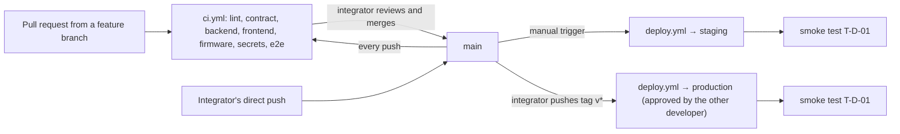

# 10: Testing, demonstration and deployment

← [09 Team and timeline](09-team-and-timeline.md) · Next: [11 GitHub backlog](11-github-backlog.md)

This document covers deliverable 12: how the system is tested, the acceptance criteria the demonstration must meet, a step-by-step demonstration runbook, the deployment plan, the replay fallback, and what to switch off afterwards. Every test ID (`T-…`) and acceptance criterion (`AC-…`) used in documents 01 to 11 is defined here. `B-nn` names an issue in [11](11-github-backlog.md).

## 10.1 Test strategy

**Principles**

1. **Nothing in CI depends on Wokwi.** CI runs topology T-B from [02 §2.5](02-architecture.md#25-runtime-topologies): `tools/sim_device.py` plays the device against a local API and PostgreSQL. Wokwi is tested by hand with the T-W-06 checklist (B-20, B-21, B-51, B-56). Automated Wokwi tests (B-63) are stretch work and need a paid plan.
2. **The device contract is tested from both sides.** The firmware and `sim_device.py` are written by different developers, and both must produce batches that validate against `shared/schemas/frame-batch.v1.schema.json` (T-C-04, T-W-04).
3. **Tests wait for the snapshot `version`, never for a fixed time.** An E2E test that needs "the alert is open" polls E05 until the version that contains it, with a timeout. This is the main defence against flaky tests.
4. **Expected values come from the same sources as the code.** Thresholds come from the rule seeds, decimals and ranges from the registry, and inputs from `shared/fixtures/`. A changed threshold is changed in one place, and the tests follow it.
5. **Honesty is tested like any other feature.** The banner, the `is_simulated` flag, source badges and "Preliminary" labels have their own tests (T-E-09, T-B-03, T-B-15), so a refactor cannot remove them silently.

**Test levels**

"Every PR" in the last column means every pull request *and* every push to `main`: the integrator commits to `main` directly, so CI runs on both ([09 §9.6](09-team-and-timeline.md#96-git-branching-and-review-plan)).

| Level | What it proves | Tools | Where | When it runs |
|-------|----------------|-------|-------|--------------|
| Contract (T-C) | Registry, schemas, fixtures, GLB node names and generated files agree | pytest + `jsonschema`, `tools/check_registry.py`, `tools/check_literals.py`, `frontend/scripts/check-glb-nodes.mjs` | `backend/tests/contract/`, `tools/tests/`, `tools/` | Every PR |
| Firmware unit (T-W-01 to T-W-05) | Pure firmware modules, compiled for the PC | PlatformIO `pio test -e native` (Unity) | `firmware/test/` | Every PR |
| Firmware manual (T-W-06) | Scenarios SC1 to SC7 on the real Wokwi simulation | Checklist with screenshots | `docs/reports/wokwi-scenarios.md` | B-20, B-21, B-56, B-60 |
| Backend unit | Rule maths: baselines, persistence counts, clear conditions | pytest | `backend/tests/unit/` | Every PR |
| Backend integration (T-B) | API, database and rules together, in real transactions | pytest + `httpx.AsyncClient` + PostgreSQL 16 service container | `backend/tests/integration/` | Every PR |
| Security (T-S) | Cookies, CSRF header, roles, key rotation, no secrets in the repository | pytest, gitleaks | `backend/tests/integration/`, `.gitleaks.toml` | Every PR |
| Frontend unit and component (T-F) | Hooks, formatters, status visuals, 3D binding, 2D fallback, locales | Vitest + React Testing Library; `@react-three/test-renderer` for the 3D scene graph | `frontend/src/**/*.test.ts(x)` | Every PR |
| End-to-end (T-E) | User journeys J1 to J6 ([06 §6.7](06-ui-ux.md#67-user-flows-deliverable-8)) on the production build | Playwright (Chromium, headless) + `sim_device.py` | `frontend/e2e/` | Every PR, from B-57 |
| Accessibility (T-A) | WCAG 2.2 AA | `@axe-core/playwright`, keyboard-only run, NVDA | `frontend/e2e/a11y.spec.ts`, `docs/reports/accessibility.md` | axe on every PR; manual checks in W6 |
| Deployment (T-D) | The container boots, migrates, serves and rolls back | `deploy.yml` smoke step, timed rollback drill | `.github/workflows/deploy.yml` | Every deployment; drill once in W6 |
| Acceptance (AC) | The claims made in the demonstration | Mix of the above plus measurements | `docs/reports/acceptance.md` | B-60, then before the presentation |

**CI jobs** (`.github/workflows/ci.yml`, B-07; the whole workflow should finish in under 10 minutes)

| Job | Steps | Added by |
|-----|-------|----------|
| `lint` | ruff, mypy, eslint, `tsc --noEmit` | B-07 |
| `contract` | `check_registry.py`, `check_literals.py`, `check-glb-nodes.mjs`, `make gen` followed by `git diff --exit-code` (stale `schema.d.ts`), pytest `backend/tests/contract` | B-05, B-07, B-12, B-35 |
| `backend` | pytest `unit` and `integration` against a PostgreSQL 16 service container | B-07, B-23 |
| `frontend` | Vitest | B-07 |
| `firmware` | `pio test -e native`, `pio run -e esp32` | B-17 |
| `secrets` | gitleaks on the diff and the full history | B-07 |
| `e2e` | Start PostgreSQL, run migrations and `seed`, start the API serving a frontend built with `VITE_E2E=1`, start `sim_device.py`, run every Playwright spec | B-57 |

**Test data.** Payload and snapshot examples (valid and invalid) live in `shared/fixtures/`, replay recordings in `shared/fixtures/replays/`. The CI device key and the demo-user passwords are generated at job start and never stored. No test uses a staging or production secret.

**Flaky-test rule.** A test that fails and then passes on retry is flaky. It gets an issue the same day and is fixed or quarantined (skipped with the issue number) within 48 hours. A quarantined test does not count towards the "five green runs in a row" exit check for M5.

## 10.2 Test catalogue

IDs are stable. A new test takes the next free number in its group; a removed test is marked "retired" here and its number is not reused. "Issues" names the issues whose work the test proves. Contract, unit, integration and security tests are written in the first issue listed and extended by the others. The end-to-end specs are written in B-53 and B-57 (see the note under T-E).

### Contract (T-C)

| ID | Test | File | Issues |
|----|------|------|--------|
| T-C-01 | Every registry file validates against `shared/schemas/registry.schema.json`; station, sensor and device IDs are unique; every station has the 4 sensors | `backend/tests/contract/test_registry.py` | B-04, B-05 |
| T-C-02 | Cross-file consistency: GPIO pins in the registry match the connections in `firmware/diagram.json`; generated `registry.h` and `registry.ts` are up to date | `tools/check_registry.py` | B-05, B-19 |
| T-C-03 | Every registry `model.components[].node` exists in the committed `station-v1.glb` | `frontend/scripts/check-glb-nodes.mjs` | B-11, B-12 |
| T-C-04 | Every payload fixture and the output of `sim_device.py` for every scenario validates against `frame-batch.v1`; snapshot fixtures validate against `station-state.v1` | `backend/tests/contract/test_fixtures.py`, `tools/tests/test_sim_device.py` | B-06, B-22 |
| T-C-05 | No hand-typed thresholds, status colours, station IDs, GPIO pins or sensor values outside the files allowed to hold them ([05 §5.12](05-synchronisation.md#512-banned-patterns-checked-in-review-and-ci)) | `tools/check_literals.py` | B-07 |
| T-C-06 | `frontend/src/api/schema.d.ts` matches the API's `/api/v1/openapi.json` | CI step in job `contract` | B-35 |

### Firmware (T-W)

| ID | Test | File | Issues |
|----|------|------|--------|
| T-W-01 | Raw ADC value → engineering units for each channel, including raw 555 → 18.4 NTU and 1546 → 142.5 NTU ([04 §4.4](04-wokwi-integration.md#44-transfer-functions-raw--engineering-units)) | `firmware/test/test_transfer/test_main.cpp` | B-17 |
| T-W-02 | Ring buffer keeps 600 frames, drops the oldest when full, counts `dropped_frames`, flushes oldest-first in batches of 20 | `firmware/test/test_frame_buffer/test_main.cpp` | B-17 |
| T-W-03 | Backoff 1, 2, 4, 8, 16, 30 s (± 20 %) and reset after a success | `firmware/test/test_backoff/test_main.cpp` | B-17 |
| T-W-04 | Serialised batches carry `boot_id`, `seq` and `time_source` and validate against the `frame-batch.v1` fixture; per-seq acks (`stored`, `duplicate`) free buffer slots; 401, 403, 409, 413, 422, 429 and 503 lead to the actions in [04 §4.8](04-wokwi-integration.md#48-payload-contract-hwwframesv1) | `firmware/test/test_uplink/test_main.cpp` | B-18, B-21 |
| T-W-05 | The OLED shows each value with the registry's decimals; the LEDs and beacon follow the ack's `station_status` ([04 §4.5.4](04-wokwi-integration.md#454-local-indicators-mirror-the-server)); the firmware holds no alert thresholds (`check_literals.py` over `firmware/src`) | `firmware/test/test_display/test_main.cpp` | B-52 |
| T-W-06 | Manual checklist: SC1 to SC7 on Wokwi against staging, with expected and observed results and a screenshot each | `docs/reports/wokwi-scenarios.md` | B-20, B-21, B-56 |

### Backend (T-B)

All files are under `backend/tests/`.

| ID | Test | File | Issues |
|----|------|------|--------|
| T-B-01 | `alembic upgrade head` succeeds on an empty database; migrations are forward-only | `integration/test_migrations.py` | B-23 |
| T-B-02 | E01 reports `db: ok` (and `db: down` when the database is stopped); E02 returns `server_time` and the Wokwi link; `cli seed` is idempotent and keeps admin edits to rules | `integration/test_health_meta.py`, `integration/test_seed.py` | B-02, B-24 |
| T-B-03 | Provenance: every stored measurement has a `source` (`simulated_wokwi`, `simulated_replay`, `simulated_script`) and every reading in every API response has `is_simulated: true` | `integration/test_ingest_api.py` | B-25 |
| T-B-04 | Ingest errors: 401 `invalid_device_key`, 403 `station_mismatch` and `device_disabled`, 409 `station_busy`, 413, 422 `schema_invalid`, 429 with `Retry-After`, 503 `ingest_disabled`; a re-sent batch is acknowledged as `duplicate` and stores nothing | `integration/test_ingest_api.py` | B-25 |
| T-B-05 | G1: an error injected half-way through a batch leaves no frames, measurements, alerts or version change | `integration/test_state_api.py` | B-28 |
| T-B-06 | Validity: `q = fault` or a value outside the physical range sets `sensor_fault` and opens `VALID_RANGE`; two valid readings clear it | `unit/test_rules_validity.py` | B-27 |
| T-B-07 | SC2: `REF_PH_BAND` opens a critical, preliminary alert after 3 frames below the band; the sensor returns to `normal` after 3 in-band frames; the alert stays open with `cleared_at` set | `unit/test_rules_ph.py` | B-27 |
| T-B-08 | SC3: turbidity baseline after the warm-up; threshold max(3 × baseline, baseline + 50); `CHG_TURB_SPIKE` after 2 frames | `unit/test_rules_turbidity.py` | B-27 |
| T-B-09 | SC3c: `CHG_DO_DROP` after 3 frames when DO ≤ 3.2 mg/L and the drop from baseline is ≥ 2.0 mg/L | `unit/test_rules_do.py` | B-27 |
| T-B-10 | A faulty channel runs no water-quality rule; an active rule stays active but the sensor shows `sensor_fault` | `unit/test_rules_fault.py` | B-27 |
| T-B-11 | Offline is decided by server `received_at`, not device clocks; back-filled frames are stored as `buffered`, without duplicates; `sensor_state` never moves backwards (G8); alerts raised from back-filled data have `detected_late = true` | `integration/test_offline.py` | B-29 |
| T-B-12 | A new `boot_id` starts a new session; a session ends after 60 s without frames; a second producer gets 409 `station_busy` | `integration/test_sessions.py` | B-26 |
| T-B-13 | G2: snapshots read while batches are being ingested are never torn (`station_state` and `sensor_state` from one transaction) | `integration/test_state_api.py` | B-28 |
| T-B-14 | A replay opens the same alerts, in the same order, at speed 1 and speed 5; takeover blocks the live device and releases the station at the end | `integration/test_replay.py` | B-34, B-36 |
| T-B-15 | Database honesty constraints: `source` and review outcome `CHECK` constraints reject values outside the allowed lists (no "verified incident"); alert events are append-only | `integration/test_migrations.py` | B-23 |
| T-B-16 | Alert lifecycle open → acknowledged → under review → closed; illegal transitions return 409; `cleared_at` is set when the condition ends | `integration/test_alerts_api.py` | B-27, B-30 |
| T-B-17 | History buckets: bucket sizes per range, gaps longer than 3 intervals returned as gaps, back-filled data visible after back-fill | `integration/test_history_api.py` | B-31 |
| T-B-18 | Review: allowed outcomes only, alerts closed on submit, every step in the alert history with user and time | `integration/test_reviews.py` | B-33 |
| T-B-19 | SSE: events are sent only after commit and carry no measurement values; heartbeat every 15 s | `integration/test_stream.py` | B-55 |

### Security (T-S)

| ID | Test | File | Issues |
|----|------|------|--------|
| T-S-01 | `hww_session` cookie is `HttpOnly; Secure; SameSite=Strict; Path=/api` with an 8-hour lifetime; no token in `localStorage` | `backend/tests/integration/test_auth.py` | B-32 |
| T-S-02 | A state-changing request without `X-Requested-With: hww` or without `Content-Type: application/json` is refused | `backend/tests/integration/test_auth.py` | B-32 |
| T-S-03 | Role matrix: every endpoint E01 to E32 called as anonymous, operator, reviewer and admin returns the expected status; anonymous users never see alert notes | `backend/tests/integration/test_roles.py` | B-30, B-32 |
| T-S-04 | Key rotation: the old key gets 401 at once, the new key works, the key is shown only once, only `key_prefix` and SHA-256 are stored | `backend/tests/integration/test_admin.py` | B-37 |
| T-S-05 | gitleaks finds nothing in the repository history; the folder made by `bundle_wokwi_web.py` contains no secret except the demo-scoped device key | job `secrets`, `tools/tests/test_bundle.py` | B-07, B-16 |

### Deployment (T-D)

| ID | Test | Where | Issues |
|----|------|-------|--------|
| T-D-01 | After a deployment: `/api/v1/health` returns 200 with `db: ok`; `/` serves the app with the simulated-data banner; E02 reports the deployed version; E05 for `HWW-KNG-001` has `is_simulated: true` | smoke step in `deploy.yml` | B-08, B-58 |
| T-D-02 | Rollback to the previous image, timed from the decision to a passing T-D-01: under 5 minutes | drill recorded in `docs/reports/acceptance.md` | B-58 |

### End-to-end (T-E)

All files are under `frontend/e2e/`. `sim_device.py` drives `HWW-KNG-001`; `tlh-loop` drives `HWW-TLH-001`.

Playwright is set up in B-53 (week 4), and B-57 (week 6) writes the specs that B-53 does not. A feature issue that closes earlier, such as B-13 or B-40, runs its `T-E` test by hand: it follows the description below on a local build and puts the result, with a screenshot, in the PR (or on the issue, for the integrator's own commits). B-57 then automates it, and from then on CI runs it on every PR and every push to `main`.

| ID | Test | File | Issues |
|----|------|------|--------|
| T-E-01 | Overview: 3 markers with the right statuses and source badges (`HWW-NHU-001` unavailable); a recent anomaly links to its alert; journey J1 starts here | `overview.spec.ts` | B-40, B-57 |
| T-E-02 | Dashboard: 4 cards, history charts, event timeline and availability; values and times use the shared formatters | `dashboard.spec.ts` | B-43, B-44, B-57 |
| T-E-03 | Consistency: at each step of the spike, fault and outage scenarios, the cards, the 3D model (`window.__hww3d`), the map marker and the detail panel show the same `version` and statuses | `consistency.spec.ts` | B-53, B-57 |
| T-E-04 | Simulation page: link states (Waiting, Receiving, Delayed, Offline, Replay in control, Rejected), payload inspector, the Wokwi link opens in a new tab with `rel="noopener noreferrer"`, replay controls hidden from anonymous users | `simulation.spec.ts` | B-47, B-57 |
| T-E-05 | Alerts: a spike opens an alert labelled "Abnormal (preliminary)" and "Simulated anomaly"; a signed-in operator gets a toast; journeys J3 and J4 | `alerts.spec.ts` | B-45, B-46, B-48, B-57 |
| T-E-06 | Outage: offline shown within the time in AC-05; "—" with the last valid value; after recovery the chart gap is filled and there are no duplicate points | `offline.spec.ts` | B-53, B-57 |
| T-E-07 | Model: the GLB loads; every sensor can be selected by click, from the list and with the keyboard; the URL keeps the selection | `model.spec.ts` | B-13, B-57 |
| T-E-08 | Fallback: with WebGL disabled (an init script makes `getContext("webgl2")` and `getContext("webgl")` return `null`) and with the GLB answering 404, the 2D schematic shows the same data | `fallback.spec.ts` | B-42, B-57 |
| T-E-09 | The simulated-data banner is on every route and cannot be dismissed for longer than the session | `banner.spec.ts` | B-03, B-57 |

### Frontend (T-F)

| ID | Test | File | Issues |
|----|------|------|--------|
| T-F-01 | Every status gets its colour, icon and text from `status_visuals.json`; no status is shown by colour alone | `frontend/src/domain/statusVisuals.test.ts` | B-38 |
| T-F-02 | Version guard: a snapshot with a lower `version` than the cached one is ignored | `frontend/src/api/hooks.test.ts` | B-39 |
| T-F-03 | `value: null` renders "—" with `last_valid` as secondary text; `last_valid` never appears in a current-value slot | `frontend/src/components/status/status.test.tsx` | B-38 |
| T-F-04 | `formatValue` and `formatTime` (ICT) are the only formatters and give the same text in every component that shows a reading | `frontend/src/domain/format.test.ts` | B-38 |
| T-F-05 | Selecting a sensor in 3D, in the list or through the URL selects it everywhere | `frontend/src/features/model/selection.test.tsx` | B-14 |
| T-F-06 | Chart tail merge from the snapshot; gaps longer than 3 intervals are not joined by a line | `frontend/src/api/hooks.test.ts` | B-39, B-43 |
| T-F-07 | Node materials, beacon and LED meshes follow the snapshot statuses; the pulse runs only for a new `measured_at` | `frontend/src/features/model/StationModel.test.tsx` | B-41 |
| T-F-08 | The 2D schematic has a real `<button>` per sensor and shows the same snapshot data | `frontend/src/features/model/StationSchematic2D.test.tsx` | B-42 |
| T-F-09 | `en.json` and `vi.json` have the same keys and the same placeholders | `frontend/src/locales/parity.test.ts` | B-50 |

### Accessibility (T-A)

| ID | Test | File | Issues |
|----|------|------|--------|
| T-A-01 | axe finds no serious or critical violation on any route, signed out and signed in | `frontend/e2e/a11y.spec.ts` | B-49 |
| T-A-02 | Status colours meet 4.5:1 for text and 3:1 for icons and outlines against their background | `frontend/src/domain/statusVisuals.test.ts` | B-38 |
| T-A-03 | Journey J6 with the keyboard only: model page → 2D schematic → Tab to turbidity → Enter → detail panel | `frontend/e2e/a11y.spec.ts` | B-49 |
| T-A-04 | One manual NVDA + Chrome pass over journeys J1 and J6, recorded with findings | `docs/reports/accessibility.md` | B-49 |

## 10.3 Acceptance criteria

The demonstration is ready when all 14 criteria pass on the production URL, with evidence in `docs/reports/acceptance.md` (B-60). "Measured by" says how; a criterion with no measurement is not passed.

| ID | Pass if | Measured by | Evidence |
|----|---------|-------------|----------|
| AC-01 | **Latency.** The p95 of (time the browser shows a new snapshot − that snapshot's `measured_at`) over a 10-minute run is ≤ 6 s on the Wokwi path (T-A) and ≤ 4 s with `sim_device.py` (T-B), with no frame lost | `tools/measure_latency.py` (B-54) opens the dashboard in headless Chromium, reads `version` and `measured_at` from the E05 responses the page receives, records when the debug footer shows that version, and corrects for the clock offset from E02. 10 minutes ≈ 300 frames | `docs/reports/latency.md` with p50, p95, max and n per path |
| AC-02 | **SC1 values match the device.** For 10 consecutive frames, each dashboard card equals the OLED value to the registry's decimals | Side-by-side screen recording of the Wokwi tab and the dashboard; the 10 frames are read from the recording | Recording extract and table in `acceptance.md` |
| AC-03 | **Abnormal shows quickly and everywhere.** After the 60 s warm-up, sliding turbidity from 555 to 1546 (SC3a) turns the turbidity sensor red in the 3D model and on the dashboard within 10 s, opens `CHG_TURB_SPIKE` labelled "Abnormal (preliminary)" and "Simulated anomaly", and the device's red LED and beacon follow within one more POST (G7) | Screen recording at ≥ 25 fps with both windows visible; time from the slider being released to red, counted in frames; 5 trials | Max and median of the 5 trials; all ≤ 10 s |
| AC-04 | **A fault never looks like water quality.** With DIP SW3 on (SC4), within 3 frames the turbidity value shows "—" with the last valid value as secondary text, an amber icon, station `degraded` and a `VALID_RANGE` equipment alert (warning); no water-quality alert opens for turbidity while the fault lasts; the sensor clears 2 valid frames after SW3 is off | Observation plus E08 filtered by station and time window | Screenshots and the E08 result |
| AC-05 | **Outage and recovery.** With DIP SW5 on (SC5), the `station_offline` event is ≤ 16 s after the last frame's `received_at` (15 s plus the 1 s monitor tick) and every view shows offline on its next poll; after SW5 is off the station is online at the first new frame, about 30 frames are back-filled as `buffered`, and no frame is stored twice | E07 timeline times; E12 session counters (accepted, buffered, duplicates); T-E-06 for the automated version | Timeline extract, counters, screenshot of the filled chart gap |
| AC-06 | **One snapshot everywhere.** At 5 moments in each of SC1, SC3, SC4 and SC5, the cards, 3D model, map marker and detail panel show the same `version` and statuses | T-E-03 in CI; on production, the debug footer `v…` checked on each view | T-E-03 run link; 4 screenshots |
| AC-07 | **Duplicates are harmless.** A re-sent batch is acknowledged as `duplicate`, stores nothing and does not change the snapshot | T-B-04; on production, the SC5 session's `duplicates` counter compared with stored frame counts | Test run link; counters |
| AC-08 | **The fallback works.** An operator switches `HWW-KNG-001` from live Wokwi to the `demo-golden` replay in ≤ 60 s; the replay reproduces MVD steps 3 to 5 with the "Replay" source badge; the live device gets 409 `station_busy` meanwhile; the station is released at the end | Timed rehearsal of [§10.7](#107-replay-fallback) level L1; T-B-14 | Switch time; screenshots; test run link |
| AC-09 | **Simulated data is always identified.** The banner is on every route; every reading has a source badge; every API reading has `is_simulated: true`; alerts carry "Preliminary" and, where it applies, "Simulated anomaly"; change heuristics show "Demo heuristic, no regulatory meaning"; the map shows 3 stations, with `HWW-NHU-001` unavailable; no text claims to be a measurement of water in Hanoi | T-E-09, T-E-01, T-B-03; a copy review of `en.json` and `vi.json` against [01 §1.5](01-mvp-and-stack.md#15-data-honesty-rules) | Test run links; copy-review note |
| AC-10 | **No WebGL, same information.** With WebGL disabled the model page shows the 2D schematic with the same values and statuses and every sensor reachable; a missing GLB gives the same result plus "3D model unavailable" | T-E-08, T-F-08; a manual check in a browser with hardware acceleration turned off | Screenshots |
| AC-11 | **The model is usable and interactive.** On the "Fast 4G" throttling profile with an empty cache, the model page is usable (first sensor selectable) in < 4 s on a mid-range laptop; the GLB is within the budgets in [03 §3.4.5](03-3d-integration.md#345-budgets); every sensor can be selected by click, list and keyboard | Chrome DevTools performance recording, 3 runs, median; `check-glb-nodes.mjs` size output; T-E-07 | Median time; GLB size and triangle count |
| AC-12 | **A wrong key is rejected.** A batch with a wrong key gets 401 `invalid_device_key`; nothing is stored; the Simulation page shows "Device rejected: auth" | T-B-04; SC7 on staging (never on production, so the demo key is not edited in the public project before the demo) | Test run link; staging screenshot |
| AC-13 | **Alerts are reviewed by people.** An operator acknowledges and adds a note; a reviewer reviews and closes the alert with an allowed outcome; "Verified incident" is not offered; each step is in the alert history with user and time; anonymous visitors do not see notes | T-B-18, T-E-05 (J3, J4); once by hand on production | Test run links; screenshot of the alert history |
| AC-14 | **Accessible.** axe reports no serious or critical violation; J6 works with the keyboard only; focus is always visible; status is never shown by colour alone; one NVDA pass is recorded | T-A-01 to T-A-04, T-F-01 | `docs/reports/accessibility.md` |

## 10.4 Scenario test matrix

Each scenario from [04 §4.6](04-wokwi-integration.md#46-demonstration-scenarios) is covered three ways: by hand on live Wokwi, by a replay recording, and automatically with `sim_device.py`.

| Scenario | Live Wokwi (manual, T-W-06) | Replay recording | `sim_device.py` in CI | Automated tests | In the runbook |
|----------|----------------------------|------------------|----------------------|-----------------|----------------|
| SC1 Normal | Defaults, M0 | `demo-golden` (start) | `--scenario normal` | T-E-02, T-E-03 | Step 4 |
| SC2 Gradual pH | MODE once (≈ 86 s to the alert) | `gradual-ph.jsonl` | `--scenario gradual_ph` | T-B-07 | Q&A only (too slow) |
| SC3a Turbidity slider | Warm-up ≥ 60 s, slide 555 → 1546 | `demo-golden` | — (no slider; SC3b stands in) | AC-03 (manual) | Step 6 |
| SC3b Turbidity profile | MODE twice | `turbidity-spike.jsonl` | `--scenario spike_turb` | T-B-08, T-E-03, T-E-05 | Fallback for step 6 |
| SC3c DO drop | MODE three times | — | `--scenario do_drop` | T-B-09 | Q&A only |
| SC4 Sensor fault | DIP SW3 | `sensor-fault.jsonl`, `demo-golden` | `--fault turbidity` | T-B-10, T-E-03 | Step 8 |
| SC5 Network outage | DIP SW5 for 30 to 60 s | `network-gap.jsonl`, `demo-golden` | `--outage 60` | T-B-11, T-E-06 | Step 9 |
| SC6 Restart | Stop and start the simulation | — | Stop and rerun (each run draws a new `boot_id`) | T-B-12 | Q&A only |
| SC7 Bad key | Wrong `DEVICE_KEY`, staging only | — | `--key` with a wrong value | T-B-04, AC-12 | Described only |

## 10.5 Demonstration runbook

This section is the source for `docs/demo/runbook.md` and `docs/demo/script.md` (B-59). It takes about 12 minutes plus questions.

**Roles.** A *presenter* talks and drives the app; an *operator* drives Wokwi, signs in as staff and runs the fallback. Either developer can take either role; decide at the first rehearsal (B-56), and have both rehearse both.

**Set-up.** One laptop with the Wokwi tab and the app side by side (or two screens), so the audience sees cause and effect together. Keep the Wokwi tab visible: a browser may slow down timers in hidden tabs, so check during rehearsal that the simulation keeps real time when the app has focus. A second laptop is the standby (fallback levels L2 and L3 in §10.7). Staff sign in from a separate browser profile, so the public view stays anonymous. Passwords come from the team's secret store and are typed off-screen; they are never written in the runbook or shown.

### Pre-flight checklist

**The day before**

* [ ] Full rehearsal, including one switch to the replay fallback (AC-08).
* [ ] Production runs tag `v1.0-demo`; E02 shows that version.
* [ ] The Wokwi project's `INGEST_BASE_URL` is the production URL, and its `ROOT_CA_PEM` still matches the host's certificate chain.
* [ ] The standby laptop has the `v1.0-demo` image pulled, and `docker compose` with the replay starts offline (L2). The rehearsal video (L3) is on its disk.
* [ ] A phone hotspot is charged and tested with both laptops.

**T − 60 minutes**

* [ ] `https://<app-host>/api/v1/health` returns 200 with `db: ok`.
* [ ] `HWW-TLH-001` shows the "Replay" badge and is updating; `HWW-NHU-001` shows unavailable.
* [ ] If rehearsal alerts clutter the list, an admin runs the demo reset (E30, needs `{"confirm": "RESET"}` and `DEMO_MODE=true`).
* [ ] Start Wokwi; "Receiving" appears on the Simulation page within about 10 s; rejected count 0. Stop it again.
* [ ] Operator signs in (reviewer role, which includes operator rights) in the staff profile.
* [ ] Simulation page, replay controls: `demo-golden`, `HWW-KNG-001`, speed 1×, "Take over" ticked, **not started**.
* [ ] Standby laptop: L2 stack running, browser open at the local Overview; L3 video paused at 0:00.
* [ ] Screen recording started (it is evidence and can become the next L3 video).
* [ ] Browser zoom 125 %, notifications off, other tabs closed.

**T − 10 minutes**

* [ ] Press ▶ in Wokwi (fresh boot). "Receiving" within about 10 s.
* [ ] Wait out the 60 s warm-up; the station is `normal` with 4 green sensors.
* [ ] Go / no-go: if "Receiving" has not appeared after one restart of the simulation, start the talk on fallback L1.

### Runbook

The "If it fails" column applies when the expected result has not appeared within the time given. Never wait more than 30 s in front of the audience.

| # | Time | Say | Do | Expect | If it fails |
|---|------|-----|----|--------|-------------|
| 0 | 0:00 | "Everything you see is simulated. The readings come from a Wokwi electronics simulation or a recorded replay. They are not measurements of water in Hanoi, and the station locations are illustrative." | Point at the banner | Banner on screen | — |
| 1 | 0:30 | The pipeline: Tinkercad model → Blender → 3D web model; Wokwi ESP32 → HTTPS → FastAPI → PostgreSQL → this app | Simulation page, pipeline diagram | "Accepted" counter rising, "rejected 0" | Counter frozen for 10 s → check link status, go to the fallback decision in step 4 |
| 2 | 1:30 | Three stations: one driven live by Wokwi, one by a looping replay, one planned and therefore unavailable | Overview map | KNG-001 "Wokwi live", TLH-001 "Replay", NHU-001 unavailable | Map tiles missing → the station list panel shows the same; carry on |
| 3 | 2:15 | The station's digital model, built in Tinkercad | Open KNG-001's model; orbit; click the turbidity sensor; Tab through the sensor list | Model loads; detail panel with value, unit, time, status and source | Model not shown in 5 s → the 2D schematic appears by itself; say "this is the fallback view" and carry on |
| 4 | 3:15 | The device sends a batch every 2 s; the server validates and stores it | Simulation page: link status and payload inspector; point at the OLED and the dashboard values | "Receiving · last frame 1 s ago"; `hww.frames.v1` in the inspector; dashboard values = OLED (SC1) | Not "Receiving" after 30 s → operator starts L1 (§10.7); continue from step 5 with the "Replay" badge |
| 5 | 4:15 | Every view reads the same snapshot | Dashboard, then model page; point at the version in the debug footer | Same values, statuses and `v…` on both | Different versions for more than one poll → reload once; still different → note it and carry on |
| 6 | 5:00 | "Now a sudden rise in turbidity. The rule compares against this station's recent baseline. It is a demo heuristic with no regulatory meaning." | In Wokwi slide turbidity from 555 to 1546; watch the model | Within 10 s: turbidity sensor red, beacon on, device red LED; operator sees a toast; alert "Abnormal (preliminary)", "Simulated anomaly" | No red after 15 s with the link "Receiving" → warm-up probably not done: press MODE twice (SC3b). Link not "Receiving" → L1 |
| 7 | 6:15 | "An alert is a prompt for a person to check, not a finding." | Open the alert: evidence frames, baseline, rule basis. Operator: Acknowledge, add a note, Start review, choose "Confirmed simulated anomaly", Submit and close. Then slide turbidity back to 555 | History shows each step with name and time; "Verified incident" is not offered; sensor back to green | Sign-in fails → show the read-only alert and the J4 screenshot from the rehearsal report |
| 8 | 8:00 | "A broken sensor must not look like clean or polluted water." | DIP SW3 on; wait; then SW3 off | Turbidity "—" with "last valid …", amber, station `degraded`, `VALID_RANGE` equipment alert, no water-quality alert; clears 2 frames after SW3 off | Value still shown after 10 s → check the switch in Wokwi; skip to step 9 |
| 9 | 9:15 | "If the network drops, the device keeps measuring and the site says it is offline instead of showing old numbers as current." | DIP SW5 on; OLED shows "LINK ✗ n queued"; wait for grey; after about 30 s SW5 off | Offline within about 16 s: grey, "—" with last valid values; after recovery the chart gap fills and the session shows buffered frames and 0 duplicates | Not offline after 25 s → show `network-gap` results from the rehearsal report |
| 10 | 11:00 | What this proves and what it does not: data flow, statuses, alerts and failure handling work end to end on simulated data; it says nothing about real water quality, and the alert rules are demo heuristics or reference bands, not compliance tests | Overview again; point at TLH-001's "Replay" badge | — | — |
| 11 | 12:00 | Questions. Optional extras: SC2 gradual pH (about 90 s), SC6 restart, the replay fallback | — | — | — |

### What each step proves

| The demonstration must prove that… | Steps | Criteria |
|------------------------------------|-------|----------|
| the model loads and is interactive | 3 | AC-11, AC-10 |
| Wokwi transmits | 1, 4 | AC-02 |
| the backend validates and stores | 1, 4, 9 | AC-07, AC-12 (rehearsal report) |
| the dashboard and 3D reflect statuses | 5, 6 | AC-06, AC-03 |
| abnormal values give preliminary alerts | 6, 7 | AC-03, AC-13 |
| failures don't produce misleading values | 8, 9 | AC-04, AC-05 |
| simulated data is clearly identified | 0, 2, 6, 10 | AC-09 |

**Right after the demonstration:** stop the Wokwi simulation, sign the operator out, and run the first three steps of §10.9.

## 10.6 Deployment plan

### Environments

"Production" here means the environment used for the demonstration. It never receives real monitoring data.

| Environment | Purpose | URL | Deployed by | Data sources | Device key |
|-------------|---------|-----|-------------|--------------|------------|
| Local | Development | `http://localhost:8000` (`docker compose`) | Each developer | `sim_device.py`, replays | Dev key in the git-ignored `config.h` or a shell variable |
| CI | Tests | none (inside the job) | `ci.yml` | Fixtures, `sim_device.py` | Generated per job |
| Staging | Integration, spike S2, rehearsals, SC7 | `https://<staging-host>` | `deploy.yml`, manual trigger from `main` | Wokwi, replays; may be reset | Staging key |
| Production | Demonstration | `https://<app-host>` | `deploy.yml` on a `v*` tag | Wokwi, replays | Demo key, rotated after the demonstration |

### Host criteria (B-08)

The host is chosen in B-08 and the comparison is written to `docs/reports/hosting.md`. This blueprint does not name a provider, because offers and free tiers change; check each criterion against the provider's current documentation.

| # | Must have | Why |
|---|-----------|-----|
| H1 | One Docker container as one **always-on** instance, with no sleep when idle | Wokwi's first POST must not hit a cold start; background tasks need one worker (ADR-0004) |
| H2 | Automatic HTTPS with a publicly trusted certificate on a stable hostname | The firmware pins the root CA with `setCACert`; HSTS |
| H3 | Managed PostgreSQL 16 with automatic daily backups, in the same region as the app | Data safety; ingest latency |
| H4 | A secret store or protected environment variables, separate per environment | §7.11 secrets never in the repository or the image |
| H5 | Deployment from GitHub Actions with a token, and redeployment of an earlier image | `deploy.yml`; rollback in under 5 minutes |
| H6 | Container health checks with automatic restart, and readable logs | Failure E4 in [02 §2.6](02-architecture.md#26-error-handling-and-offline-behaviour-deliverable-9) |
| H7 | Cost fits the team's budget for at least 8 weeks | A free tier is acceptable only if it meets H1 to H6 |

Choose the region with the latency measured in spike S2. Record the host's root CA and its expiry date in `hosting.md`: if the host's certificate chain changes, the firmware's `ROOT_CA_PEM` must change too.

### Image

One multi-stage `Dockerfile`: a Node stage builds the SPA (`npm ci`, `npm run build`), and a Python stage runs `uvicorn app.main:app --workers 1` and serves both `/api` and the SPA. The image runs as a non-root user and has a `HEALTHCHECK` on `/api/v1/health`. Images are tagged with the commit SHA and, for releases, the git tag.

### Pipeline



`deploy.yml` steps:

1. Build the image and push it to the registry with the SHA tag (and the git tag on release).
2. Back up the database: on production, take a manual snapshot or `pg_dump --format=custom` before every deployment.
3. Run `alembic upgrade head` against the target database before the new version takes traffic (a one-off job on the host, or the image's start script if the host has no one-off jobs). See [07 §7.12](07-backend-database-api.md#712-seeding-and-migrations).
4. Run `python -m app.cli seed` (idempotent; it keeps admin edits to rules).
5. Switch the service to the new image.
6. Run the smoke test T-D-01. If it fails, roll back.

Production deployments use a GitHub environment `production`. The integrator pushes the tag and the other developer approves the deployment. On the Free, Pro and Team plans, GitHub offers required reviewers for environments only in public repositories; in a private repository on those plans, the two developers agree in the daily sync before the tag is pushed instead. GitHub Actions holds only the host deploy token and the registry token; every runtime secret stays in the host's secret store.

### Configuration and secrets

All variables are listed in [07 §7.11](07-backend-database-api.md#711-configuration-envexample). `DATABASE_URL`, `JWT_SECRET` and the `DEMO_*_USERNAME` / `DEMO_*_PASSWORD` variables are secrets and live only in the host's secret store, with different values per environment. Production sets `PUBLIC_BASE_URL`, `WOKWI_PROJECT_URL`, `DEMO_MODE=true`, `REPLAY_TLH_ENABLED=true` and `INGEST_ENABLED=true`. The device key is never a server variable: the server stores only its hash, and the key itself goes into the Wokwi project's `config.h` through `bundle_wokwi_web.py`.

### Migrations, backups and rollback

* **Migrations are forward-only and additive** (new tables, new nullable columns). The previous image must still run on the new schema, so rolling back the app never needs a database downgrade. A change that would break the old image is split over two releases. No migrations after M4.
* **Backups:** the managed daily backup, plus the snapshot in step 2 before every production deployment. A restore into staging is tried once in W6.
* **Rollback (T-D-02):** run `deploy.yml` with the input `image_tag` set to the previous release, skip steps 2 to 4, and run the smoke test. Target: under 5 minutes from decision to a passing smoke test. Drill it once in W6 and record the time.
* **Kill switches** during the demonstration window: `INGEST_ENABLED=false` stops all ingest; `devices.enabled = false` stops one device; key rotation (E29) invalidates the public key at once ([04 §4.9](04-wokwi-integration.md#49-authentication-and-security-on-a-public-simulator)).

### Publishing the Wokwi project

`python tools/bundle_wokwi_web.py` builds the wokwi.com bundle with `INGEST_BASE_URL=https://<app-host>` and the demo key, and the operator uploads it to the public project. The demo key is demo-scoped: one device, one station, ingest only, stored as `simulated_wokwi`. Staging and production use different keys. Set `WOKWI_PROJECT_URL` to the project link so the Simulation page shows it.

## 10.7 Replay fallback

The fallback is a ladder. Each level gives up a little of the live proof and keeps the rest. Switch down a level when the trigger happens; never debug in front of the audience.

| Level | Trigger | What runs | How to switch | Switch time | Still shown |
|-------|---------|-----------|---------------|-------------|-------------|
| **L0 Live** | Default | Wokwi in the browser → public gateway → production | — | — | Everything |
| **L1 Replay takeover** | Link not "Receiving" 30 s after ▶ and one restart; Wokwi or its gateway slow or down; device rejected for an unexpected reason | `demo-golden.jsonl` replayed on `HWW-KNG-001` through the same ingest pipeline, with takeover | Operator, Simulation page: Replay `demo-golden`, `HWW-KNG-001`, 1×, "Take over" ticked → Start (E21) | ≤ 60 s (AC-08) | Model, dashboard, statuses, alerts, review, fault and outage handling. Live transmission is shown with the rehearsal recording from B-56 instead |
| **L2 Local stack** | Production unreachable from the venue, even through the hotspot | Standby laptop: `docker compose` with image `v1.0-demo`, local PostgreSQL, `seed`, `demo-golden` on `HWW-KNG-001` and `tlh-loop` on `HWW-TLH-001` | Switch the projector to the standby laptop; it was started in the T − 60 check | ≤ 2 min | The same as L1, at `localhost`. The banner and badges are identical. Wokwi cannot be used: its public gateway can only reach public URLs |
| **L3 Recorded video** | Standby laptop also fails | Screen recording of the last full rehearsal, labelled "Recording of the rehearsal on" followed by the rehearsal date | Play it and narrate with the same script | ≤ 30 s | A description, not a live proof; say so |

**How L1 works.** E21 (`POST /replays/{name}/runs` with takeover) makes the replay the station's active source. While it runs, the live device gets 409 `station_busy`: it drops its frames (it does not buffer them) and the OLED shows "BUSY" (failure E9 in [02 §2.6](02-architecture.md#26-error-handling-and-offline-behaviour-deliverable-9)). Replayed frames are stored as `simulated_replay`, so every view shows the "Replay" badge. Stopping the run (E22) releases the station; restart Wokwi to go back to L0.

**What `demo-golden.jsonl` contains.** It is re-recorded in B-59 from a live Wokwi session on the final firmware, following runbook steps 4 to 9 in order (normal operation, the turbidity slide, return to normal, sensor fault, network outage and recovery), so the presenter can keep the same "Say" column. It is exported with E19 and `tools/record_session.py`. At M3 a `sim_device.py` version stands in for it.

**Honesty during a fallback.** Say what happened: "The live simulation is not reaching the server, so I am switching to a recording of an earlier simulation run." The badge already says "Replay"; the spoken sentence makes sure nobody thinks it is live.

## 10.8 Acceptance run and release

The acceptance run is B-60, a joint session on Wed 30 Dec (milestone M5; see [09 §9.7](09-team-and-timeline.md#97-integration-milestones)).

**Entry conditions:** the `e2e` job is green five runs in a row (B-57); production is deployed from a release-candidate tag such as `v1.0-rc.1` (B-58); `demo-golden.jsonl` is recorded and the runbook has been rehearsed (B-59).

**Steps**

1. Run AC-01 to AC-14 on the production URL in the order of the runbook. AC-12 runs on staging, and AC-01's 10-minute measurement can run while other criteria are checked by hand.
2. Fill in `docs/reports/acceptance.md`, using the template below.
3. If every criterion passes, tag the same commit `v1.0-demo`. The tag deploys the same image again, and the smoke test runs.
4. If a criterion fails: fix it, tag `v1.0-rc.2`, and rerun the failed criteria plus the smoke test. Thu 31 Dec is the buffer for this.

```markdown
# Acceptance run, <date>

Commit `<sha>` · image `<tag>` · URL https://<app-host> · firmware `<version>` · Wokwi project <link>

| AC | Result | Measured value | Evidence | Notes |
|----|--------|----------------|----------|-------|
| AC-01 | pass / fail | p95 = … s (n = …) | reports/latency.md | |
| …  | | | | |

Rollback drill (T-D-02): … min … s
Open issues: …
Decision: release `v1.0-demo`: yes / no
```

**Code freeze.** From the `v1.0-demo` tag until after the presentation, only fixes for a failing criterion are merged, each with a new tag and a rerun of the criteria it touches. No dependency upgrades, no migrations, no stretch issues, and no change to the Wokwi project except its key. The presentation date is assumed to be in the first week of January 2027; do a full rehearsal, with one fallback switch, the day before.

## 10.9 After the demonstration

**The same day**

1. Stop the Wokwi simulation.
2. Rotate the device key: `POST /admin/devices/wokwi-esp32-01/rotate-key` (E29) or `python -m app.cli devices rotate-key wokwi-esp32-01`. The key in the public project stops working at once (T-S-04). Do not put the new key in the public project.
3. Set `INGEST_ENABLED=false`, unless the site is to keep receiving live data.
4. In the public Wokwi project, replace the key in `config.h` with a placeholder such as `hwwk_REPLACE_ME`, and say in the project description that it needs a key from the team. A paid plan can make the project private instead.
5. Disable the demo staff accounts, or change their passwords in the secret store.

**Within a week**

6. Keep the evidence: `acceptance.md`, `latency.md`, `wokwi-scenarios.md` and the recordings. If wanted, export the demonstration session with E19 as `shared/fixtures/replays/demo-<date>.jsonl`.
7. Demo data is purged after `RETENTION_DAYS` (7); the demo reset (E30) removes it at once.
8. Decide whether the site stays up:
   * **It stays up** as a replay-only showcase: keep `REPLAY_TLH_ENABLED`, leave ingest off, rotate `JWT_SECRET` (this signs everyone out) and keep the banner.
   * **It is shut down:** take a final database backup, delete the service and the database, revoke the deploy and registry tokens, and delete the GitHub environment secrets.
9. Update `README.md` with how to run the project locally with replays, so it can still be shown without any hosting.
