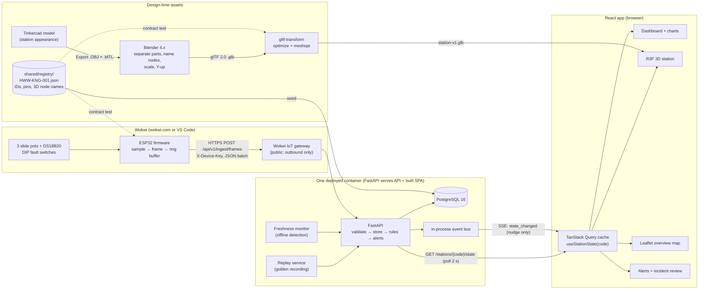

# Hanoi WaterWatch: Implementation Blueprint

**Version:** 1.0 (18 Nov 2026) · **Status:** design complete, no application code written yet
**Audience:** Ngân, Akai, and any coding agent that implements the system
**Scope:** an end-to-end *demonstration* that joins a Tinkercad 3D station model, a Wokwi ESP32 simulation and a full-stack monitoring web app. All data is simulated.

---

## 1. The architecture in one picture

**One rule holds it together:** the backend is the only source of truth. Wokwi only *produces* frames, the 3D model and dashboard only *display* `GET /stations/{code}/state`, and the shared registry is the only place where sensor IDs, Wokwi pins and 3D node names are defined.

## 2. Reading order (dependency order)

| # | Document | Covers prompt section |
|---|----------|----------------------|
| 1 | [01-mvp-and-stack.md](01-mvp-and-stack.md) | MVP spec, exclusions, technology decisions |
| 2 | [02-architecture.md](02-architecture.md) | System architecture, topologies, error/offline matrix, repo structure, ADRs |
| 3 | [03-3d-integration.md](03-3d-integration.md) | Tinkercad → Blender → GLB → React Three Fiber |
| 4 | [04-wokwi-integration.md](04-wokwi-integration.md) | ESP32 circuit, firmware, scenarios, transport, security |
| 5 | [05-synchronisation.md](05-synchronisation.md) | Registry, IDs, status model, state management, latency |
| 6 | [06-ui-ux.md](06-ui-ux.md) | Five pages, component hierarchy, journeys, accessibility |
| 7 | [07-backend-database-api.md](07-backend-database-api.md) | Services, ERD, rules, API contracts with examples |
| 8 | [08-roadmap.md](08-roadmap.md) | Phases 1 to 7, minimum viable demonstration, critical path |
| 9 | [09-team-and-timeline.md](09-team-and-timeline.md) | Ngân/Akai matrix, Git plan, milestones, six-week schedule |
| 10 | [10-testing-demo-deploy.md](10-testing-demo-deploy.md) | Test plan, acceptance criteria, deployment, demo runbook, replay fallback |
| 11 | [11-github-backlog.md](11-github-backlog.md) | 60 small, testable GitHub issues plus 3 stretch issues, labels, milestones and an import script |

## 3. Decisions at a glance

| Question | Decision |
|----------|----------|
| Wokwi → backend transport | **HTTPS POST** of JSON frame batches from the ESP32 to a **deployed** FastAPI endpoint. MQTT and serial bridging rejected for the MVP (see [04 §4.7](04-wokwi-integration.md#47-transport-evaluation-and-decision)). |
| Reaching a local backend during development | Use, in order of preference: (1) `tools/sim_device.py` posting to localhost; (2) a Cloudflare quick tunnel so the public Wokwi gateway can reach localhost over HTTPS; (3) Wokwi Private Gateway / VS Code with `host.wokwi.internal` (paid plans). |
| Live updates to the browser | Poll `GET /stations/{code}/state` every 2 s (MVP). SSE added in Phase 6 as a *nudge* that triggers a refetch. SSE never carries values. |
| 3D format | Tinkercad **.OBJ (+ .MTL)** → Blender → **.glb** (glTF 2.0) → meshopt compression → R3F `useGLTF`. STL rejected because it carries no colour and no parts. |
| Wokwi in the app | **Not embedded.** Wokwi publishes no supported embedding API, so the Simulation page links out to a new tab and shows live connection status. |
| Sensor identity | `shared/registry/HWW-KNG-001.json` is seeded into the DB, served by the API, and checked against firmware constants and GLB node names in CI. |
| Thresholds | pH and temperature use a *configurable reference band* traced to a cited regulation (verify before presenting). Turbidity and DO use *statistical change rules* labelled "demo heuristic, no regulatory meaning". |
| Hosting | One Docker image (FastAPI serving API and the built React app) plus a managed Postgres. Local: `docker compose`. |

## 4. Platform facts verified on 17 Nov 2026 (and what still needs a spike)

| Fact | Status | Source |
|------|--------|--------|
| Wokwi ESP32 joins the open AP `Wokwi-GUEST` (no password, channel 6). | Verified | [Wokwi ESP32 WiFi guide](https://docs.wokwi.com/guides/esp32-wifi) |
| Public gateway: outgoing HTTP/HTTPS/MQTT allowed, **no incoming**, **traffic is monitored**, slower and medium stability. | Verified | same |
| Private gateway: paid plans only; reach your PC at `host.wokwi.internal`; supports incoming via port forwarding; not supported in Safari. | Verified | same |
| Wokwi for VS Code bundles the Private IoT Gateway; `[[net.forward]]` in `wokwi.toml`. | Verified | [project-config docs](https://docs.wokwi.com/vscode/project-config) |
| Free "Community" plan: public projects only, public gateway. Hobby adds unlisted projects and the Private Gateway. "Wokwi for VS Code" appears from Hobby+. CI minutes appear only on Pro. | Verified | [Wokwi pricing](https://wokwi.com/pricing) |
| `wokwi-ds18b20` part exists with an interactive temperature control (-55 to 125 °C). | Verified | [DS18B20 reference](https://docs.wokwi.com/parts/wokwi-ds18b20) |
| Custom chips (C/WASM) can output analog voltage (`pin_dac_write`) and expose `range` slider controls. | Verified | [Analog API](https://docs.wokwi.com/chips-api/analog), [chip JSON](https://docs.wokwi.com/chips-api/chip-json) |
| Embedding Wokwi in another site | **No official, documented embed API found.** Only an `_alpha/wembed` prototype in a Wokwi example repo. Treat as unsupported. | [wokwi-embed-bridge-example listing](https://awesome.ecosyste.ms/projects/github.com%2Fwokwi%2Fwokwi-embed-bridge-example) |
| Tinkercad OBJ export keeps colours (via MTL); STL is monochrome; export of groups can merge shapes; 2025 update "bundle groups" preserves part structure in exports. | Community-verified, **spike W1** | [Hackaday 2025](https://hackaday.com/2025/10/22/tinkercad-in-color), [All3DP 2025](https://all3dp.com/4/tinkercad-updates-change-export-behavior-adds-group-tools/) |
| Tinkercad GLB/glTF export availability in your account | **Unverified, spike W1** (secondary sources disagree) | [MergeEDU help](https://support.mergeedu.com/hc/en-us/articles/360052931192-Exporting-Objects-from-Tinkercad) |
| QCVN 40:2025/BTNMT replaced QCVN 40:2011/BTNMT for industrial effluent from 1 Sep 2025; excerpts show pH 6–9 and temperature ≤ 40 °C. | Secondary sources, **verify the official text before quoting** | [VnEconomy](https://en.vneconomy.vn/new-industrial-wastewater-standards-take-effect-in-sept-2025.htm), [Envirotech](https://www.envirotech-online.com/news/wastewater-analysis/155/international-environmental-technology/what-vietnams-new-industrial-wastewater-standard-qcvn-402025-means-for-monitoring-professionals/67739) |
| GitHub branch protection: when "Do not allow bypassing the above settings" is off, people with admin rights bypass the rule; bypass lists for named actors exist only for organisation repositories. Used for the integrator in [09 §9.6](09-team-and-timeline.md#96-git-branching-and-review-plan). | Verified 18 Nov 2026 | [About protected branches](https://docs.github.com/en/repositories/configuring-branches-and-merges-in-your-repository/managing-protected-branches/about-protected-branches) |
| A closing keyword (`Closes #12`) in a commit message closes the issue when the commit reaches the default branch. | Verified 18 Nov 2026 | [Linking a pull request to an issue](https://docs.github.com/en/issues/tracking-your-work-with-issues/using-issues/linking-a-pull-request-to-an-issue) |
| Environment required reviewers: on Free, Pro and Team plans only for public repositories. | Verified 18 Nov 2026 | [Deployments and environments](https://docs.github.com/en/actions/reference/workflows-and-actions/deployments-and-environments) |

**Week-1 spikes that close the open items:** S1 Tinkercad export test (OBJ and GLB if offered). S2 Wokwi → HTTPS POST to a deployed echo endpoint, plus NTP sync and `esp_random()` across 3 restarts. S3 Leaflet + R3F in the same Vite app on a mid-range phone.

## 5. Engineering rules (checkable)

| ID | Rule | How it is enforced |
|----|------|--------------------|
| R1 | 3D visualisation ≠ electronic simulation. The GLB never contains values; Wokwi never renders 3D. | Code review; GLB contains geometry only. |
| R2 | Backend is the single source of truth for values *and* statuses. The frontend never computes thresholds. | `domain/statusVisuals.ts` only maps status → visuals; lint rule bans importing rule configs into the frontend. |
| R3 | 3D model and dashboard can't disagree. | Both read the same TanStack Query key `['stationState', code]`; E2E test T-E-03, acceptance criterion AC-06. |
| R4 | Provenance is server-assigned from the device record, never trusted from the payload. | `IngestService` derives `source` from `devices.kind`. Integration test T-B-03. |
| R5 | No stale or faulty value is ever shown as current. | `value` is `null` in state when the status is `sensor_fault` or `offline`; UI test T-F-03. |
| R6 | Every screen that shows data shows the simulated-data label. | `SimulatedDataBanner` in `AppShell`; Playwright check on all routes (T-E-09). |
| R7 | No unsupported thresholds are presented as pollution evidence. | Each rule stores `basis_text` and `is_regulatory`; UI shows them in alert detail. |
| R8 | Deterministic replay exists before the demo. | `fixtures/replays/demo-golden.jsonl` and replay determinism test T-B-14. |
| R9 | Unsupported integrations are not assumed (Wokwi iframe, browser APIs, inbound connections to Wokwi). | Architecture uses only outbound HTTPS from the ESP32. |
